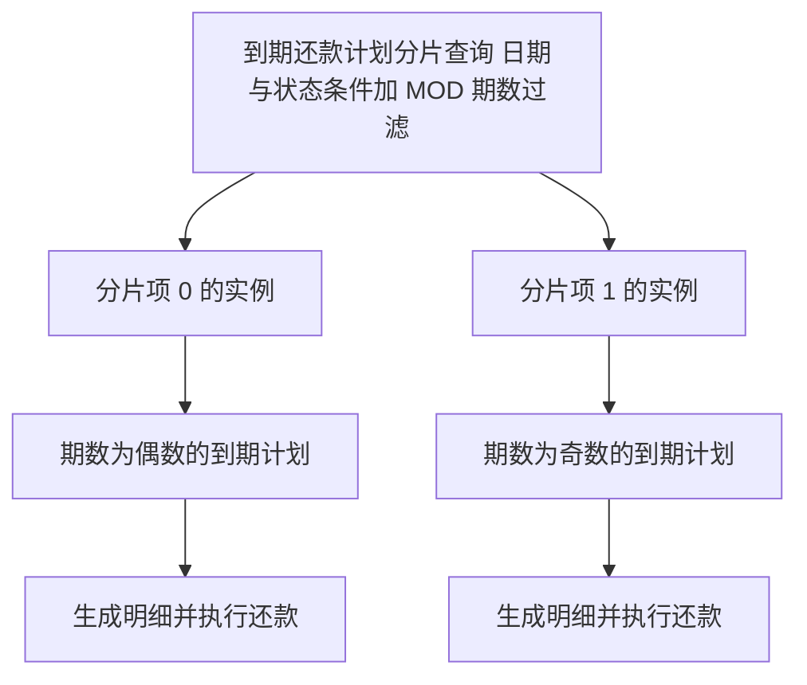

# 定时还款任务的数据访问层：一条 MOD 取余 SQL 实现按期数分片

依赖与 Apollo 配置就位后，改造从代码的最底层开始。这里有个容易想岔的点：还款功能早已开发完毕，现在加定时任务并不是重写一遍还款流程，而是给既有的链路换一个触发者。触发者换了，链路本身却要背上新的职责：两个还款服务实例并行干活，谁查哪些到期还款计划必须划得清清楚楚。这道边界就划在数据访问层的 SQL 里，这一课改的就是还款服务的 `PlanMapper`。

## 先给结论

- 原有查询的两个条件（应还日期等于当天、还款状态为未还款）原封不动保留，分片条件以一个 AND 追加在后面。
- 分片条件的核心是 MySQL 的 `MOD` 函数：`MOD(NUMBER_OF_PERIODS, #{shardingCount}) = #{shardingItem}`，期数除以分片总数取余，余数等于分片项的记录才被本实例查出。
- 不在原方法上直接改，新增一个重载方法 `selectDueRepayment(String date, int shardingCount, int shardingItem)`，原单参数方法保留做前后对照。
- 多参数的注解式 Mapper 必须给每个参数加 `@Param` 声明参数名，否则 SQL 里的 `#{}` 绑定不到值。
- 分片键选期数字段而不是主键 ID，好处是同一合同的各期还款计划天然分散到不同实例，业务语义也更贴合还款场景。

## 原查询为什么与分片沾不上边

打开还款服务的 `PlanMapper`，先看清现状。已有的 `selectDueRepayment(String date)` 方法只接收一个日期参数，SQL 是两条硬条件的组合：

```sql
SELECT * FROM repayment_plan
WHERE DATE_FORMAT(SHOULD_REPAYMENT_DATE,'%Y-%m-%d') = #{date}
  AND REPAYMENT_STATUS = '0'
```

`SHOULD_REPAYMENT_DATE` 是应还时间，用 `DATE_FORMAT` 截断到天再与传入日期比较，意思是「今天到期」；`REPAYMENT_STATUS = '0'` 表示尚未还款。两个条件一个都动不得：日期条件决定了只处理到期的计划，状态条件决定了已还款的记录不再进入流程。

对照 Elastic-Job 入门案例的分片查询，差距一目了然。入门案例的查询带着 `MOD(id, #{shardingTotalCount}) = #{shardingItem}`，每台服务器只查自己编号对应的那部分数据；还款服务这条 SQL 却会把当天所有到期计划一网打尽。设想两个还款服务实例同时被 cron 触发，它们跑的是同一条 SQL，同一笔还款计划会被两个实例各查一次、各执行一次还款，结果就是重复扣款。分片的意义正在于此：把「每个实例都查全部」改成「每个实例只查自己那一半」。

## 分片条件怎么加进 SQL

分片策略在上一课已定：按期数拆分，分片总数 2。期数字段是 `NUMBER_OF_PERIODS`，把入门案例的套路迁移过来，被除数从 id 换成期数：

```sql
SELECT * FROM repayment_plan
WHERE DATE_FORMAT(SHOULD_REPAYMENT_DATE,'%Y-%m-%d') = #{date}
  AND REPAYMENT_STATUS = '0'
  AND MOD(NUMBER_OF_PERIODS,#{shardingCount})=#{shardingItem}
```

解读这个条件要看清运算顺序：`MOD(NUMBER_OF_PERIODS, #{shardingCount})` 先对期数求余，余数再与 `#{shardingItem}` 比较相等。分片总数是 2，余数只可能是 0 或 1，恰好对应两个实例的编号。期数为奇数的计划全部落进分片项 1，偶数的全部落进分片项 0，两个实例各查各的半边，合起来恰好覆盖全部到期计划，既不重复也不遗漏。

这张图把一条 SQL 拆到两个实例上：



图中最关键的是两个实例的条件差异：SQL 完全相同，唯一不同的是框架传入的分片项参数，一个实例拿到 0，另一个拿到 1。同一个方法、同一个模板，参数一换，数据边界就划开了，这正是分片查询设计的巧妙处。

## PlanMapper 新增重载方法

SQL 定了，接口方法跟着定。原来那条查询的三个新需求分别是：日期参数已有，分片总数与分片项要新传。在 `PlanMapper` 里新增一个重载方法，与原方法并存：

```java
package com.study.finance.repayment.mapper;

import com.baomidou.mybatisplus.core.mapper.BaseMapper;
import com.study.finance.repayment.entity.RepaymentPlan;
import org.apache.ibatis.annotations.Param;
import org.apache.ibatis.annotations.Select;
import java.util.List;

/**
 * 还款计划 Mapper 接口
 */
public interface PlanMapper extends BaseMapper<RepaymentPlan> {

    /**
     * 查询到期的还款计划（人工触发版本，保留对照）
     */
    @Select("SELECT * FROM repayment_plan "
            + "WHERE DATE_FORMAT(SHOULD_REPAYMENT_DATE,'%Y-%m-%d') = #{date} "
            + "AND REPAYMENT_STATUS = '0'")
    List<RepaymentPlan> selectDueRepayment(String date);

    /**
     * 分片查询到期的还款计划
     * @param date 到期日期 格式 yyyy-MM-dd
     * @param shardingCount 分片总数
     * @param shardingItem 分片项 当前实例的编号 从 0 开始
     */
    @Select("SELECT * FROM repayment_plan "
            + "WHERE DATE_FORMAT(SHOULD_REPAYMENT_DATE,'%Y-%m-%d') = #{date} "
            + "AND REPAYMENT_STATUS = '0' "
            + "AND MOD(NUMBER_OF_PERIODS,#{shardingCount})=#{shardingItem}")
    List<RepaymentPlan> selectDueRepayment(String date,
                                           @Param("shardingCount") int shardingCount,
                                           @Param("shardingItem") int shardingItem);
}
```

三处细节值得盯住。**第一，`@Param` 一个都不能省。**方法有三个参数，注解式 SQL 里出现了三个 `#{}` 占位符，`@Param` 就是参数与占位符之间的桥，参数名与 SQL 里的名字一一对应，写错名字或漏写注解都会在运行时抛绑定异常。**第二，原方法保留而非删除。**人工触发的 Controller 还在调用单参数版本，定时任务链路尚未跑通之前，它是排查问题时的对照物；等分片版本验证完毕再清理也不迟。**第三，继承 `BaseMapper<RepaymentPlan>` 不变。**分片查询只是追加了一个自定义注解 SQL，MyBatis-Plus 提供的单表 CRUD 能力照旧可用。

## 分片键为什么选期数

分片键不是随便挑的，判断标准有两条：数据分布要均匀，条件要能自然写进 SQL。期数两条都满足。还款计划表里的期数从 1 开始逐期递增，同一笔借款的第 1 期、第 2 期、第 3 期依次生成，对 2 取模后奇偶各半，分布天然均衡；`MOD` 条件直接挂在 WHERE 后面，查询写起来毫无别扭。

换成主键 ID 其实也成立，框架层面完全等价，入门案例用的就是 id。取舍落在业务语义上：同一合同的各期计划按期数拆分后会落到不同实例，某一天到期的那几期计划被均匀摊开并行处理；而按 id 取模只能保证记录级别的分散，与还款业务没有语义上的呼应。两种选法都正确，分得均匀、写得自然的就是好分片键。

顺带留意 `DATE_FORMAT` 这一处的隐患。函数包在字段外面，索引无法按原值匹配，数据量大时这条查询会走全表扫描。课堂按画面原样保留了这种写法，真实项目里可以改成 `SHOULD_REPAYMENT_DATE >= 当天零点 AND SHOULD_REPAYMENT_DATE < 次日零点` 的范围条件，让索引重新可用，分片条件不受影响。

## 常见误区

- **直接在原方法上改签名。**错例：把单参数的 `selectDueRepayment` 就地改成三参数，人工触发的 Controller 立刻编译报错，前后版本也无法对照。正解：新增重载方法，原方法保留，定时任务链路验证通过后再统一清理。
- **漏写 `@Param` 或名字与占位符对不上。**错例：三个参数不加 `@Param`，或写成 `#{shardingCount}` 对应的方法参数却是 `count`。正解：每个参数用 `@Param` 显式命名，与 SQL 占位符严格一致。
- **`MOD` 条件的括号位置写错。**错例：把比较表达式塞进取余函数里，写成 `MOD(NUMBER_OF_PERIODS, #{shardingCount} = #{shardingItem})`。正解：小括号只包住取余部分，整个条件的语义是「余数等于分片项」。
- **分片键选了分布极不均匀的字段。**错例：随手拿某个状态字段当分片键，绝大部分记录余数相同，一个实例空转、另一个实例过载。正解：分片键要求取模后余数分布均匀，期数逐期递增是天然合适的依据。

## 面试可能被问到的问题

1. 面试官追问：「两个实例跑同一条分片 SQL，为什么不会重复处理同一笔还款计划？」
   答：SQL 模板相同，但框架给每个实例注入的分片项不同，分片项从 0 连续编号且互不重叠。期数对分片总数取模的余数唯一，每条记录只会命中一个分片项，因此每笔到期计划只被一个实例查出并执行，合并起来又覆盖全部数据。
2. 面试官追问：「分片键为什么选期数而不选主键 ID？」
   答：两条标准是分布均匀和条件自然。期数逐期递增，对 2 取模后奇偶各半，分布均衡；MOD 条件直接写进 WHERE 即可。按 ID 取模在框架层同样成立，但期数与还款业务语义贴合，同一合同各期计划被拆到不同实例并行处理，业务上更直观。
3. 面试官追问：「`DATE_FORMAT` 写在 WHERE 条件里有什么风险？」
   答：对字段套函数后索引无法按原值定位，查询退化为全表扫描，到期计划数据量大时性能明显下降。改用应还时间的范围条件（当天零点到次日零点）可以恢复索引能力，同时保持「查当天到期」的语义不变。
4. 面试官追问：「MyBatis 注解式多参数方法为什么必须加 `@Param`？」
   答：编译后方法参数名默认丢失，MyBatis 无法把 `#{}` 占位符对应到具体的形参上，多参数场景会直接报绑定异常。`@Param` 显式声明参数名，占位符按这个名字取值，同时提高了 SQL 与接口之间的可读性。
5. 面试官追问：「分片查询方案对数据库连接数有什么影响？」
   答：每个实例按自己的分片项独立查询，查询数等于实例数而非数据分块数，连接占用是每个实例各自的连接池，互不叠加。要注意的是触发时刻集中，多个实例同时发起查询与后续还款操作，数据库瞬时压力等于实例数的倍数，实例规模要结合库的承载能力评估。

## 配套资料

- 讲义：`materials/docs/10/万信金融-第5章-用户还款v1.0.md`，7.2 节功能实现第 3 步（在 `PlanMapper` 接口中再增加一个 `selectDueRepayment` 方法用来进行分片查询，SQL 含 `MOD(NUMBER_OF_PERIODS, #{shardingCount}) = #{shardingItem}` 条件）。
- 代码：`materials/code/10/wanxinp2p/`，课程资料包内的工程源码归档目录（内含原始工程命名，与正文改写后的命名并非一一对应）；还款服务的 `PlanMapper` 源码不在资料包内，文中接口代码按课堂画面与讲义补全，包名统一为 `com.study.finance` 系。
