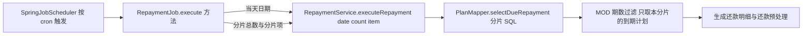

# 定时还款任务的业务层与任务类：接口改参、分片日志与 SimpleJob 触发链

数据访问层的分片 SQL 就位后，改造沿分层结构向上推进。业务层是第二站：它调用数据访问层，Mapper 的方法从一个参数变成三个参数，业务层的接口与实现必须跟着变，否则编译都过不了。改完业务层还剩一个悬而未决的问题：这条链路由谁触发？过去是 Controller 接收人工请求，现在人工触发要退役，取而代之的是 Elastic-Job 的任务类。这一课把业务层改造与任务类编写连起来讲，它们合在一起才构成完整的触发链。

## 先给结论

- 业务层接口的两个方法 `selectDueRepayment` 与 `executeRepayment` 各增加分片总数与分片项两个参数，旧的单参数签名保留下来注释对照，不直接删除。
- 实现类的修改清单就是编译报错清单：接口一改，实现类所有调用旧签名的地方全部标红，逐处补上 `shardingCount` 与 `shardingItem` 即可。
- 还款编排逻辑本身一行不动：查询到期计划、生成还款明细、还款预处理，变的只是方法多了两个透传的分片参数。
- 循环体里追加一条打印，输出当前分片项与查到的还款计划，为将来多实例运行时观察分片效果留下观测点。
- 任务类放在新建的 `job` 包里，`RepaymentJob` 实现 `SimpleJob` 接口并标注 `@Component`，`execute` 方法里调用业务层：日期用 JDK8 时间 API 取当天，两个分片参数从 `ShardingContext` 上下文直接取。

## 业务层接口：参数从 1 个变 3 个

打开还款服务的 `RepaymentService` 接口，与定时还款相关的方法有两个：`selectDueRepayment(String date)` 查询到期的还款计划，`executeRepayment(String date)` 执行还款编排。它们都只有一个日期参数，这个签名对应的是人工触发时代的数据访问层。

数据访问层新增的三参数重载方法上线后，业务层面临一个选择：接口层直接透传分片参数，还是在业务层内部处理分片？透传是正确答案。分片项是 Elastic-Job 分给当前实例的编号，它的消费者只有一条，就是 Mapper 里那条 `MOD` 条件，业务层在这里既不该加工也不该拦截，加两个参数一路传下去即可。改造后的接口如下，旧签名保留为注释，方便与改前做对照：

```java
/**
 * 查询所有到期的还款计划
 * @param date 日期 格式 yyyy-MM-dd
 * @param shardingCount 分片总数
 * @param shardingItem 分片项
 */
List<RepaymentPlan> selectDueRepayment(String date, int shardingCount, int shardingItem);

/**
 * 执行还款
 * @param date 日期 格式 yyyy-MM-dd
 * @param shardingCount 分片总数
 * @param shardingItem 分片项
 */
void executeRepayment(String date, int shardingCount, int shardingItem);
```

两个方法各加两个参数，参数顺序与 Mapper 保持一致：日期在前，分片总数居中，分片项在后。命名也与数据访问层对齐，`shardingCount` 对应分片总数，`shardingItem` 对应分片项，名字贯穿三层不变，排查时从 SQL 一路往上对，不用反复翻译。

被注释掉的原签名还承担一个提醒职责：`selectDueRepayment(String date)` 与 `executeRepayment(String date)` 是人工触发时代的入口，等定时链路验证完毕，它们连同 Controller 里的测试方法一起退役。保留到那时再删，是为了在改造期间随时可以对照「改了什么」。

## 实现类：报错清单就是修改清单

接口一改，实现类 `RepaymentServiceImpl` 立刻满屏报错。这不是坏事，报错的位置恰好是需要修改的位置：实现类里所有按旧签名调用的地方，编译器一个不漏地指了出来。修改本身没有智力含量，逐处把两个分片参数补进调用即可。

实现类里与还款编排直接相关的是 `executeRepayment`，改完后的版本：

```java
package com.study.finance.repayment.service.impl;

@Service
@Slf4j
public class RepaymentServiceImpl implements RepaymentService {

    @Autowired
    private PlanMapper planMapper;

    @Autowired
    private RepaymentDetailMapper repaymentDetailMapper;

    @Autowired
    private DepositoryAgentApiAgent depositoryAgentApiAgent;

    @Override
    public void executeRepayment(String date, int shardingCount, int shardingItem) {
        // 查询到期的还款计划（本分片负责的那一部分）
        List<RepaymentPlan> repaymentPlanList = selectDueRepayment(date, shardingCount, shardingItem);

        // 逐条生成还款明细并做还款预处理
        repaymentPlanList.forEach(repaymentPlan -> {
            // 生成还款明细
            RepaymentDetail repaymentDetail = saveRepaymentDetail(repaymentPlan);
            // 还款预处理
            Boolean preRepaymentResult = preRepayment(repaymentPlan, repaymentDetail.getRequestNo());
        });
    }

    @Override
    public List<RepaymentPlan> selectDueRepayment(String date, int shardingCount, int shardingItem) {
        return planMapper.selectDueRepayment(date, shardingCount, shardingItem);
    }
}
```

编排结构没有变化：先调本接口的 `selectDueRepayment` 拿到本分片的到期计划集合，再用 `forEach` 逐条生成还款明细、拿着明细里的请求流水号做还款预处理。与改前唯一的差异是方法多了两个参数，并且原样透传给了 Mapper。分片的边界控制完全下沉在 SQL 里，业务层对「哪一半数据是我的」毫无感知，这是把分片条件放在数据访问层的直接收益：触发与分片由框架决定，业务逻辑零改动。

循环体里的两步调用是此前用户还款各阶段开发完成的既有逻辑。`saveRepaymentDetail` 根据还款计划生成还款明细并落库，明细上带着生成的请求流水号，它是后续与存管系统交互时的业务凭据；`preRepayment` 拿着请求流水号请求存管代理服务，做还款预处理的冻结操作，把借款人的应还款金额冻结起来，为正式扣款做准备。这两步是每笔还款计划的标准动作，集合里有几条计划就执行几轮，分片把集合切小了，但每条计划的动作清单一个不少。

为了在多实例运行时能亲眼看到分片效果，循环体前加一条输出，与入门案例的打印习惯保持一致：

```java
@Override
public void executeRepayment(String date, int shardingCount, int shardingItem) {
    List<RepaymentPlan> repaymentPlanList = selectDueRepayment(date, shardingCount, shardingItem);

    repaymentPlanList.forEach(repaymentPlan -> {
        RepaymentDetail repaymentDetail = saveRepaymentDetail(repaymentPlan);
        Boolean preRepaymentResult = preRepayment(repaymentPlan, repaymentDetail.getRequestNo());
        // 打印分片项与查到的还款计划 供多实例控制台对比观察
        System.out.println("当前分片：" + shardingItem + "，还款计划：" + repaymentPlan);
    });
}
```

这条打印的意义要到功能测试那一课才充分显现：两个还款服务实例同时被触发，两个控制台各自滚动输出，分片项一个恒为 0、一个恒为 1，各自查出的计划 ID 互不重叠，分片是否真的平均分配，控制台上一眼可辨。开发阶段多埋这类观测点，测试时能省掉大量翻日志的工夫。

## 从入门案例到项目版：中间为什么隔了一个业务层

入门案例里没有业务层这个环节，作业类的 `execute` 方法直接调用 Mapper 完成查询，一气呵成。到了还款服务，任务类与数据访问层之间却夹着一个完整的 `RepaymentService`，任务类调用业务层、业务层再调用 Mapper，多绕了一道。这个差别不是随意的设计，而是两种场景的复杂度差距所致。

入门案例的业务只有一条查询，没有编排可言，作业类直连 Mapper 反而简洁，加一层纯属形式主义。还款服务则完全不同：查询到期计划只是第一步，后面跟着生成还款明细、还款预处理、发送确认还款的消息、调用存管代理服务确认还款，一连串动作有先后依赖、有失败分支，这些编排职责全落在业务层。任务类如果直接调 Mapper，剩下的编排逻辑就得堆在 `execute` 方法里，作业类从「触发者」退化成「业务容器」，将来换调度框架或者新增人工触发入口时，业务逻辑要被拖着重写。

隔一层业务层还有第二个收益：触发入口可以替换。人工触发时代，Controller 调用的是同一个 `RepaymentService`；定时任务上线后，任务类调用的还是它。业务层不关心调用者是谁，编排逻辑只写一份，人工触发与定时触发共享同一套代码。这正是此前 Controller 占位设计的兑现时刻：当时留下的占位，就是为了等定时任务来替换它，业务层一行不改。

## 任务类登场：谁来调用业务层

业务层就绪后，链路的最后一环是触发者。过去的触发路径是 Controller：测试方法接收请求，调用业务层，功能执行。现在要换成定时触发，做法与入门案例完全一样：新建一个任务类，实现 Elastic-Job 的 `SimpleJob` 接口，框架到点就调它的 `execute` 方法。

还款服务里还没有放任务的包，新建一个 `job` 包，里面放任务类 `RepaymentJob`。类的骨架由三部分组成：实现 `SimpleJob` 接口并重写 `execute` 方法、标注 `@Component` 交给 Spring 管理、注入业务层。完整代码：

```java
package com.study.finance.repayment.job;

import com.dangdang.ddframe.job.api.ShardingContext;
import com.dangdang.ddframe.job.api.simple.SimpleJob;
import com.study.finance.repayment.service.RepaymentService;
import org.springframework.beans.factory.annotation.Autowired;
import org.springframework.stereotype.Component;

import java.time.LocalDate;
import java.time.format.DateTimeFormatter;

/**
 * 定时还款任务
 */
@Component
public class RepaymentJob implements SimpleJob {

    @Autowired
    private RepaymentService repaymentService;

    @Override
    public void execute(ShardingContext shardingContext) {
        // 调用业务层执行定时还款任务
        repaymentService.executeRepayment(
                LocalDate.now().format(DateTimeFormatter.ISO_LOCAL_DATE),
                shardingContext.getShardingTotalCount(),
                shardingContext.getShardingItem());
    }
}
```

`execute` 方法体只有一行，却是整条链路的点火开关，三个实参各有来路。**第一个是日期。**到期与否的比较对象是「今天」，所以日期必须是当前日期。JDK8 的时间 API 一行搞定：`LocalDate.now()` 拿到今天的日期对象，`DateTimeFormatter.ISO_LOCAL_DATE` 是内置的静态格式化器，输出形如 `2024-03-15` 的年月日格式，正是 Mapper SQL 里 `DATE_FORMAT(SHOULD_REPAYMENT_DATE,'%Y-%m-%d')` 所期待的 `yyyy-MM-dd`。早些年做同样的事要自己 new 一个 `SimpleDateFormat` 并手写 `yyyy-MM-dd` 模式，还要担心它的线程安全问题；JDK8 的这套 API 不可变、线程安全，常用格式还预置好了，能省则省。

**第二与第三个参数来自 `ShardingContext`。**它是 Elastic-Job 传给每次执行的分片上下文，封装了本轮调度的分片信息，`getShardingTotalCount()` 取分片总数，`getShardingItem()` 取当前实例分到的分片项。这两个值正是 Mapper 那条 `MOD` SQL 缺的参数，从上下文取出、经业务层透传、落到 SQL 条件，三个参数的旅程就此闭合。

`@Component` 这一个注解不要小看。任务类不是自己 new 出来调用的，下一课的配置类要从 Spring 容器里把它作为 Bean 注入调度器，没有 `@Component`，容器里就没有这个 Bean，配置类装配时直接空指针。入门案例里它是不起眼的一行，真实项目里漏掉它就是一个启动期事故。

## ShardingContext 里还有什么

`ShardingContext` 在本课只用到了两个方法，但它携带的信息不止于此。作为每次调度传给作业的分片上下文，它里面还有作业名（`getJobName()`）、本次任务实例的标识（`getTaskId()`），以及分片自定义参数（`getShardingParameter()`）。作业名对应 ZooKeeper 里的作业节点，排查注册与选举问题时靠它定位；`getTaskId()` 每次触发都不同，可以用来关联同一次触发的全部日志。

分片自定义参数是框架预留的扩展点：配置作业时可以为每个分片项指定一个参数字符串，运行时通过 `getShardingParameter()` 取出，常见用法是给不同分片项配不同的数据库编号，实现真正的分库处理。定时还款场景里数据同库，分片项直接参与 SQL 过滤即可，用不到这个参数，但它解释了分片体系的一个设计思路：框架负责把「你是几号」送到作业手里，至于这个编号用来过滤数据还是用来选库，作业自己决定。

回看 `execute` 方法的写法，可以概括成一个固定套路：从上下文取分片信息，组装业务参数，调用业务层。任务类里不写任何业务判断，哪怕一行 `if` 都不该出现。这个套路的价值在于任务类的稳定性，它的复杂度是常量，业务再复杂也不膨胀，膨胀的部分被挡在业务层里。

## 触发链路全貌

把三层改造连起来看，定时还款的完整触发链就成形了：



图上从左到右是调用的方向，从上到下是参数的来源。起点是调度器，它在配置类装配完成后由框架接管，按 cron 表达式的节奏调起任务类；任务类只做参数组装，当天日期加两个分片参数；业务层透传；数据访问层的 SQL 用 `MOD` 条件把数据边界划开；最后才是既有的还款编排。链路上每一层都只新增了「传参数」这一件事，还款业务本身零改动。

目前这条链还差最后一口气：`SpringJobScheduler` 还没有装配出来，`RepaymentJob` 写得再完整也不会被执行。配置类是下一课的主题，两块配置（ZooKeeper 注册中心与 Elastic-Job 调度器）加上后，这条链才会真正转起来。

## 常见误区

- **只改接口不改实现，或漏改实现类中的某一处调用。**错例：接口签名加了参数，实现类里还有一处按旧签名调用的代码没动，编译报错又随手改成传 `null` 或 `0`。正解：把编译报错当成修改清单，逐处补齐两个分片参数，实参统一从上游透传，不编造值。
- **任务类漏写 `@Component`。**错例：类写得完整，但没交给 Spring 管理，配置类注入任务对象时容器里找不到 Bean，启动报 `NoSuchBeanDefinitionException`。正解：`SimpleJob` 的实现类必须标注 `@Component`，它是后续调度器装配的前提。
- **混淆 `getShardingItem` 与 `getShardingTotalCount`。**错例：把分片总数传进了分片项的位置，两个实例都拿着相同的值去过滤，SQL 条件失效，要么都查空要么重复执行。正解：`getShardingTotalCount()` 是分片总数，所有实例相同；`getShardingItem()` 是当前实例的编号，各不相同，位置不能颠倒。
- **日期格式与 SQL 的期待不一致。**错例：用 `LocalDate.now().toString()` 直接传，或格式化成 `yyyy/M/d`。正解：SQL 里 `DATE_FORMAT` 用的是 `%Y-%m-%d`，传入日期必须是 `yyyy-MM-dd`，`DateTimeFormatter.ISO_LOCAL_DATE` 恰好就是这个格式。
- **业务层实际还在调用单参数旧方法。**错例：接口与实现类都加了新方法，但 `executeRepayment` 内部仍调旧的单参数 `selectDueRepayment`，运行时根本没走分片 SQL，多实例重复执行。正解：改造完通读一遍调用链，确保入口到 SQL 全程使用带分片参数的新方法，旧方法只留注释对照。

## 面试可能被问到的问题

1. 面试官追问：「业务层加定时还款时为什么只是加参数，业务逻辑完全没动？」
   答：分片的边界控制下沉在数据访问层的 SQL 条件里，`MOD` 取余决定了每个实例只查自己的数据。框架把分片项经任务类传入，业务层只需把它透传给 Mapper，编排逻辑（查询、生成明细、预处理）与分片完全正交，因此零改动，这也体现了分层带来的改动隔离。
2. 面试官追问：「`execute` 方法的三个参数分别怎么来的？」
   答：当天日期用 JDK8 时间 API，`LocalDate.now().format(DateTimeFormatter.ISO_LOCAL_DATE)` 输出 `yyyy-MM-dd`，与 SQL 的日期比较格式一致；分片总数与分片项从 `ShardingContext` 上下文取，前者由配置决定、各实例相同，后者由框架分配、各实例不同。
3. 面试官追问：「为什么任务类要实现 `SimpleJob` 接口？还有别的作业类型吗？」
   答：`SimpleJob` 是简单作业接口，实现它并重写 `execute`，框架按 cron 调用时传入 `ShardingContext`，任务在方法体里按分片项处理自己的数据。Elastic-Job 还提供 `DataflowJob` 等类型，适合抓取数据与处理数据分开流式处理的场景，定时还款一次性处理到期集合，简单作业足够。
4. 面试官追问：「任务类上的 `@Component` 能省吗？为什么？」
   答：不能省。配置类装配 `SpringJobScheduler` 时，任务对象是作为 Spring Bean 注入进去的，没有 `@Component` 容器里就不存在这个 Bean，启动阶段直接报找不到 Bean 的异常。任务类必须同时实现接口与交给容器管理，两者缺一不可。
5. 面试官追问：「如果任务类里不把分片参数传给业务层，会发生什么？」
   答：SQL 少了 `MOD` 过滤条件，每个实例都会查出当天全部到期计划并执行还款，同一笔计划被多个实例重复处理，还款业务里就表现为重复扣款。分片参数从上下文到 SQL 的传递链必须完整，任何一层断掉，分片就退化成重复执行。
6. 面试官追问：「循环里打印分片项和还款计划，除了调试还有什么价值？」
   答：它是分片正确性的直接观测点，多实例同时运行时，各控制台的分片项输出应恒定且互不相同，查出的数据集合应互不重叠。生产上这类输出会升级为结构化日志，带上实例标识与作业名，便于在日志平台核对每个实例实际处理的业务量是否均衡。

## 配套资料

- 讲义：`materials/docs/10/万信金融-第5章-用户还款v1.0.md`，7.2 节功能实现第 3 步与第 4 步（`PlanMapper` 新增分片查询方法、业务层代码修改为带分片参数的三参数版本）。
- 代码：`materials/code/10/wanxinp2p/`，课程资料包内的工程源码归档目录（内含原始工程命名，与正文改写后的命名并非一一对应）；还款服务的业务层与任务类源码不在资料包内，文中 `RepaymentService`、`RepaymentServiceImpl` 与 `RepaymentJob` 按课堂画面与讲义补全，包名统一为 `com.study.finance` 系。
