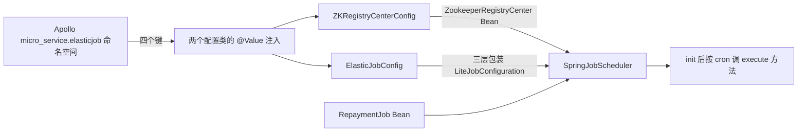

# 定时还款任务的配置类：注册中心与调度器两块装配，让任务类活起来

任务类写完了，`execute` 方法静静躺在 `job` 包里，此刻没有任何东西会去调用它：既没有 cron 节拍，也没有调度引擎。补上这一口气靠两块配置类，一块创建 ZooKeeper 注册中心，一块装配 Elastic-Job 的调度器。这两块代码与入门案例几乎逐行相同，真正的差别只有一个：所有参数的来源从本地 properties 文件换成了 Apollo。这一课把两块配置装进还款服务，定时还款的发动机随即点火。

## 先给结论

- 两块配置类的类名与入门案例一致：`ZKRegistryCenterConfig` 负责 ZooKeeper 注册中心，`ElasticJobConfig` 负责调度器装配，都放在 `job` 包里。
- 注册中心的产出是 `ZookeeperRegistryCenter` Bean，由 `ZookeeperConfiguration` 封装服务地址与作业命名空间后创建，`@Bean(initMethod = "init")` 的 init 是建立会话的关键。
- 调度器的最终产物是 `SpringJobScheduler`，构造需要任务类、注册中心、`LiteJobConfiguration` 三样，其中配置对象经 `JobCoreConfiguration`、`SimpleJobConfiguration`、`LiteJobConfiguration` 三层包装而成。
- 四个参数值全部来自 Apollo 的 `micro_service.elasticjob` 命名空间，`@Value` 写的是 `p2p.` 前缀的四个键，与入门案例的 `myjob.` 系列一一对应。
- 代码是固定写法，理解三层包装的层次后可以直接取用，不必逐行手敲。

## ZooKeeper 注册中心配置类

ZooKeeper 是一个独立的服务，注册中心要建起来必须知道它的服务地址与作业命名空间，这两个值此前已经配在 Apollo 的 `micro_service.elasticjob` 命名空间里，键名分别是 `p2p.zookeeper.connString` 与 `p2p.job.namespace`。在 `job` 包里新建配置类，两个 `@Value` 注入，一个 Bean 方法创建注册中心：

```java
package com.study.finance.repayment.job;

import com.dangdang.ddframe.job.reg.zookeeper.ZookeeperConfiguration;
import com.dangdang.ddframe.job.reg.zookeeper.ZookeeperRegistryCenter;
import org.springframework.beans.factory.annotation.Value;
import org.springframework.context.annotation.Bean;
import org.springframework.context.annotation.Configuration;

@Configuration
public class ZKRegistryCenterConfig {

    // zookeeper服务地址
    @Value("${p2p.zookeeper.connString}")
    private String ZOOKEEPER_CONNECTION_STRING;

    // 定时任务命名空间
    @Value("${p2p.job.namespace}")
    private String JOB_NAMESPACE;

    // 创建注册中心
    @Bean(initMethod = "init")
    public ZookeeperRegistryCenter setUpRegistryCenter() {
        // 配置对象封装服务地址与命名空间
        ZookeeperConfiguration zookeeperConfiguration =
                new ZookeeperConfiguration(ZOOKEEPER_CONNECTION_STRING, JOB_NAMESPACE);
        // 创建注册中心
        ZookeeperRegistryCenter zookeeperRegistryCenter =
                new ZookeeperRegistryCenter(zookeeperConfiguration);
        return zookeeperRegistryCenter;
    }
}
```

骨架是「两个属性注入，一个 Bean 方法」，与入门案例逐行对应，变化只发生在 `@Value` 表达式里：键从 `zookeeper.connString` 换成了 `p2p.zookeeper.connString`，从 `myjob.namespace` 换成了 `p2p.job.namespace`。表达式里的键必须与 Apollo 界面上配置的键严格一致，客户端是按键取值的，差一个字母都解析失败。

`@Bean(initMethod = "init")` 这一行的分量与入门案例中讲过的一样重：new 出来的 `ZookeeperRegistryCenter` 只是个对象，`init` 方法才真正建立与 ZooKeeper 的会话。漏掉 `initMethod`，Bean 照样创建、启动不报错，调度器拿到手的却是一个没连上服务的空壳，作业注册与分片全部静默失败，这类问题排查起来非常绕。

## ElasticJobConfig 装配调度器

调度器这块要注入四样东西：任务类 `RepaymentJob`、上一块配置产出的注册中心 Bean、分片总数、cron 表达式。新建 `ElasticJobConfig`，先做注入准备：

```java
package com.study.finance.repayment.job;

import com.dangdang.ddframe.job.api.simple.SimpleJob;
import com.dangdang.ddframe.job.config.JobCoreConfiguration;
import com.dangdang.ddframe.job.config.simple.SimpleJobConfiguration;
import com.dangdang.ddframe.job.lite.config.LiteJobConfiguration;
import com.dangdang.ddframe.job.lite.spring.api.SpringJobScheduler;
import org.springframework.beans.factory.annotation.Autowired;
import org.springframework.beans.factory.annotation.Value;
import org.springframework.context.annotation.Bean;
import org.springframework.context.annotation.Configuration;

@Configuration
public class ElasticJobConfig {

    @Autowired
    private RepaymentJob repaymentJob;

    @Autowired
    private ZookeeperRegistryCenter registryCenter;

    // 分片总数
    @Value("${p2p.job.count}")
    private int jobCount;

    // cron表达式 定时策略
    @Value("${p2p.job.cron}")
    private String cron;
}
```

这里能看到 `@Autowired` 注入任务类的意义：`RepaymentJob` 上的 `@Component` 让容器里存在这个 Bean，配置类才能把它注进来。调度器不知道你的业务，它只认「一个实现了 `SimpleJob` 的对象」，注入的过程就是把任务类交接给框架的仪式。

四个值齐了，剩下的工作是装配 `SpringJobScheduler`。它的第三个参数 `LiteJobConfiguration` 创建链路较长，单独抽一个私有方法封装，三层包装的顺序与入门案例完全一致：

```java
/**
 * 配置任务详细信息
 * @param jobClass 任务执行类
 * @param cron 执行策略
 * @param shardingTotalCount 分片数量
 * @return LiteJobConfiguration 作业配置
 */
private LiteJobConfiguration createJobConfiguration(
        final Class<? extends SimpleJob> jobClass,
        final String cron,
        final int shardingTotalCount) {
    // 1.创建 JobCoreConfiguration 传入作业名 cron 分片总数
    JobCoreConfiguration jobCoreConfiguration =
            JobCoreConfiguration.newBuilder(jobClass.getCanonicalName(), cron, shardingTotalCount)
                    .build();
    // 2.基础配置连同任务类全名包装成 SimpleJobConfiguration
    SimpleJobConfiguration simpleJobConfiguration =
            new SimpleJobConfiguration(jobCoreConfiguration, jobClass.getCanonicalName());
    // 3.包装成 LiteJobConfiguration overwrite 为 true 覆盖注册中心中的旧配置
    LiteJobConfiguration liteJobConfiguration = LiteJobConfiguration
            .newBuilder(simpleJobConfiguration)
            .overwrite(true)
            .build();
    return liteJobConfiguration;
}
```

**第一层 `JobCoreConfiguration`** 装核心调度参数，作业名、cron、分片总数经静态工厂 `newBuilder` 进入 Builder 再 `build()` 出对象，作业名用任务类的全限定名，对应 ZooKeeper 里的作业节点。**第二层 `SimpleJobConfiguration`** 在基础配置上声明作业类型是简单作业。**第三层 `LiteJobConfiguration`** 是顶层包装，链式配置里的 `overwrite(true)` 让本地配置在启动时覆盖注册中心里已持久化的旧配置，开发阶段改过 cron 或分片数后必须靠它生效。

三层包装就位，调度器方法水到渠成：

```java
// 创建 SpringJobScheduler 任务调度器 初始化后按 cron 调度任务类
@Bean(initMethod = "init")
public SpringJobScheduler initElasticJob() {
    SpringJobScheduler springJobScheduler = new SpringJobScheduler(
            repaymentJob,
            registryCenter,
            createJobConfiguration(repaymentJob.getClass(), cron, jobCount));
    return springJobScheduler;
}
```

三个构造参数各就各位：注入的任务对象、注入的注册中心、装配方法产出的配置对象。`initMethod = "init"` 同样不可省，调度器在 init 里启动调度引擎。这个对象一存在，它就盯着 cron 表达式的节奏，到点找到任务类调 `execute`，定时还款的整条链路正式通电。

整条装配链用一张图收拢：



图上纵向是参数的来路，横向是装配的流向。Apollo 供给四个键值，注册中心与调度器两条配置线汇合，任务类作为第三个 Bean 挂进来，最终在 `SpringJobScheduler` 处合体并启动。

## 常见误区

- **`@Value` 的键名抄错。**错例：把 `p2p.zookeeper.connString` 写成 `pzp.zookeeper.connString`，或漏掉 `.connString` 的后半段，启动报占位符无法解析。正解：表达式里的键与 Apollo 命名空间中的配置逐字符核对，四个键都与 `micro_service.elasticjob` 里的键一致。
- **cron 注入字段类型声明错。**错例：`@Value("${p2p.job.cron}")` 的字段声明成 `int`，方法传参处编译报错。正解：cron 是字符串，分片总数才是 `int`，两个字段的类型按用途声明。
- **漏掉两处 `initMethod = "init"`。**错例：注册中心 Bean 或调度器 Bean 没指定 init，服务启动正常但作业不注册、不触发。正解：两个 Bean 方法都必须带 `initMethod = "init"`，init 分别负责建立会话与启动调度引擎。
- **漏掉 `overwrite(true)`。**错例：调整分片总数或 cron 后重启，运行行为仍是旧值。正解：作业配置首次运行后会持久化到 ZooKeeper，开发调试阶段必须打开覆盖开关，让本地最新配置生效。
- **任务类 Bean 注入失败仍继续装配。**错例：`RepaymentJob` 没加 `@Component`，`ElasticJobConfig` 注入处报找不到 Bean。正解：先确认任务类已交给容器管理，再写调度器配置，两个环节有先后依赖。

## 面试可能被问到的问题

1. 面试官追问：「项目版的 Elastic-Job 配置与入门案例相比，代码上有什么差别？」
   答：两块配置类的结构与逐行逻辑完全一致，注册中心一个 Bean 方法、调度器三层包装加一个 Bean 方法。差别只在参数来源：入门案例从本地 properties 文件读，项目版的四个键由 Apollo 的 `micro_service.elasticjob` 命名空间下发，改配置不用动工程文件，还能多环境管理与热更新。
2. 面试官追问：「`SpringJobScheduler` 的三个构造参数分别是什么？」
   答：实现了 `SimpleJob` 的任务对象、初始化完成的 `ZookeeperRegistryCenter` 注册中心、封装了作业名 cron 与分片总数的 `LiteJobConfiguration`。任务对象负责执行，注册中心负责注册与分片协调，配置对象负责调度规则，三者齐备并在 init 后由框架接管调度。
3. 面试官追问：「`LiteJobConfiguration` 的三层包装各层装了什么？」
   答：`JobCoreConfiguration` 装作业名、cron、分片总数等核心参数；`SimpleJobConfiguration` 在其上声明作业类型与实现类全名；`LiteJobConfiguration` 是顶层，附加 overwrite 覆盖开关等运行期选项。层层包装让各层职责单一，框架按层级读取。
4. 面试官追问：「为什么注册中心和调度器的 Bean 都要指定 initMethod？」
   答：new 出来的对象只是内存中的实例。注册中心的 init 负责真正连接 ZooKeeper 建立会话，调度器的 init 负责启动调度引擎并注册作业，不指定 initMethod，Bean 创建成功但功能完全静止，这类静默失败排查成本很高。
5. 面试官追问：「分片总数配置为 2，运行时需要几个服务实例？」
   答：理论上启动两个实例，每台分到一个分片项并行处理。只启动一个实例时框架也能运行，单片全部数据由单实例处理，只是失去了并行能力；反过来实例多于分片总数没有意义，多余的实例分不到分片项，空跑注册信息。

## 配套资料

- 讲义：`materials/docs/10/万信金融-第5章-用户还款v1.0.md`，7.2 节功能实现（ZooKeeper 配置类与 Elastic-Job 配置类部分，`ZookeeperRegistryCenter`、`createJobConfiguration` 三层包装与 `SpringJobScheduler` 装配）；参数键名对应 Apollo 中 `micro_service.elasticjob` 命名空间的四个配置项。
- 代码：`materials/code/10/wanxinp2p/`，课程资料包内的工程源码归档目录（内含原始工程命名，与正文改写后的命名并非一一对应）；两个配置类源码不在资料包内，文中代码按讲义与课堂画面补全，包名统一为 `com.study.finance` 系，键名沿用 Apollo 口径。
