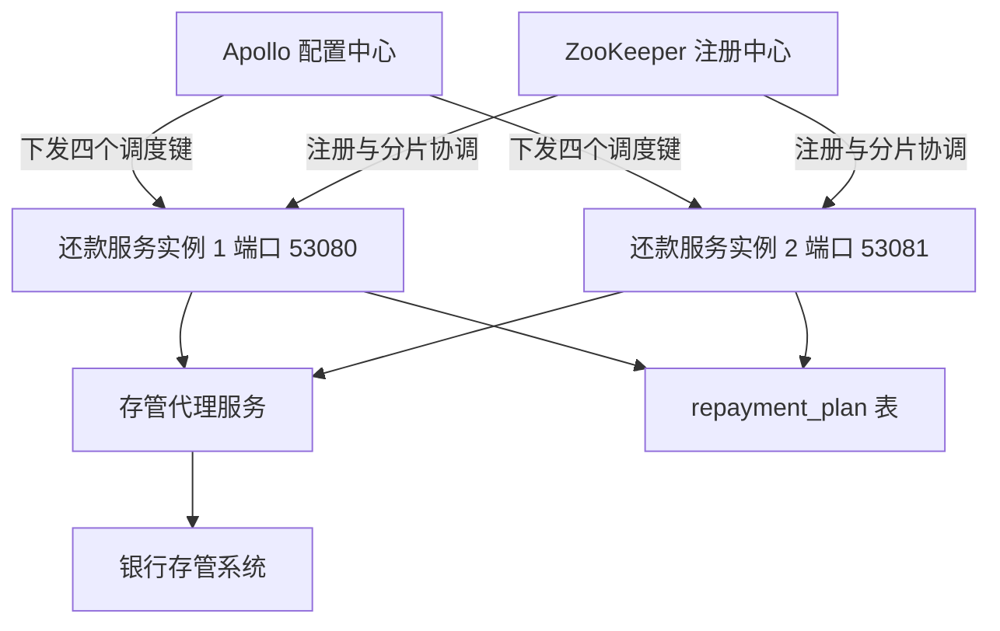

# 定时还款任务功能测试：两实例分片验证，定时触发链路收官

数据访问层、业务层、任务类、两块配置类全部就位，定时还款的代码已经写完，剩下的事情是让它真正跑起来，并且亲眼看到分片生效。测试这一环节有两个常被忽略的前置动作：一是把旧的人工触发入口清干净，否则编译报错或新旧链路混跑；二是把测试数据改到「今天」，否则定时任务每 5 秒查一次，查回来永远是空集合。这一课从清理到启动到观察，走完定时还款的最后一公里。

## 先给结论

- 测试前先处理 Controller 的编译报错：业务层方法已变成三参数，人工触发的测试方法直接退役，注释或删除整段。
- 启动清单是六样：Apollo、ZooKeeper、银行存管系统、存管代理服务、两个还款服务实例；与前端无关，不需要启动页面工程。
- 还款服务必须起两个实例，端口分别是 53080 与 53081，依据就是 Apollo 里 `p2p.job.count` 配置的分片总数 2。
- 数据准备的核心是把 `repayment_plan` 表中 `SHOULD_REPAYMENT_DATE` 字段改成当天日期，到期查询按天精确匹配，日期对不上就永远查不出数据。
- 验收标准：两个实例的控制台各自恒定打印一个分片项（0 与 1），各自查出的还款计划互不重叠，且每隔 cron 周期自动触发一轮。

## 测试前的收尾：人工触发入口退役

代码写完后 IDE 里有一个地方标红：还款服务的 Controller。它还在调用业务层的 `executeRepayment(String date)`，而这个方法已经改成了三参数版本，单参数调用自然报错。这个报错不需要修，它标记的是一个即将退役的临时入口。

当初在 Controller 里写测试方法，是替定时任务占位：定时任务没落地之前，由人发请求走到同一个业务层方法。现在任务类、调度器全部装配完毕，占位的使命结束，把这段人工触发代码注释或删除即可。留着它反而有害，任何人手滑发一个请求，就会在定时调度之外多触发一轮还款流程，测试数据被搅乱。

测试准备阶段还处理了一个隐蔽问题：启动后控制台的输出显示，执行的仍是旧的单参数查询。排查发现 `PlanMapper` 里保留做对照的单参数旧方法仍在被调用，新旧两条链路混在了一起。处理方式是把旧方法注释掉，只留下带分片参数的三参数版本，重启两个实例再观察。这个插曲提醒我们，保留旧代码做对照是有期限的，分片链路一旦验证通过，旧签名就该果断清理，否则「看起来在分片，实际在查全量」的假象会一直蒙混下去。

## 启动清单：六个服务各司其职

对照用户还款的方案图清点要启动的服务。Apollo 与 ZooKeeper 在基础配置阶段已经启动过，银行存管系统此前也已就绪，剩下要动手的是存管代理服务与还款服务：



图上值得数一数节点：还款服务出现了两个，这是分片总数决定的。`p2p.job.count` 配置为 2，意味着作业拆成两片，两个实例各领一片并行执行；只起一个实例，分片机制照样运转，但一半的并行能力被闲置，测试目的之一正是观察两实例的分片表现，所以必须起两个。第二实例不用改代码，把 53080 的启动项复制一份，端口改成 53081 即可，两个实例共用同一份代码与同一套 Apollo 配置，靠端口号区分。

存管代理服务在清单里容易被漏掉。定时任务触发后执行的不只是查询，每条到期计划都要走生成明细与还款预处理，预处理要请求存管代理服务，再由它对接银行存管系统。少了这两个服务，任务照样每 5 秒触发一次、查询照样执行，控制台却在预处理环节报远程调用失败。前端工程则完全不用启动，这条链路的触发者是定时任务，从数据库直达后端，与页面无关。

## 数据准备与分片现象观察

服务全部启动后，控制台立刻开始滚动：两个还款实例每隔 5 秒触发一轮任务，查询正常执行，只是查回来的是空集合。原因在数据侧，`PlanMapper` 的 SQL 把 `SHOULD_REPAYMENT_DATE` 格式化成天再与传入日期精确比较，传入的是当天日期，表里的应还日期却是五花八门的历史值，一条都对不上。

处理办法是造数：在数据库工具里打开 `repayment_plan` 表，把两条记录的 `SHOULD_REPAYMENT_DATE` 改成当天日期（课堂环境当天是 10 月 22 日），两条记录的期数一奇一偶，正好各落一片。改完不用重启，下一轮 cron 触发时新数据自然被扫到。

两个控制台随即各自出现输出，对照着看：

```sql
-- 实例 1 的查询条件（分片项 0）
AND MOD(NUMBER_OF_PERIODS, 2) = 0
-- 实例 2 的查询条件（分片项 1）
AND MOD(NUMBER_OF_PERIODS, 2) = 1
```

实例 1 的控制台恒定打印「当前分片：0」，查出的还款计划 ID 是 793；实例 2 的控制台恒定打印「当前分片：1」，查出的计划 ID 是 330。两个 ID 正是刚改过日期的那两条数据，一条期数为偶、一条期数为奇，被 `MOD` 条件分到两个实例，各自处理、互不重叠。多观察几轮触发，规律稳定不变：每个实例始终只碰自己的那半边，这就是平均分片在真实业务里的样子。

到这里，验收目标达成：方案图上的 1.1「查询到期的还款计划」由定时任务自动触发，不再是浏览器里的人工请求，而 1.1 之后生成明细、预处理、确认还款的整条链路随查询结果自动跟进。后续环节此前在人工触发阶段已经逐阶段测过，本轮只需验证触发方式切换正确即可，不必把整条链重测一遍。

## 常见误区

- **把 Controller 的报错当成 bug 去修。**错例：给人工触发方法补上两个分片参数凑合编译通过，测试时人工请求与定时调度混跑。正解：报错标记的是退役入口，注释或删除整段，触发权完全交给定时任务。
- **两个实例端口没改。**错例：复制启动项后直接启动，端口冲突起不来。正解：第一实例 53080，第二实例改 53081，分片实例靠端口区分。
- **测试数据日期不改。**错例：服务起来了、任务在跑，控制台却每轮都查空，以为代码有问题。正解：到期查询按天精确匹配，把 `SHOULD_REPAYMENT_DATE` 改成当天日期，最好一奇一偶各改一条，便于观察两片分配。
- **漏启动存管代理服务。**错例：只起还款服务与数据库，查询正常输出，预处理环节远程调用报错。正解：预处理要经存管代理服务对接银行存管系统，这两个服务必须在启动清单里。
- **用单实例验证分片。**错例：只启动 53080 一个实例，控制台只有一个分片项的输出，得出「分片没生效」的结论。正解：分片总数为 2 就要两个实例同时在线，两个控制台对照观察，分片项与数据集合的差异才看得出来。

## 面试可能被问到的问题

1. 面试官追问：「定时任务测试时为什么要清掉 Controller 里的人工触发代码？」
   答：人工触发方法当初是定时任务的占位，定时链路上线后它的使命结束。留着有两个问题：业务层方法签名已变，旧调用编译报错；即便补上参数凑合编译，人为请求会在定时调度之外多触发还款流程，测试数据被搅乱。触发权必须收敛到一个入口。
2. 面试官追问：「怎么验证 Elastic-Job 的分片真的生效了？」
   答：两个实例的控制台各打印分片项与查到的数据，分片项应恒定且互不相同（一个 0 一个 1），查出的业务数据集合应互不重叠，合并起来覆盖全部到期计划。连续多轮触发规律稳定，说明分片分配正确且没有数据重复执行。
3. 面试官追问：「测试时发现任务每 5 秒触发但永远查空，排查思路是什么？」
   答：按数据链路排查。任务类传入的日期是 `LocalDate.now()` 格式化的当天，SQL 用 `DATE_FORMAT` 把应还日期截断到天做精确匹配，测试数据的历史日期天然对不上，所以先查数据再怀疑代码，把测试记录的应还日期改成当天即可验证。
4. 面试官追问：「分片总数是 2 但只启动了一个实例，会发生什么？」
   答：框架不会报错，作业照常调度，两个分片项会全部分给这一个实例，由它串行处理全部数据，功能正确但失去并行能力。反过来实例多于分片总数没有意义，多余的实例分不到分片项。实例数与分片总数匹配才能发挥设计目标。
5. 面试官追问：「测试用的每 5 秒 cron，上线前要改成什么？要注意什么？」
   答：改成符合还款业务周期的频率，例如每天凌晨 3 点或 5 点扫一次到期计划。要评估两件事：触发时刻对数据库与存管系统的瞬时压力，量小时可以分片少一些、量大时增加分片总数配合多实例；以及调度重叠的防护，单轮执行时间超过 cron 间隔时的幂等与补偿策略要提前设计。

## 配套资料

- 讲义：`materials/docs/10/万信金融-第5章-用户还款v1.0.md`，7.3 节功能测试（分片总数设置为 2 时需再配置一个端口号为 53081 的还款服务、最终启动两个还款服务的测试思路）。
- 代码：`materials/code/10/wanxinp2p/`，课程资料包内的工程源码归档目录（内含原始工程命名，与正文改写后的命名并非一一对应）；还款服务源码不在资料包内，文中涉及的测试步骤与控制台现象按课堂实录整理，模块名按 `finance-repayment-service` 口径改写。
