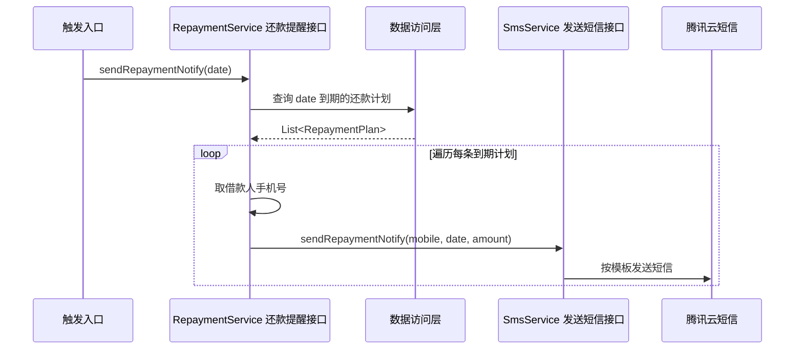

# 还款短信提醒的接口设计：发送与查询各管一段

腾讯云短信的签名、模板与密钥都已备好，接下来进入编码。按项目一贯的节奏，动手写实现之前先把接口定下来：接口是契约，先把方法签名、参数、职责边界说清楚，两侧的编码才能并行推进。还款短信提醒一共要定义两个接口，一个管发短信，一个管查数据并发起提醒，拆成两个的理由值得单独说透。

## 先给结论

- 两个接口分别是「还款服务发送短信接口」与「还款服务还款提醒接口」：前者纯粹调腾讯云发短信，后者查询到期计划、取得借款人手机号后调用前者。
- 发送接口定义在新建的 `sms` 包下，名为 `SmsService`，方法 `sendRepaymentNotify(String mobile, String date, BigDecimal amount)`，无返回值。
- 提醒接口直接加在既有的 `RepaymentService` 业务接口上，方法同名 `sendRepaymentNotify(String date)`，入参只有日期，无返回值。
- 拆两个接口的核心动机是隔离变化：将来短信通道从腾讯云换成其他服务商，只需替换 `SmsService` 的实现类，查询与编排逻辑一行不动。
- 金额参数必须用 `BigDecimal`，日期与手机号用 `String`，接口签名的类型选择本身就是文档。

## 两个接口各管什么

发送接口的职责一句话说完：给一个手机号、一个日期、一个金额，按模板把短信发出去。它不关心这条短信是发给谁的、金额从哪查的，也不关心到期计划长什么样，它就是一个纯粹的发送能力。之所以要单独立成接口而不是在业务类里直接写几行腾讯云 SDK 调用，是出于切换成本的考虑：短信服务商完全可能换，今天用腾讯云，明天换别的云，甚至接入自建网关，发送这一层永远是易变的。把易变的部分封进接口，上层依赖抽象，实现替换就是换个类的事。

提醒接口的职责是数据与编排：查询某个日期到期的全部还款计划，从每条计划里拿到借款人标识，据此查出借款人手机号，最后拿着手机号、日期与应还金额去调发送接口。它是这条链路的组织者，数据从哪来、按什么顺序处理，都由它负责。两个接口一个提供能力，一个消费能力，谁也不掺和对方的活。

两者的调用关系如下：



时序图上最能说明设计意图的是 loop 块里的分工：提醒接口负责查与找，发送接口只负责最后一跳，二者之间只隔着三个参数。

## 发送接口：SmsService

在还款服务 `com.study.finance.repayment` 下新建 `sms` 包，与发送短信相关的接口和实现都收拢在这个包里。包内先定义 `SmsService` 接口：

```java
package com.study.finance.repayment.sms;

import java.math.BigDecimal;

public interface SmsService {

    /**
     * 发送还款短信通知
     * @param mobile 还款人手机号
     * @param date 日期
     * @param amount 应还金额
     */
    void sendRepaymentNotify(String mobile, String date, BigDecimal amount);
}
```

三个参数各有讲究。`mobile` 是还款人手机号，短信总得知道发给谁；`date` 是还款日期，字符串形式直接对应模板占位符里要填的内容；`amount` 是应还金额，用 `BigDecimal` 而不是 `double`，看到这个类型就该想到它是钱，浮点数算钱丢精度是老坑，金额从数据库读到内存全程 `BigDecimal` 才稳。方法返回值定为 `void`：发短信这个动作本身不需要给调用方回什么数据，发送成功与否的反馈策略在实现类里用日志与异常处理表达。

## 提醒接口：RepaymentService 新增方法

第二个接口不新建，加在还款服务的业务层接口 `RepaymentService` 上。这个接口里已有还款流程各阶段的方法，还款提醒与它们同属业务编排层，放一起名正言顺：

```java
/**
 * 查询借款人相关信息，并调用发送短信接口进行还款提醒
 * @param date 日期
 */
void sendRepaymentNotify(String date);
```

入参只有一个日期，语义是「把这一天到期的还款计划全部找出来做提醒」。返回值同样是 `void`，遍历与发送都在方法内部完成。与发送接口同名不同参，是两个独立方法，不算重载意义上的依赖：调用方传一个参数走提醒接口，传三个参数走发送接口，编译器按签名分派，互不干扰。

值得留意的是方法注释的写法。两个接口的注释各自写清了职责边界与参数含义，后续实现类、测试用例、接口文档全都以这份契约为准，注释里的「查询借款人相关信息」「发送还款短信通知」几个字就是将来排查问题时对照行为的标尺。

## 常见误区

- **把发送逻辑直接写进业务实现类。** 错例：在 `RepaymentServiceImpl` 里内联几十行腾讯云 SDK 调用。正解：发送是易变的底层能力，封进 `SmsService` 接口加实现类，将来换短信通道只动一个类，业务层零改动。
- **金额参数图省事用 `double`。** 错例：`sendRepaymentNotify(String mobile, String date, double amount)`，金额在格式化与传输中丢精度。正解：金额一律 `BigDecimal`，转字符串填模板时显式调用 `toString()` 或格式化。
- **两个同名方法被当成冗余想合并。** 错例：把提醒接口的方法改成直接复用发送接口的签名，让上层每次都自己查手机号。正解：二者职责不同层次不同，一个管数据编排一个管发送，签名不同恰好是分工清晰的体现。
- **接口包位置随手放。** 错例：`SmsService` 被放进 `service` 包与业务接口混居。正解：按项目惯例收进独立的 `sms` 包，短信相关的接口与实现集中一处，查找与替换都方便。

## 面试可能被问到的问题

1. 面试官追问：「为什么要为发短信单独定义一个接口？」
   答：短信通道属于易变的第三方依赖，今天腾讯云明天可能换其他服务商。把它封进接口，业务层依赖抽象而非具体实现，切换时只替换实现类，符合依赖倒置的原则，也方便在测试环境用日志输出来模拟发送。
2. 面试官追问：「提醒接口和发送接口方法名一样，会不会有冲突？」
   答：不会。它们是两个不同接口上的两个方法，签名不同（一个参数、三个参数），调用按编译期类型分派。业务接口上的方法面向调用方，发送接口上的方法面向实现方，重名只是巧合，语义与层次完全不同。
3. 面试官追问：「接口方法都返回 void，失败怎么感知？」
   答：void 表示方法不回传业务数据，不代表错误被吞掉。发送实现在内部记录日志、按策略处理异常；对提醒这种旁路功能，单条失败不应中断整批遍历，失败详情落在日志里供排查，必要时可扩展为落库补偿。
4. 面试官追问：「金额为什么必须用 BigDecimal，接口层可以直接传字符串吗？」
   答：金额参与计算与展示，浮点数有精度误差，算钱必须用 BigDecimal。接口层传字符串看似省事，但把格式化责任推给了调用方，容易各处格式不一；用 BigDecimal 保留精度与运算能力，填模板时再统一转字符串。

## 配套资料

- 讲义：`materials/docs/10/万信金融-第5章-用户还款v1.0.md`，8.2 节接口定义：8.2.1 还款服务发送短信接口（`SmsService` 的方法签名与参数注释）、8.2.2 还款服务还款提醒接口（接口描述三步与 `RepaymentService` 新增方法）。
- 代码：`materials/code/10/wanxinp2p/`，课程资料包内的工程源码归档目录（内含原始工程命名，与正文改写后的命名并非一一对应）；还款服务模块源码不在资料包内，文中接口定义为按讲义与课堂画面补全的示例，包名按 `com.study.finance` 系改写。
