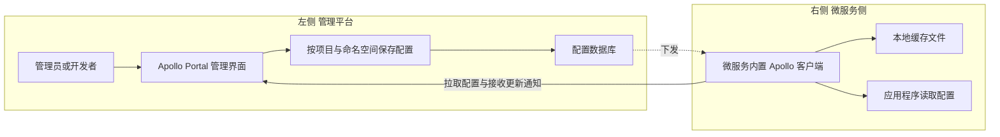

# 面试易问技术：配置中心，从传统配置文件的四个缺陷讲到 Apollo 运行原理

项目业务讲完，面试的火力必然转向技术：这个项目用了哪些组件、解决什么问题、理解到什么深度。配置中心是必问题之一，因为万信金融的每个微服务都把配置交给了 Apollo，简历上写了它就躲不开追问。这一课按面试官的问法组织：为什么需要配置中心、Apollo 的运行原理是什么、它和 Nacos 怎么选，每个问题都结合项目里的真实用法作答。

## 先给结论

- 回答「为什么用配置中心」的标准路径是先讲传统配置文件的四个缺陷：缺少权限控制、缺少版本控制、缺少实时控制、微服务化与分布式带来的新挑战，配置中心逐条对应解决。
- 配置中心的定义一句话说清：将配置从各个应用中剥离出来自成一体，统一管理各种应用配置的基础服务组件，与注册中心、网关、认证中心并列，属于微服务基础架构组件。
- Apollo 运行原理分两块讲：左侧管理平台统一维护配置，右侧微服务内置 Apollo 客户端拉取配置并在本地做文件缓存，缓存保证配置中心不可达时服务照常启动运行。
- 项目里的落地证据要能随口说出：每个微服务对应 Apollo 的一个项目，配置按主题拆成多个命名空间，如 `micro_service.springframework`、`micro_service.elasticjob`，`application.yml` 只负责声明加载哪些命名空间。
- 与 Nacos 的取舍：Apollo 配置治理能力强但部署重，Nacos 注册与配置二合一、部署轻但配置治理弱，万信金融选 Apollo 的核心理由是权限、审计与多环境管理。

## 传统配置形式的四个缺陷

配置文件是程序员最熟悉的东西，`properties`、`xml`、`yml` 各种形态都写过，但它在工程化视角下有四个硬伤。

**第一，缺少权限控制。** 配置能改变程序行为，一个错误的数据库连接串、一个写错的开关值，都可能引发生产事故。配置文件躺在各服务的代码目录里，任何能接触代码仓库的人都能改，修改权没有收敛，出了事也难以追责。

**第二，缺少版本控制。** 有人会说 Git 就是版本控制，但 Git 管的是整个工程的代码快照，配置只是顺带被提交。配置需要的是独立的、只针对自己的版本历史：这个键谁在什么时候从什么值改成了什么值、为什么改，传统形式完全记录不了。

**第三，缺少实时控制。** 配置文件改完必须重启应用才能生效，重启意味着服务中断，改一个日志级别也要走一次发布流程。配置的动态生效能力，即热发布，传统形式给不了。

**第四，微服务化与分布式带来的挑战。** 单体拆成若干微服务部署到不同节点后，配置文件跟着被切割，散落在各台服务器上，管理与检索难度陡增，节点之间还难免大量重复配置。同一应用在不同环境下又需要不同配置，开发环境连测试库、生产环境连生产库，切换靠手工改文件，改错环境的事故时有发生。

这四个问题串成一条线，配置中心的存在理由就完整了：配置剥离、集中管理、权限与版本治理、动态下发，逐条对症。

## Apollo 的运行原理：管理平台与客户端两块

Apollo 是携程框架部门研发的分布式配置中心，能集中管理应用在不同环境、不同集群的配置，修改后实时推送到应用端。讲原理时把整张图切成左右两块，条理立刻清晰。



左块是配置的写入侧。Apollo 部署好后有一个管理界面，登录进去看到的是一堆项目，每个项目对应一个微服务：交易中心、还款服务、存管代理服务各占一个。点进某个项目，里面是它抽取过来的全部配置，数据库连接、`context-path`、各种框架参数，键值对形式排列，每条都带最后修改人与修改时间。原本写在微服务配置文件里的内容，全部通过这个界面录入并保存到 Apollo 侧。

右块是配置的消费侧。微服务里嵌入一个 Apollo 客户端，客户端负责两件事：从配置中心拉取配置并接收更新通知，把拿到的配置先缓存成本地文件，再交给应用程序使用。本地缓存这一步是精髓：一旦微服务与配置中心之间的网络出问题，客户端可以直接读本地缓存文件继续工作，服务该启动启动、该运行运行，配置中心连不上不等于微服务瘫痪。

落到万信金融的工程里，右侧的接入代码非常薄。微服务的 `application.yml` 只声明要加载哪些命名空间：

```yaml
app:
  id: repayment-service
apollo:
  bootstrap: true
  namespaces: micro_service.elasticjob, micro_service.springframework
```

之后配置项的使用与本地配置毫无区别，`@Value` 直接注入：

```java
@Value("${p2p.job.cron}")
private String cron;
```

改 cron 不用重新打包发布，在 Portal 上修改发布，客户端收到更新通知即生效，这正是四个缺陷里「实时控制」的兑现。

## 与 Nacos 的对比与选型理由

面试常追一句：为什么用 Apollo 不用 Nacos。Nacos 在课程里也出现过，它身兼注册中心与配置中心两个角色，这一点与 Apollo 只管配置不同。

对比可以从三个维度展开。能力上，Apollo 的配置治理更完整：细粒度的权限控制、发布审核流程、完整的修改审计、多环境多集群管理、灰度发布，都是为配置管理专门打磨的；Nacos 的配置功能相对基础，长项在服务发现。部署上，Nacos 一个进程起步，轻；Apollo 需要 Portal、配置服务、数据库等多个部件，重。定位上，如果团队只需要一个注册中心顺便管点简单配置，Nacos 一站式更省事；如果配置规模大、变更频繁、对权限与审计有硬要求，Apollo 更稳。

万信金融选 Apollo 的理由与项目形态匹配：微服务数量多，配置主题多，数据库凭证、存管系统私钥这类敏感项必须有权限与审计兜底，Elastic-Job 的调度参数还需要随时热调，这些诉求都压在配置治理能力上，所以宁可部署重一些也要治理完整。

## 常见误区

- **把「缺少版本控制」反驳成有 Git 就够了。** 错例：认为配置随代码提交就有版本历史。正解：Git 管理的是工程整体的代码快照，配置需要的是独立的键级版本记录与修改人追溯，配置中心的发布历史才是配置自己的版本控制。
- **以为配置中心挂了微服务就得跟着挂。** 错例：Apollo 不可达时认为服务无法启动。正解：客户端把拉到的配置缓存成本地文件，断连时读缓存兜底，服务照常运行，这正是本地缓存存在的意义。
- **把所有配置一股脑塞进默认命名空间。** 错例：数据库、调度、框架参数混在一起，谁都能改。正解：按主题与归属拆命名空间，如 `micro_service.springframework`、`micro_service.elasticjob`，配合项目级权限实现分而治之。
- **只背定义不讲项目证据。** 错例：面试时只会念「统一管理配置的基础服务组件」。正解：紧跟项目实例，说明每个微服务对应 Apollo 一个项目、命名空间如何划分、哪个配置是热更新改的，答案立刻有了可信度。

## 面试可能被问到的问题

1. 面试官追问：「什么是配置中心？你们项目为什么要用它？」
   答：配置中心是把配置从各应用剥离出来、统一管理的基础服务组件。传统配置文件缺少权限控制、版本控制与实时生效能力，微服务化后配置又散落各节点且需按环境切换。万信金融每个微服务的配置都抽取到 Apollo，集中管理、热更新、有审计，四个问题逐条解决。
2. 面试官追问：「请描述 Apollo 框架的运行原理。」
   答：分两块。左侧管理平台按项目与命名空间维护全部配置并保存入库；右侧微服务内置 Apollo 客户端，负责拉取配置、接收更新通知，并把配置缓存成本地文件后交给应用使用。客户端与应用之间无感知，配置中心不可达时客户端读本地缓存兜底，服务不受影响。
3. 面试官追问：「Apollo 和 Nacos 怎么选？」
   答：Apollo 配置治理强，权限、审计、灰度发布、多环境多集群管理完善，但部署部件多、偏重；Nacos 注册中心与配置中心合一，部署轻，配置功能相对基础。配置规模大、敏感配置多、要审计就选 Apollo，要轻量一站式就选 Nacos，万信金融因为配置治理诉求强选了 Apollo。
4. 面试官追问：「配置修改后如何实时生效？需要重启微服务吗？」
   答：不需要重启。客户端与配置中心保持长连接，Portal 发布后客户端收到更新通知，刷新内存中的配置并更新本地缓存文件，`@Value` 注入的值随之生效。这也是传统配置文件形式做不到的实时控制能力。
5. 面试官追问：「你们项目里 Apollo 的命名空间是怎么划分的？」
   答：按主题拆分，每个微服务一个 Apollo 项目，项目内再按配置主题分命名空间，例如 Spring 框架相关在 `micro_service.springframework`，Elastic-Job 调度参数在 `micro_service.elasticjob`。微服务的 `application.yml` 只声明加载哪些命名空间，改调度参数不用发版，直接在对应命名空间修改发布即可。

## 配套资料

- 讲义：`materials/docs/10/day16-项目总结&就业指导v1.0.md`，3.1 节配置中心（3.1.1 什么是配置中心及传统配置的四个问题，3.1.2 Apollo 框架运行原理）。
- 讲义：`materials/docs/10/Nacos-服务发现与配置管理v1.0.md`，Nacos 的配置管理能力与注册中心定位，可作为对比问题的知识补充。
- 代码：`materials/code/10/wanxinp2p_apollo/`，接入 Apollo 的工程源码归档（内含 `wanxinp2p_apollo/` 等原始命名子目录，路径只列到该层级，与正文改写后的命名并非一一对应）；文中 `application.yml` 命名空间声明与 `@Value` 注入为按项目配置补全的示例，包名按 `com.study.finance` 系改写。
