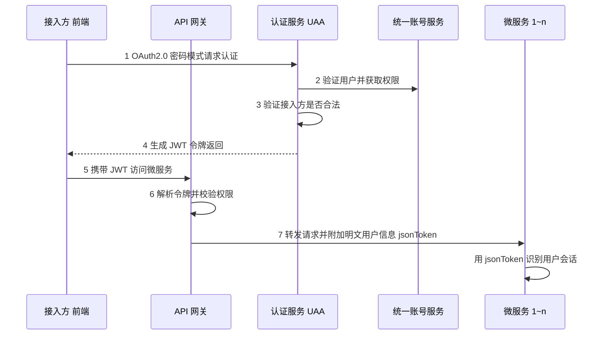

# 面试易问技术：UAA 统一认证中心，令牌是什么与认证流程怎么答

> 🔒 安全提示：文中示例的口令/密钥均为课程教学环境演示口径，生产环境的安全要求见《安全与合规须知》。

UAA 服务是万信金融平台单独抽出来的一个微服务，充当统一认证中心，认证与授权集于一身，技术上用 Spring Security 整合 OAuth2.0 实现授权服务器角色，令牌采用 JWT 存储与传递用户信息。面试聊到这里通常只有两个追问：令牌是什么、JWT 起什么作用；以及项目里的认证流程是怎么走的。这两个问题恰好对应概念与实践两级，值得各自准备成一套完整的答案。

## 先给结论

- 回答「什么是令牌」要先铺垫传统 Session 认证在分布式架构下的失效原因，再引出令牌的本质：一个能证明用户身份的凭证，服务端无状态。
- JWT 是 JSON Web Token 的缩写，RFC 7519 定义的行业标准，本质是一段自包含的 JSON 串，可携带用户信息，且经数字签名可验证、可信任。
- 项目认证流程的主线是七步：接入方以 OAuth2.0 密码模式请求 UAA，UAA 借统一账号服务验证用户与接入方，签发含双方权限的 JWT，接入方带令牌过网关，网关解析校验后转发微服务并附上明文用户信息。
- 认证是两重验证：既验登录用户，也验接入方（客户端）本身的合法性，这一点是加分项。
- 答流程题的顺序有讲究：先讲图上有哪几方、各自职责，再按步骤走流程，比上来就背步骤更清晰。

## 从 Session 到令牌：认证方式为什么变了

传统认证的玩法是：用户在登录页填账号密码，提交到服务器端，验证通过后把用户信息存进 Session，用户退出时再清除。这套机制在单体时代运转良好，问题出在分布式与微服务架构下：Session 存在某一台服务器的内存里，请求被负载均衡分到另一台服务器时就找不到会话，要么做 Session 共享复制，要么粘滞会话，扩展性与可靠性都打了折扣。

现在的主流做法是用令牌代替 Session。令牌可以类比影视剧里锦衣卫腰间的那块牌子：牌子上写着身份，拿出来一亮就能证明「我是谁」。令牌就是这个作用，一个能证明用户身份的东西。流程与 Session 的差别在于保管方掉了个头：认证通过后服务器生成一个令牌发给客户端，客户端自己保存，放进 cookie 或 localStorage 都行；此后客户端发任何请求都带着令牌，服务器端校验令牌真假，真的就从令牌里取出用户信息。用户数据在令牌里而不是在服务器内存里，这种服务端无状态的认证方式天然适配多实例部署，任何一台实例拿到令牌都能独立完成校验。

JWT 正是令牌的事实标准实现。它是 RFC 7519 定义的开放行业标准，一种简洁的、自包含的协议格式，用于通信双方传递 JSON 对象，传递的信息经数字签名后可以被验证和信任。结构上分三段，用点号连接：

```json
// JWT 的三段式结构，前两段 Base64 编码，第三段为签名
{
  "header": { "alg": "HS256", "typ": "JWT" },
  "payload": {
    "sub": "user-1001",
    "authorities": ["ROLE_USER"],
    "exp": 1717000000
  },
  "signature": "HMACSHA256(base64(header).base64(payload), secret)"
}
```

payload 里放的就是用户相关数据，例如用户标识与权限列表；签名保证了令牌内容不可篡改，改一个字符签名就对不上。万信金融正是用 JWT 存储和传递用户信息。

## 项目认证流程：先讲清有哪几方，再走步骤

被要求介绍认证流程时，直接背步骤容易乱。更稳的讲法是先描述结构：整张架构图由网关切成两大块，网关之前是接入方，可以理解为前端工程，包括 WEB、移动端与第三方接入；网关之后是后端，后端又分两块，一块是 UAA 认证服务与它依赖的统一账号服务，另一块是承接业务的微服务群。接入方想访问后端，任何请求都必须过网关，网关是后端的统一屏障。



按图走七个步骤。第一步，用户在接入方登录，接入方以 OAuth2.0 的密码模式向 UAA 发起认证请求；密码模式是 OAuth2.0 四种授权模式里适合自有登录页的一种，用户名密码直接交给认证服务换令牌。第二步，UAA 调用统一账号服务验证该用户，取出用户权限信息，账号体系独立成服务，认证与账号数据解耦。第三步，UAA 同时获取接入方的权限信息并验证接入方是否合法，也就是除了验人还验「来访的应用」，认证是两重验证。第四步，用户与接入方都合法，UAA 生成 JWT 令牌返回给接入方，令牌里同时包含用户权限与接入方权限。第五步，接入方携带令牌访问平台的微服务资源，请求先到网关。第六步，网关解析令牌，校验接入方权限能否访问本次请求的微服务，令牌是假权限不够，请求在网关就被拦下。第七步，校验通过，网关把请求转发给微服务，并附上解析后的明文用户信息 `jsonToken`，微服务用它识别本次请求的用户会话，无需再碰令牌。

链路里有个细节值得主动指出：令牌的校验发生在网关，微服务拿到的是网关解析好的明文用户信息，职责被切得很干净，UAA 负责签发、网关负责校验与转换、微服务只管消费身份。面试时把这条分工讲出来，比背完七步更能体现理解深度。

顺带补一个实操层面的示意，密码模式下客户端请求令牌的报文长这样：

```bash
# OAuth2.0 密码模式申请令牌（示例，按本课写法补全）
curl -X POST "http://uaa-service/oauth/token" \
  -H "Authorization: Basic <客户端凭证>" \
  -d "grant_type=password&username=user1&password=123456"
```

客户端凭证放在 Basic 认证头里，对应第三步的接入方验证；响应里的 `access_token` 就是第四步返回的 JWT。

## 常见误区

- **把 JWT 与 OAuth2.0 混为一谈。** 错例：认为 JWT 就是 OAuth2.0，或说「我们用 JWT 做授权服务器」。正解：OAuth2.0 是授权框架，定义令牌的签发与使用规则；JWT 是令牌的具体格式标准，两者一个是协议、一个是载体，项目中是 Spring Security 整合 OAuth2.0 签发 JWT 格式的令牌。
- **说令牌认证「服务端不存任何状态」时忽略签名校验。** 错例：以为无状态等于服务器对令牌无任何依赖。正解：无状态指不存会话数据，但服务器仍持有签名密钥，校验签名与有效期是必须的动作。
- **只答「用户登录拿令牌」漏掉接入方验证。** 错例：流程只讲用户账号密码的校验。正解：UAA 同时验证登录用户与接入方（客户端）两重身份，JWT 中同时包含用户权限与接入方权限，这是架构里的关键设计。
- **跳过网关直接说微服务校验令牌。** 错例：认为每个微服务各自解析 JWT。正解：令牌解析与权限校验收敛在 API 网关，网关转发时附加明文用户信息 `jsonToken`，微服务只消费明文，避免每个服务重复集成令牌校验逻辑。

## 面试可能被问到的问题

1. 面试官追问：「什么是令牌？JWT 起什么作用？」
   答：令牌是能证明用户身份的凭证，服务端认证通过后签发给客户端，客户端保存后随每次请求携带，服务端校验通过即可确认身份，用户信息存在令牌里，服务端无状态。JWT 是 RFC 7519 定义的令牌行业标准，一段自包含的 JSON 串分 header、payload、signature 三段，可携带用户信息且经数字签名防篡改。
2. 面试官追问：「Session 认证在微服务下有什么问题？」
   答：Session 存在单台服务器的内存里，请求被负载到其他实例就取不到会话，需要 Session 复制或粘滞路由，扩展受限。令牌方式把用户数据放在客户端持有的令牌里，任何实例都能凭签名密钥独立校验，天然适配多实例部署。
3. 面试官追问：「介绍一下你们项目的认证流程。」
   答：接入方以 OAuth2.0 密码模式请求 UAA；UAA 调统一账号服务验证用户并取权限，同时验证接入方合法性；两重验证通过后签发含用户权限与接入方权限的 JWT；接入方带令牌经网关访问微服务，网关解析令牌并校验权限，通过后转发请求并附加明文用户信息 jsonToken，微服务用它识别用户会话。
4. 面试官追问：「为什么要单独抽一个 UAA 认证服务，不在每个微服务里各自做认证？」
   答：认证与授权是横切所有服务的公共能力，各自实现会有 N 份重复逻辑且密钥、规则难以统一维护。集中到 UAA 后账号验证逻辑与签发规则只有一份，配合统一账号服务实现认证与账号数据解耦，接入方无论自有应用还是第三方都走同一套机制。
5. 面试官追问：「令牌放在客户端，被窃取了怎么办？」
   答：JWT 默认只签名不加密，payload 可被解码，所以不能放敏感明文，项目中令牌主要承载用户标识与权限列表。防护手段包括全程 HTTPS 防止传输被截获、设置较短的有效期配合刷新机制、网关侧做令牌失效与风控，签发密钥严格保密，签名保证的是令牌不可篡改而非不可见。
6. 面试官追问：「密码模式把用户名密码交给认证服务，安全吗？」
   答：密码模式适合第一方应用，也就是自家前端调用自家认证服务，密码在 HTTPS 通道内直达可信的 UAA，不经过第三方。若是第三方接入，应改用授权码模式，用户在认证服务的页面输入密码，接入方只拿授权码换令牌，全程接触不到密码。选模式要看接入方的可信程度。

## 配套资料

- 讲义：`materials/docs/10/day16-项目总结&就业指导v1.0.md`，3.2 节 UAA 服务（3.2.1 什么是令牌与 JWT，3.2.2 项目认证流程的七步描述与架构图）。
- 讲义：`materials/docs/10/万信金融-身份认证-实战v1.0.md`，UAA 认证授权的工程实现细节，可作为流程问题的深度补充。
- 代码：`materials/code/10/wanxinp2p/`，课程资料包内的工程源码归档目录（内含 `wanxinp2p/` 等原始命名子目录，路径只列到该层级，与正文改写后的命名并非一一对应）；UAA 服务源码不在资料包内，文中 JWT 结构与密码模式请求示例为按主流写法补全，包名与模块名按 `com.study.finance` 系改写。
