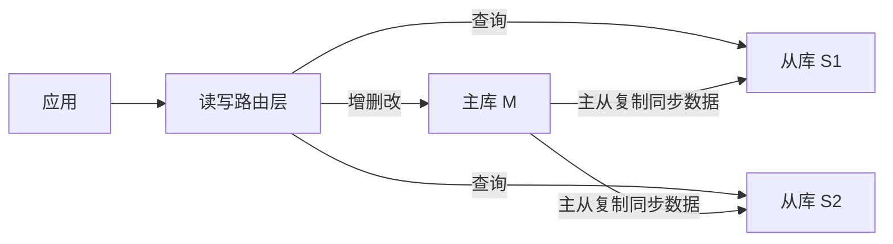

# 面试易问技术：读写分离，主从架构、读写路由与主从延迟的答法

> 🔒 安全提示：文中示例的口令/密钥均为课程教学环境演示口径，生产环境的安全要求见《安全与合规须知》。

分库分表答完，面试官常会顺着一件事往下追：除了拆库拆表，项目里还有没有别的数据库优化手段？这一问的标答案是读写分离。它与分库分表经常被混为一谈，但两者拆的东西完全不同，答的时候要把区别点破，再按「为什么用、怎么拆、数据怎么同步、延迟怎么办」的顺序把层次拉开。

## 先给结论

- 读写分离的适用场景是访问量日益增加、高并发的情况，此时数据库性能面临巨大瓶颈。
- 根因是一个细节事实：数据库写操作（增删改）比读操作（查询）更耗时，高并发下读写挤在同一个库，写操作会严重拖累读操作，这是单纯分库分表解决不了的问题。
- 方案是把数据库拆分为主库与从库：主库只处理增删改，从库只处理查询，读写分开后查询性能得到极大改善，还能避免由数据更新导致的行锁争抢。
- 读写分离只拆操作不拆数据，主从节点的数据内容是一致的，必须解决主从数据同步问题，同步靠 MySQL 自身的主从复制，需要在数据库层单独搭建。
- 拓扑可按压力扩展：一主多从分散查询压力，多主多从进一步兼顾吞吐量与可用性；路由交给 Sharding-JDBC 按 SQL 语义自动完成，应用无感。

## 为什么读写会互相拖累

场景先讲清楚：面对日益增加的系统访问量和高并发，数据库性能遇到瓶颈。高并发意味着同一时刻既有增删改又有查询。这时一个容易被忽略的事实起了决定作用：写操作通常比读操作更耗时。用课程给过的具体数字感受一下量级：往 Oracle 写一万条数据可能要三分钟，而读一万条数据可能只要五秒。写与读的耗时差距是数量级的。

把这个事实放进高并发场景，结论就自然了：读操作本来很快，但写操作占着连接、锁着行、吃着 IO，读写混在同一个库里，写会严重拖累读，查询也被拖得非常慢。单纯分库分表对此无能为力，因为分库分表解决的是数据量大的存储与检索问题，同一个节点上读写互相争抢的问题它管不到。

问题的成因是读和写待在一起，那解决办法就是把它们拆开：读操作指向一个数据库，写操作换成另一个数据库。这里要主动向面试官点破一个易混点：读写分离确实也把一个数据库变成了两个，但它与分库分表是两码事，分库分表拆的是数据，读写分离拆的是操作，两个库里的数据内容是一模一样的。

## 主从架构怎么搭

拆出来的两个库各有名分：主库（Master）专门负责增删改等写操作，从库（Slave）专门负责查询。这只是两个角色名，本质是把原来一个库的工作分给两个节点。这张图在讲基本的读写分离架构与它的扩展形态：



关键路径是主库指向从库的同步箭头：应用程序保存一条数据落到主库，从库原本没有这条数据，应用接着来查就会查不到，所以主库的每一次变更都要同步到从库，增、删、改都得同步。这根箭头就是读写分离唯一的额外代价，同步机制靠 MySQL 自身的主从复制能力，需要在数据库层单独搭建主从架构，中间件不代劳。

架构还能随压力扩展。一主多从把查询请求均匀分散到多个从库，进一步提升处理能力；多主多从不只提升系统吞吐量，还提升可用性，任何一个主库宕机甚至磁盘损坏，其余主库仍可承接写入，系统照常运行。选型要看业务并发量，不是节点越多越好。读写分离与分库分表也不互斥，两者可以综合运用，数据既按分片规则打散，每个分片内部再做主从，数据库的整体性能就能得到大幅提升。

## 主从复制原理与读写路由

被问到「主从之间数据怎么同步」，标准答法是 MySQL 主从复制三线程模型（此段为通用数据库知识，课程未展开，面试按主流口径作答）：主库把变更写入二进制日志 binlog，并维护一个 dump 线程负责把日志内容推送给从库；从库的 IO 线程接收后写入本地中继日志 relay log；从库的 SQL 线程重放中继日志里的变更，把数据追平。主库每一次增删改都走这条链路到达从库，两个节点的数据才能保持一致。

应用侧怎么决定一条 SQL 去主库还是从库？手写两套数据源再按语句分发又蠢又容易错，Sharding-JDBC 的做法是解析 SQL 语义：判断语句是写操作就路由到主库，是读操作就路由到从库，编程体验和操作一个数据库一样，路由对使用者不可见。接入只需在配置里声明主从关系（示例，按本课写法补全，连接账号为本课环境约定的 root/123456）：

```properties
# 示例 按本课写法补全 主从数据源声明
spring.shardingsphere.datasource.names = m0,s0

spring.shardingsphere.datasource.m0.type = com.alibaba.druid.pool.DruidDataSource
spring.shardingsphere.datasource.m0.driver-class-name = com.mysql.jdbc.Driver
spring.shardingsphere.datasource.m0.url = jdbc:mysql://localhost:3306/finance_transaction_0
spring.shardingsphere.datasource.m0.username = root
spring.shardingsphere.datasource.m0.password = 123456

spring.shardingsphere.datasource.s0.type = com.alibaba.druid.pool.DruidDataSource
spring.shardingsphere.datasource.s0.driver-class-name = com.mysql.jdbc.Driver
spring.shardingsphere.datasource.s0.url = jdbc:mysql://localhost:3310/finance_transaction_0
spring.shardingsphere.datasource.s0.username = root
spring.shardingsphere.datasource.s0.password = 123456

# 主从规则 增删改走 m0 查询走 s0
spring.shardingsphere.masterslave.name = ms0
spring.shardingsphere.masterslave.master-data-source-name = m0
spring.shardingsphere.masterslave.slave-data-source-names = s0
```

对照读一遍：`m0` 与 `s0` 指向同一个逻辑库名，但端口不同，是两台（或两个实例）数据库；`masterslave` 段声明谁是主谁是从，之后应用照常对数据源执行 SQL，写语句自动落主库，查询自动落从库。

## 主从延迟怎么答

读写分离的高频追问是主从延迟。复制是异步的，从库重放日志总要落后主库一点，刚写入主库的数据立刻去从库查，可能还查不到。延迟的常见来源有三类：主库写入量大时 binlog 堆积，从库重放速度跟不上；大事务或大批量更新导致单次重放耗时过长；从库自身还承担查询压力，资源被挤占，重放更慢。

应对思路按业务分档。对一致性不敏感的读（列表页、统计页）继续走从库，容忍短暂延迟；对一致性敏感的读（支付完成后立刻确认订单状态这类场景）强制路由到主库，宁可让关键读承受主库压力；架构上可以引入半同步复制，主库至少等一个从库确认收到日志再返回成功，缩小不一致窗口，代价是写延迟略增。再配合对复制延迟的监控告警，延迟过大时及时扩从库或排查慢 SQL。能把「容忍」与「强制」的分界讲清楚，这道追问就答到位了。

## 常见误区

- **把读写分离与分库分表混为一谈。** 错例：认为读写分离也是一种分库分表，从库只放一半数据。正解：读写分离拆的是操作不是数据，主从节点数据内容一致；分库分表拆的是数据本身，解决单库单表数据量过大。
- **以为配好读写分离就万事大吉。** 错例：应用配置了主从规则却没搭主从复制链路，从库永远查不到新数据。正解：同步依赖 MySQL 自身的主从复制，要在数据库层搭建复制链路；框架只负责按 SQL 语义路由读写。
- **以为主从复制是同步完成的。** 错例：主库写入后立刻从从库读，认为一定读到最新值。正解：复制是异步的，存在主从延迟，一致性敏感的读要强制走主库或引入半同步复制。
- **无脑堆节点。** 错例：不管并发量，一律上多主多从。正解：拓扑按业务并发量与可用性要求选择，单从库够用就先一主一从，查询压力大再横向加从库。

## 面试可能被问到的问题

1. 面试官追问：「读写分离解决什么问题？为什么它能提升查询性能？」
   答：高并发下写操作耗时长，与读操作挤在同一个库会严重拖累读。把增删改交给主库、查询交给从库，读写完全分开，查询不再被写拖累，还避免了由数据更新导致的行锁争抢，整个系统的查询性能得到极大改善。
2. 面试官追问：「读写分离和分库分表有什么区别？」
   答：两者都让一个数据库变成多个，但拆的东西不同。分库分表按某种策略把数据拆到多个库多张表，解决单库单表数据量过大；读写分离把读操作与写操作分给两个数据内容一致的节点，解决高并发下读写互相争抢。实际项目可以综合运用。
3. 面试官追问：「主从库之间数据怎么保持一致？」
   答：靠 MySQL 主从复制。主库把变更写入 binlog 并由 dump 线程推送，从库 IO 线程写入本地 relay log，SQL 线程重放日志把数据追平。复制需要在数据库层单独搭建，应用侧由框架按 SQL 语义把写路由到主库、读路由到从库。
4. 面试官追问：「什么是主从延迟？怎么应对？」
   答：从库异步重放主库日志，数据更新存在滞后，刚写入的数据立刻从从库读可能读不到。应对按业务分档：一致性不敏感的读容忍延迟继续走从库，一致性敏感的读强制走主库；可引入半同步复制缩小不一致窗口，并监控复制延迟、及时扩容从库。
5. 面试官追问：「一主多从和多主多从分别解决什么？」
   答：一主多从把查询请求分散到多个从库，提升读处理能力；多主多从在提升吞吐量的同时提升可用性，任何一个主库宕机甚至磁盘损坏，其余主库仍能承接写入，系统不中断。选型要结合业务并发量，节点多维护成本也高。
6. 面试官追问：「应用代码需要为读写分离做改造吗？」
   答：不需要。Sharding-JDBC 解析 SQL 语义自动路由，写语句走主库、查询走从库，应用仍面向一个数据源编程。工作量在两处：数据库层搭建主从复制，配置层声明主从数据源关系。

## 配套资料

- 讲义：`materials/docs/10/day16-项目总结&就业指导v1.0.md`，3.3.3 什么是读写分离、它起什么作用（读写耗时对比、主从定义、一主多从与多主多从、主从数据同步注意事项）。
- 讲义：`materials/docs/10/Sharding-jdbc专题-v1.0.md`，读写分离功能定位与主从架构说明，框架按 SQL 语义路由的口径来源。
- 代码：`materials/code/10/基础代码/基础代码/dbsharding/`，Sharding-JDBC 入门示例工程骨架（目录保留课程原始命名，路径只列到该层级）。文中主从数据源配置为按本课写法补全的示例，主从复制链路搭建未在仓库归档源码，以讲义与画面线口径为准。
