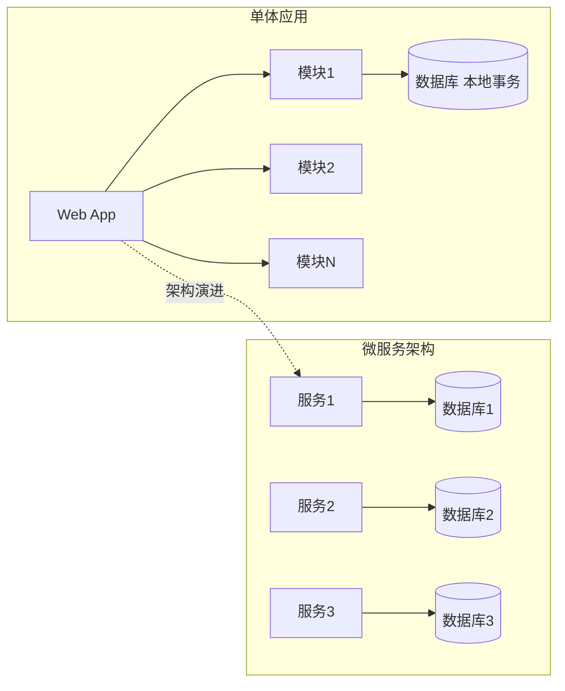

# 面试易问技术：分布式事务，从「什么是」到方案选型的速答路径

现在的后端项目基本都是微服务架构、分布式架构，分布式事务因此成了面试的固定考题。这一问的陷阱在于答得太理论：把 CAP 背得滚瓜烂熟，却说不清自己项目里哪个功能存在分布式事务、为什么选了那个方案。作答要按顺序铺开：先讲清什么是分布式事务，再给理论底座，最后落到项目的方案选型上。

## 先给结论

- 分布式事务的定义一句话说清：分布式系统环境下，一个功能由多个可独立部署的服务远程协作完成，服务与服务之间的事务机制就是分布式事务。
- 它的成因是架构演进：单体应用里所有功能操作一个数据库，数据库自身的本地事务就能搞定；拆成微服务后，一个功能的多个操作由多个服务共同参与，本地事务无能为力。
- 理论底座记 CAP 与 BASE 两组缩写：分布式环境下分区容错 P 必须保证，一致性与可用性只能取其一；BASE 给出 AP 路线的落地准则，基本可用、软状态、最终一致。
- 实践方案分两档：强一致型选 TCC，适合执行时间短、一致性要求严格的业务；最终一致型选可靠消息（如 RocketMQ 事务消息），适合耗时较长、不阻塞主流程的业务。
- 项目证据要随口能报：注册功能由用户中心与统一账号服务共同完成，用 TCC；满标放款由交易中心通知还款服务，用可靠消息最终一致性。

## 什么是分布式事务

先给左右对比的图景。左边是单体应用：所有功能、所有业务都在一个项目里，操作一个数据库，无论业务多复杂、操作有多少个，数据库自身的事务（本地事务）都能保证要么全成、要么全不成，根本不存在分布式事务的概念。右边是微服务架构：系统拆成一批可独立部署的服务，服务之间远程协作完成事务操作，部署时还可以按需做集群，节点数量众多。

架构变了，完成业务的方式跟着变了。打个比方：同一个活，以前交给一个人干，他能力再强也是一个人从头干到尾；现在这个活交给五个人共同完成，而且这五个人相互独立、各干各的。放到系统上就是：一个功能原来由一个系统完成，现在拆成多个小操作，由多个微服务分别完成，各自操作各自的数据库，部署在不同的服务器上。

万信金融里的现成例子是注册功能：用户向用户中心发起注册，用户中心保存用户业务信息，然后远程调用统一账号服务保存对应的账号信息。一个注册请求跨了两个服务、两个数据库。这时还指望传统的本地事务，结论是搞不定：本地事务的边界是单个数据库连接，远程调用一旦发出，它的成败就不在自己的事务范围里了。多个操作要同时成功或同时失败，只能靠跨服务的事务机制，这就是分布式事务。



对比图中两个子图：左边的每个模块与数据库在同一个本地事务保护下，右边的服务各自持有数据库，一次业务要跨多个库，本地事务的保护罩罩不住了。

这段代码把问题钉死（示例，按本课写法补全，包名按 `com.study.finance` 系改写）：

```java
/** 注册链路 本地事务罩不住远程调用的示意 */
@Service
public class RegisterServiceImpl {

    @Transactional // 只对 user 库的本地写生效
    public void register(UserDTO userDTO) {
        // 第一步 用户中心本地保存用户信息 失败可回滚
        userDao.insert(user);
        // 第二步 远程调用统一账号服务保存账号信息
        // 它写的是另一个库 是否成功由对方决定 本地事务管不到
        accountApi.saveAccount(accountDTO);
        // 若第二步失败 第一步已提交的本地事务不会自动回滚
        // 用户有了 账号没有 注册数据从此不一致
    }
}
```

问题明确了，答案分两路：要么把一致性做到近乎实时（强一致方案），要么允许中间出现短暂不一致、最终对齐（最终一致方案）。走哪条路，先要能讲两组理论。

## CAP 与 BASE 怎么速答

这两组理论课程未单独成节，属面试通用知识，按主流口径速答即可。**CAP 定理**：分布式系统有三个指标，一致性（Consistency，所有节点同一时刻看到相同数据）、可用性（Availability，每个请求都能在合理时间内得到响应）、分区容错性（Partition tolerance，网络分区发生时系统仍能运行）。三者不可兼得，而分布式环境下节点间的网络故障无法避免，P 是必选项，所以真正要抉择的是 C 与 A：要么保强一致牺牲可用，要么保可用接受数据短暂不一致。**BASE 理论**：既然强一致代价高昂，就退而求其次，基本可用（Basically Available，出现故障时允许损失部分可用性）、软状态（Soft state，允许数据存在中间状态）、最终一致（Eventually consistent，经过一段时间后所有副本数据一致）。BASE 是 AP 路线的落地准则，也是大型互联网分布式事务实践的理论底座。

两组理论串到方案上就形成分档：追求 C 的是强一致方案（TCC、2PC/XA 一族），追求最终一致的是柔性事务方案（可靠消息、最大努力通知一族）。

## 项目里怎么选：可靠消息与 TCC

选型不是背方案列表，而是拿业务特征去套。万信金融的两个场景是最有说服力的一组对照。

**满标放款选可靠消息最终一致性。** 交易中心要把标的状态改为「还款中」，同时通知还款服务生成还款计划和应收明细，两者原子性绑定，标的状态改成功就必须生成还款计划。但生成还款计划可能是一个耗时业务，不建议阻塞主流程，业务对强一致性要求也较低，所以采用可靠消息方案：借助消息中间件的事务消息能力，发送方先发半消息、再执行本地事务，成功则确认投递、失败则删除，发送方失联时由服务端回查本地事务状态定夺，保证消息发送与本地事务同时成功或同时失败；消费端配合重试与幂等设计，最终两边对齐。

**注册功能选 TCC。** 注册由用户中心与统一账号服务共同完成，用户与账号信息不一致会引发严重问题，业务对一致性要求严格，而且注册属于执行时间较短的业务。TCC 方案的软状态时间很短，一致性较强，恰好匹配这两个特征。

工程上两套方案各有依赖坐标，项目父工程统一锁版本（真实配置，包名与模块语义按本课口径）：

```xml
<!-- 分布式事务两套方案的依赖版本锁定 节选自项目父工程 -->
<dependencyManagement>
    <dependencies>
        <!-- TCC 方案 Hmily 框架 -->
        <dependency>
            <groupId>org.dromara</groupId>
            <artifactId>hmily-springcloud</artifactId>
            <version>2.0.4-RELEASE</version>
        </dependency>
        <!-- 可靠消息方案 RocketMQ 客户端 -->
        <dependency>
            <groupId>org.apache.rocketmq</groupId>
            <artifactId>rocketmq-spring-boot-starter</artifactId>
            <version>2.0.2</version>
        </dependency>
    </dependencies>
</dependencyManagement>
```

一句话总结选型逻辑：一致性要求严格、执行时间短，选 TCC；业务耗时、不阻塞主流程、容忍短暂不一致，选可靠消息最终一致性。能把两个场景的判断依据各说一条，选型题就答完整了。

## 常见误区

- **把分布式事务等同于某个具体框架。** 错例：面试时回答「分布式事务就是用 Hmily」。正解：分布式事务是跨服务跨库的事务一致性问题，Hmily、RocketMQ 事务消息都是解决它的具体手段，先答问题再答方案。
- **认为微服务里到处都需要分布式事务。** 错例：所有跨服务调用一律套事务方案。正解：先确认业务是否真有多操作同时成败的绑定关系，能合并成一个服务一个库的不要拆出事务问题，方案引入的复杂度本身就是成本。
- **CAP 背成三选二却不会落地。** 错例：只会背「三者不可兼得」。正解：指出 P 在分布式环境必选，实际是在 C 与 A 之间抉择，再由 BASE 引出最终一致路线，理论立刻接上项目。
- **给耗时业务套 TCC。** 错例：还款计划这类耗时业务也用 TCC 同步等着。正解：TCC 的预留阶段会占用资源，耗时业务会长时间软状态，应选可靠消息方案异步完成，不阻塞主流程。

## 面试可能被问到的问题

1. 面试官追问：「什么是分布式事务？为什么微服务架构下会出现？」
   答：分布式系统把应用拆成可独立部署的多个服务，需要服务之间远程协作才能完成事务操作，这种环境下的事务机制就是分布式事务。单体时代一个功能的多个操作在一个系统一个库里，本地事务即可；微服务化后操作分散到多个独立服务，各自持有数据库，本地事务的边界罩不住远程调用，问题随之出现。
2. 面试官追问：「本地事务为什么解决不了微服务下的事务问题？」
   答：本地事务的边界是单个数据库连接，只能保证自己库里的操作原子性。跨服务的第二步是远程调用，它的成败由对方服务与网络决定，不在发起方事务范围内；发起方本地事务已提交后，远程失败无法自动回滚，两边数据从此不一致。
3. 面试官追问：「CAP 和 BASE 分别讲什么？」
   答：CAP 指一致性、可用性、分区容错性三者不可兼得，分布式环境下 P 必选，实际在 C 与 A 之间抉择。BASE 是 AP 路线的延伸，基本可用、软状态、最终一致，允许中间的不一致状态，经过一段时间后收敛一致，是柔性事务方案的理论底座。
4. 面试官追问：「你们项目的分布式事务方案是怎么选的？」
   答：按业务特征分档。注册功能由用户中心与统一账号服务共同完成，一致性要求严格且执行时间短，选 TCC，它的软状态时间很短、一致性强。满标放款由交易中心通知还款服务生成还款计划，业务耗时且不阻塞主流程，一致性要求较低，选可靠消息最终一致性，靠事务消息的半消息、确认与回查闭环保证原子性绑定。
5. 面试官追问：「强一致方案和最终一致方案的本质区别是什么？」
   答：强一致方案在事务推进过程中对参与方资源做预留与锁定，中间状态对业务不可见，完成后数据即刻一致，代价是性能与侵入性；最终一致方案允许中间的不一致存在，靠消息重试、对账等手段在有限时间内收敛，吞吐更高但存在软状态窗口。选择取决于业务对一致性与时效的敏感度。
6. 面试官追问：「注册功能如果第二步失败了，怎么保证用户信息不被单独留下？」
   答：注册链路采用 TCC，用户中心与统一账号服务各自实现预留、确认、回滚三个操作。账号服务预留失败时，事务协调器推进用户中心回滚，撤销已做的预留动作，两个服务的操作要么都成立、要么都撤销，不会出现用户有了而账号没有的中间态。

## 配套资料

- 讲义：`materials/docs/10/day16-项目总结&就业指导v1.0.md`，3.4.1 什么是分布式事务（单体到微服务的架构演进与定义）、3.4.2 TCC 选型说明、3.4.3 RocketMQ 事务消息实现最终一致性的六步流程与满标放款选型。
- 讲义：`materials/docs/10/万信金融-第2章-讲义-开户v1.0.md`，「注册功能中的分布式事务」小节：注册请求由用户中心与统一账号服务协调完成、使用 Hmily 框架解决的结论。
- 代码：`materials/code/10/wanxinp2p/`，P2P 工程归档（目录保留原始命名，路径只列到该层级），父 `pom.xml` 锁定 `hmily-springcloud` 2.0.4-RELEASE。文中注册链路代码与 RocketMQ 客户端版本为按本课口径整理的示例，包名按 `com.study.finance` 系改写；CAP 与 BASE 为面试通用理论补充，课程未单独成节。
