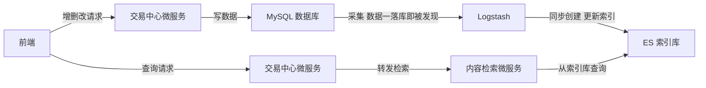

# 面试易问技术：Logstash 数据同步管道，三段式配置与增量同步怎么答

> 🔒 安全提示：文中示例的口令/密钥均为课程教学环境演示口径，生产环境的安全要求见《安全与合规须知》。

项目里一旦用上 Elasticsearch，必然多出一个问题，面试官也必然顺着问：MySQL 与 ES 索引库是两个库，数据怎么保持一致？答案就是 Logstash。这一课按面试节奏把它的答法排好：先讲清两库分工为什么必然带来同步问题，再讲 Logstash 的定位与采集管道，最后落到增量同步的实现细节，这是追问最密集的地方。

## 先给结论

- 用了 ES 之后项目里存在两个库：MySQL 数据库与 ES 索引库，两者都能应付增删改查，但项目里做分工：增删改操作针对 MySQL 数据库，查询、搜索操作通过 ES 索引库完成。
- 分工必然带来同步问题：保存走 MySQL，查询却走索引库，索引库里没有数据，两个库的数据必须一致。
- Logstash 是 Elasticsearch 常用的实时数据采集引擎，可以采集来自不同数据源的数据，输出到 ES 索引库中创建索引，两者是黄金搭档。
- 采集管道三段式：input 采集数据源，filter 加工处理，output 输出到目标，MySQL 到 ES 的同步就是把 input 指向数据库、output 指向索引库。
- 增量同步靠查询条件里的时间水位：用 `sql_last_value` 记录上次采集位置，配合 schedule 定时轮询，每次只搬新增与变更的数据。
- 项目链路：交易中心对 MySQL 增删改，Logstash 盯着数据库把变化采集出来同步到 ES 索引库，前端查询经交易中心转发内容检索服务查索引库。

## 两库分工与同步问题

答题从架构现状讲起，这一段把「为什么需要 Logstash」说成立。引入 ES 后，项目里同时存在 MySQL 数据库与 ES 索引库，两个库其实都能应付增删改查，但工程上会做分工：增删改这些写操作由 MySQL 数据库完成，查询、搜索这些读操作由 ES 索引库完成，理由在前一课已经立住，从索引库查比从数据库查性能好。

分工一落地，问题立刻浮出来：前端通过交易中心保存一条数据，数据落进 MySQL，此后前端查询走的是索引库，索引库里根本没有这条数据，查询结果就是空的。两个库之间的数据必须同步，即 MySQL 数据库中的标的信息发生变化时，ES 索引库中的数据也随之变化，这个同步工作就是 Logstash 负责完成的。面试里这层因果要讲顺：不是先有 Logstash 再有问题，而是分工决定了两库必然不一致，才需要采集引擎补位。

## Logstash 是什么：实时数据采集引擎与三段式管道

定位一句话背熟：Logstash 是 Elasticsearch 常用的实时数据采集引擎，可以采集来自不同数据源的数据，并输出到 ES 索引库中创建索引。它是 ES 的黄金搭档，不限于 MySQL 这一种数据源，文件、消息队列、其他数据库都在采集范围内。

Logstash 的管道按三段式组织，input 段负责从数据源采集数据，filter 段负责对数据加工处理，output 段负责把数据输出到目标位置。MySQL 到 ES 的同步管道就是把 input 指向数据库、output 指向索引库（示例，按本课写法补全，数据库密码 root/123456）：

```conf
# MySQL 到 ES 索引库的同步管道 标的信息表
input {
  jdbc {
    # MySQL 数据库连接 地址密码按环境配置
    jdbc_connection_string => "jdbc:mysql://localhost:3306/p2p_transaction?useSSL=false"
    jdbc_user => "root"
    jdbc_password => "123456"
    jdbc_driver_library => "/opt/logstash/mysql-connector-java-5.1.46.jar"
    jdbc_driver_class => "com.mysql.jdbc.Driver"
    # 每分钟轮询一次 数据库变化会被周期性采集
    schedule => "* * * * *"
    statement => "SELECT * FROM loan_info WHERE update_time > :sql_last_value ORDER BY update_time ASC"
    use_column_value => true
    tracking_column => "update_time"
    tracking_column_type => "timestamp"
    last_run_metadata_path => "/opt/logstash/loan_info_last_run"
  }
}
filter {
  # 数据加工阶段 可做字段裁剪与类型转换
  mutate { remove_field => ["update_time"] }
}
output {
  elasticsearch {
    # 输出到 ES 索引库 按主键写入保证重复采集覆盖旧文档
    hosts => ["http://localhost:9200"]
    index => "loan_info"
    document_id => "%{id}"
  }
}
```

这份配置就是三段式的具体形态：input 段的 jdbc 插件连上数据库定时查询，filter 段按需裁剪字段，output 段把记录写进 `loan_info` 索引。配合业务链路看整体效果：前端发增删改请求，交易中心直接操作 MySQL 数据库；数据一落库，Logstash 就发现数据库里的变化，把数据采集到手、同步保存到 ES 索引库。此后前端的查询请求经交易中心转发给内容检索服务，从索引库做全文检索，检索结果永远有数据可查。



图上两条业务线加一条同步线：写线走交易中心到 MySQL，读线走交易中心转发内容检索服务到 ES，中间的同步线由 Logstash 把两个库焊在一起。答题时指着这条同步线说结论：数据采集与同步的工作由 Logstash 承担，业务代码全程不感知，微服务不用为同步写任何代码。

## 增量同步怎么答

「怎么保证只同步新增和变更的数据，不是每次全量搬」是紧跟着的深水区追问。答法分三层。**第一，水位字段。**表里保留一个持续递增的追踪字段，常用更新时间戳，管道的 `statement` 里用 `WHERE update_time > :sql_last_value` 过滤，`:sql_last_value` 是 Logstash 维护的上次采集到的水位值，每次轮询只取水位之后的数据，这就是增量。**第二，水位持久化。**`last_run_metadata_path` 把上次水位落在本地文件里，管道重启不从头再来，`use_column_value` 与 `tracking_column` 声明按列取值而不是按查询时间取值，避免时钟误差。**第三，写入幂等。**`document_id` 绑定业务主键，同一条数据被重复采集时按相同 id 写入 ES，旧文档被覆盖而不是追加，同步天然幂等。

配套的细节也要备两句：`schedule` 用 cron 表达式控制轮询节奏，实时性要求高的业务调小间隔；追踪字段选 `update_time` 而不是 `create_time`，才能把「变更」也覆盖到，物理删除的记录需要软删除标记或定期校准任务兜底。这套口径与课程的「实时数据采集」定位一致：Logstash 周期性发现变化、实时搬移，业务方零改造。

## 常见误区

- **认为业务代码要负责同步。**错例：交易中心保存数据后再手动调一次接口往 ES 写。正解：同步由 Logstash 采集管道完成，业务侧只管操作 MySQL，双写代码既冗余又容易两边不一致。
- **把 Logstash 说成只能采集日志。**错例：名字带 log 就只当日志收集器。正解：它是实时数据采集引擎，可采集来自不同数据源的数据并输出到 ES 索引库创建索引，数据库到索引库的同步是典型用法。
- **增量同步写成全量查询。**错例：`statement` 不带 `WHERE update_time > :sql_last_value`，每轮把全表搬一遍。正解：加水位条件配合 `tracking_column` 与持久化的 `last_run_metadata_path`，只搬新增与变更。
- **漏掉写入幂等设计。**错例：output 不指定 `document_id`，ES 自动生成随机 id。正解：按业务主键写 `document_id`，重复采集时覆盖旧文档，同步动作重复执行效果不变。

## 面试可能被问到的问题

1. 面试官追问：「项目里为什么会出现 MySQL 和 ES 两个库，怎么分工？」
   答：为了性能分工。增删改操作针对 MySQL 数据库，保证事务与约束；查询、搜索操作通过 ES 索引库完成，发挥全文检索的性能优势。两个库各自负责自己擅长的一侧。
2. 面试官追问：「两个库的数据怎么保持一致？」
   答：由 Logstash 负责。它是 Elasticsearch 常用的实时数据采集引擎，采集来自不同数据源的数据并输出到 ES 索引库创建索引。配置一条 MySQL 到索引库的同步管道，数据库里标的信息一变化就被采集同步过去。
3. 面试官追问：「Logstash 的工作原理是什么？」
   答：管道三段式。input 段从数据源采集数据，支持数据库、文件、消息队列等多种来源；filter 段对数据做加工处理；output 段输出到目标。MySQL 到 ES 的同步就是 input 指向数据库、output 指向索引库，中间可选 filter 裁剪字段。
4. 面试官追问：「怎么做到增量同步而不是全量搬运？」
   答：用水位字段加轮询。表里保留更新时间戳，查询条件写 `update_time > :sql_last_value`，每次只取上次水位之后的数据；水位经 `last_run_metadata_path` 持久化，重启不重搬；`document_id` 绑定业务主键保证重复采集时覆盖旧文档，同步幂等。
5. 面试官追问：「同步有延迟，查询会不会查到旧数据？」
   答：会，这是最终一致的表现，轮询间隔内新写入的数据尚未进索引。实时性要求高的场景调小 `schedule` 间隔；对一致性敏感的个别查询仍可回落到 MySQL，同步方案与查询分工并不冲突。
6. 面试官追问：「删除的数据怎么同步到索引库？」
   答：物理删除很难被采集型同步感知，常规做法是软删除，加删除标记字段，Logstash 采到标记后按业务逻辑处理对应文档，或定期做索引与数据库的对账校准任务兜底，避免索引库残留脏数据。

## 配套资料

- 讲义：`materials/docs/10/day16-项目总结&就业指导v1.0.md`，3.6.2 Logstash 是干什么的：作为 Elasticsearch 常用的实时数据采集引擎、采集不同数据源数据输出到 ES 索引库创建索引、MySQL 数据库与 ES 索引库分工及数据同步的架构结论。
- 讲义：`materials/docs/10/day16-项目总结&就业指导v1.0.md`，3.6.1 与内容检索服务交互流程：前端请求交易中心、交易中心请求内容检索服务、内容检索服务查 ES 索引库并原路返回的六步链路。
- 代码：`materials/code/10/wanxinp2p/`，P2P 工程归档（目录保留原始命名，路径只列到该层级）。内容检索服务与 Logstash 管道配置源码未在仓库归档，文中三段式同步管道为按本课写法补全的示例，包名按 `com.study.finance` 系改写；增量同步细节为按主流实践补充，课程未单独成节。
