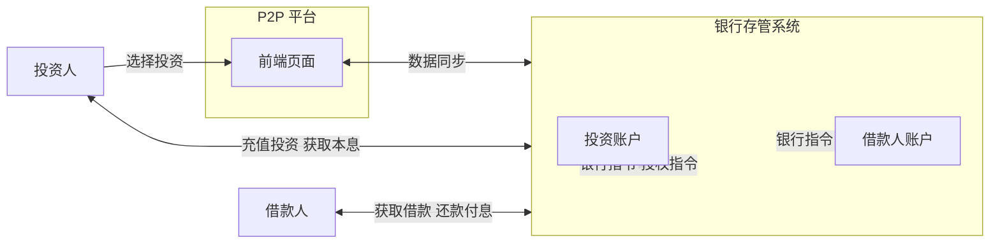
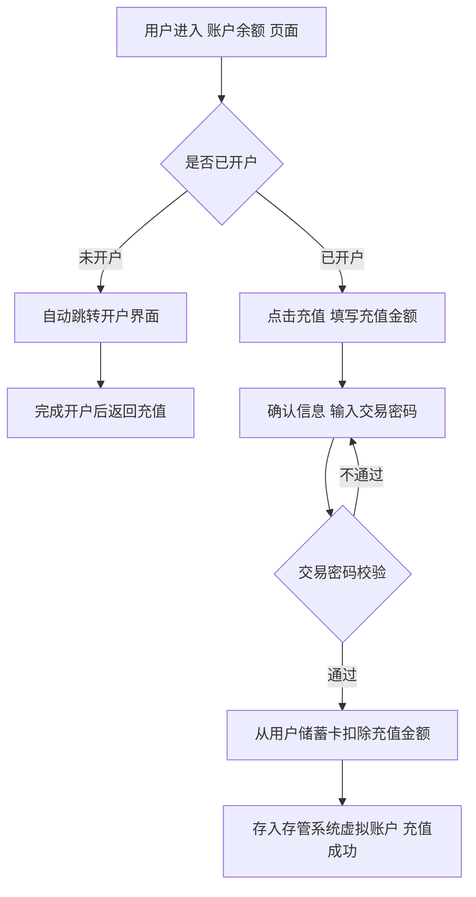

# 充值业务概述：投标之前，钱要先从储蓄卡走进存管系统

实战阶段的第一个模块就是充值。投资人要投标，账户里必须有钱，而钱从哪里来、到了哪里去，正是充值这条业务要回答的问题。概念本身不难，难的是它背后那套双账户体系：钱到底存在哪、平台碰不碰钱、余额页面上那个数字是谁给的。这一课把充值在资金链路里的位置摆正，后面的接口实现才不会走偏。

## 先给结论

- 充值的定义：用户在平台开户后，在银行存管系统中拥有一个虚拟银行账号，把储蓄卡中的金额转入这个虚拟银行账户即为充值。
- 充值的目标账户是银行存管系统侧账户，不是 P2P 平台账户；平台不碰资金，只与存管系统做数据交互和数据同步。
- 前端看到的账户余额，本质是平台向存管系统查询到的结果，资金始终由存管系统管理。
- 充值流程四步：进入账户余额页、点击充值（未开户自动跳转开户界面）、填写充值金额、确认信息并输入交易密码，随后由存管系统从储蓄卡扣款。
- 与支付宝、微信余额的充值同理：把钱从银行卡转入一个托管账户，只是这个托管方换成了银行存管系统。

## 充值是什么：双账户体系下的一次转账

开户业务完成时立下过一条铁律：万信金融 P2P 平台采用银行存管模式，任何一个用户都持有两个账户，一个在 P2P 平台，一个在银行存管系统，投资人有投资账户，借款人有借款人账户。这样设计的原因只有一个：不让平台接触资金，资金由银行存管系统管理，模式上更安全。

由此充值的定义就唯一确定了：用户把储蓄卡中的金额，转入银行存管系统里属于自己的那个虚拟银行账户。这个过程和把银行卡的钱转入支付宝或微信余额是同一个道理，只是托管方不同。

最容易走偏的认知在这里。有人会问：我在平台前端明明能看到账户余额，这钱不就在平台手里吗？答案是否定的：前端展示余额时，平台是向银行存管系统发了一个查询请求，拿到数字再回显，余额是查出来的，不是平台记出来的。资金的真实归属与存放始终在存管侧，平台与存管系统之间只流动数据。资金链路全景如下：



关键路径是中间那条数据同步线：平台与存管系统各自记账、靠同步对齐；资金划转只发生在存管系统内部与用户储蓄卡之间。投标时的冻结、满标放款时的划扣，走的都是存管系统的银行指令与授权指令，平台自始至终只递话。

## 充值流程：四步走完一次充值

从投资人视角把流程走一遍。投资人想投标，先得充值；进入充值操作时，系统先判断该用户是否已开户，因为存管系统里没有账户就无处可充。



对应到前端操作路径：登录成功后进入「我的」页面，点击「账户余额」，页面左侧按钮是充值、右侧是提现；点击充值后，未开户会被自动跳转到开户界面，已开户则进入充值页。充值页展示的正是开户时绑定的那张银行卡，扣款默认从这张卡发起；填好充值金额提交后进入交易密码环节，这是开户时设置的交易密码，资金流转必须验证它；密码正确，存管系统从储蓄卡扣除相应金额、存入存管侧账户，界面回到充值成功提示。

对用户来说操作只有两件事：填金额、输交易密码，剩下的扣款与入账都由银行存管系统完成。真实的快捷充值页面长这样，课程前端工程里能找到对应页面：

```html
<!-- materials 前端工程 pages/user/recharge.vue 摘录 快捷充值页 -->
<view class="content recharge">
    <topBar title="快捷充值" />
    <view class="cardsBlock">
        <view class="top">
            <view>￥ <text class="price">3999.00</text> 元</view>
            <view class="des">到账 5000.00 元</view>
        </view>
        <view class="cont">
            <view class="item"><text class="tit">银行卡号</text>
                <m-input type="text" value="招商银行" disabled="" /></view>
            <view class="item"><text class="tit">手机号</text>
                <m-input type="text" value="135**987" disabled="" /></view>
            <view class="item"><text class="tit">验证码</text>
                <m-input type="text" placeholder="请输入验证码" /></view>
            <view class="item clborder"><text class="tit">交易密码</text>
                <m-input type="text" placeholder="请输入交易密码" /></view>
        </view>
    </view>
</view>
```

页面信息与流程严格对应：绑定的银行卡、预留手机号置灰展示，交易密码是唯一由用户输入的关键项。页面底部还有一行温馨提示，说明存管银行不承担平台投融资标的的审核责任，这正是银行存管模式下银行与平台权责边界的体现。

## 充值落在哪张表上：存管侧余额明细

充值成功意味着存管系统里该用户的余额增加了。存管侧记录这一变化的表是余额明细表 `balance_details`，字段与充值业务一一对应：

```sql
-- 银行存管侧余额明细表 关键字段 按存管系统数据库画面资料整理
CREATE TABLE balance_details (
    ID            BIGINT(20)    NOT NULL COMMENT '主键',
    USER_ID       VARCHAR(50)   NOT NULL COMMENT '用户编号',
    CHANGE_TYPE   TINYINT(4)    NOT NULL COMMENT '变动类型',
    AMOUNT        DECIMAL(10,2) NOT NULL COMMENT '变动金额',
    FREEZE_AMOUNT DECIMAL(10,2) NOT NULL COMMENT '冻结金额',
    BALANCE       DECIMAL(10,2) NOT NULL COMMENT '余额',
    APP_CODE      VARCHAR(50)   NOT NULL COMMENT '应用编码',
    PRIMARY KEY (ID)
);
```

三条读表要点：`USER_ID` 存的是开户时生成的用户编码而不是手机号，做测试、查数据都要先换编码；`CHANGE_TYPE` 区分变动类型，充值与投标冻结、放款划扣各占一个值；`FREEZE_AMOUNT` 冻结金额是投标链路的伏笔，投标成功资金先冻结不划出，满标放款才真正扣。充值功能在实战阶段要自己实现，实现前先用这张表把「钱记在哪」想明白，后面的需求分析才有着力点。

## 常见误区

- **以为充值把钱充进了平台账户。** 错例：以为前端显示的余额存在平台数据库里。正解：资金只进银行存管系统的虚拟账户，平台侧余额是向存管系统查询回显的数据。
- **以为没开户也能充值。** 错例：直接找充值接口传金额调通就算完成。正解：充值的前置校验是已开户，未开户会被自动跳转到开户界面，账户不存在，充值无从谈起。
- **以为充值是登录密码确认的。** 错例：输入登录密码后提示失败就卡住。正解：资金流转必须验证开户时设置的交易密码，登录密码与交易密码是两套独立的凭证。
- **把充值简单当成一条 INSERT。** 错例：只在平台侧插一条充值记录就算完成。正解：充值要经存管代理与存管系统交互、维护交易记录同步状态、异步通知回平台，是一条跨系统链路，具体拆解见下一课。

## 面试可能被问到的问题

1. 面试官追问：「银行存管模式下，充值充到哪个账户？」
   答：充到银行存管系统中该用户的虚拟银行账户。平台不碰资金，充值后平台侧只做数据同步；用户看到的前端余额是平台向存管系统查询的结果。
2. 面试官追问：「为什么用户在平台能看到余额，却说平台不碰资金？」
   答：展示与托管是两回事。平台前端查询存管系统拿到余额数字并回显，资金的实际存放与划转都在存管系统内，平台库里没有可支配的资金，这就是存管模式的安全边界。
3. 面试官追问：「充值为什么必须输入交易密码？」
   答：交易密码是开户时设置的资金操作凭证，凡涉及资金流转的动作都要求验证它，与登录密码分离。这样即使登录态被盗用，资金操作还有一道独立防线，这也是存管系统的通行要求。
4. 面试官追问：「充值和提现是什么关系？」
   答：方向相反的同构业务，充值把储蓄卡资金转入存管账户，提现反向转出。两者的系统交互链路、交易记录维护、异步通知机制基本一致，开发时可以复用同一套模式。
5. 面试官追问：「余额明细表里的冻结金额字段是干什么的？」
   答：存管侧余额分可用与冻结两部分。投标成功时资金先从可用余额转入冻结，满标放款才真正划给借款人，流标等异常则解冻回可用。冻结字段让「锁定未划出」的状态在账面上可查。

## 配套资料

- 讲义：`materials/docs/10/万信金融-充值-实战v1.0.md`，1 充值业务概述：充值定义与充值流程四步骤。
- 代码：`materials/code/10/wanxinp2p_front/wanxinp2p_front/pages/user/recharge.vue`，前端快捷充值页面源文件，页面字段与流程的对应关系可对照。
- 代码：`materials/code/10/wanxinp2p/`，P2P 工程归档（目录保留原始命名，路径只列到该层级），可对照开户沉淀的账户体系与工程结构。
- 说明：`balance_details` 表结构按存管系统数据库画面资料整理；充值流程中的页面交互细节以讲义与画面线为准，充值功能本课只讲业务不写实现。
