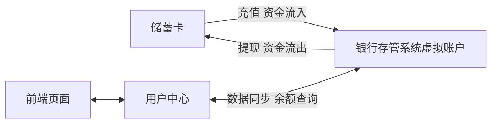
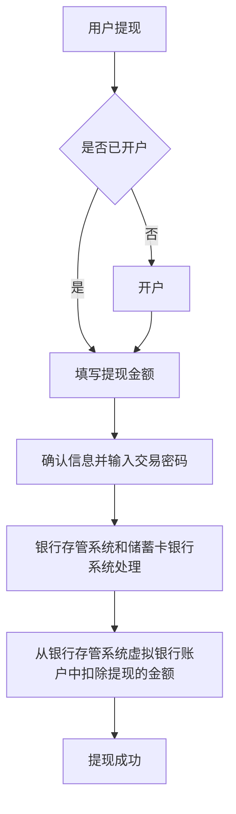

# 提现业务概述：钱要从存管系统回到银行卡，方向与充值相反的一步

充值解决「钱怎么进来」，提现解决「钱怎么出去」。投资人在平台上投标、收回款，账面上的数字涨得再好看，如果不能变成银行卡里的钱，平台就没有人敢用。提现是与充值正好相反的操作，也是 P2P 平台资金链路上不可缺少的闭环。这一课先把提现是什么、钱往哪走、用户怎么操作讲清楚，编码层面的流程拆解与接口定义放在后面两课。

## 先给结论

- 提现的定义：投资人在收到借款人的还款后，将余额从银行存管系统的虚拟账户中提取到自己绑定的储蓄卡。
- 提现与充值方向相反：充值是储蓄卡进、存管账户出，提现是存管账户出、储蓄卡进，但两者的系统链路几乎一模一样，实战时实现其中一个即可。
- 提现前仍要判断用户是否已开户，目的是兜住「没开户也点了提现按钮」的场景，未开户自动跳转到开户界面。
- 提现金额受存管账户余额约束，最多提完全部余额；资金流转同样要校验开户时设置的交易密码。
- 从存管系统虚拟账户扣除提现金额、把钱划到储蓄卡，这个动作由银行存管系统（模拟）完成，平台只做数据准备与状态同步。

## 提现在资金链路中的位置

开户课立过的双账户铁律在这里同样适用：用户在 P2P 平台有一个账户，在银行存管系统里有一个虚拟银行账户，资金始终放在存管侧，平台不碰钱。还款业务完成时，借款人还的钱经存管系统进入投资人的存管账户，投资人的余额随之增加。提现就是把这笔余额从存管系统的虚拟账户划回投资人绑定的那张储蓄卡。

把充值与提现并排看，方向感立刻就出来了：



关键在下方那条数据同步线：充值与提现的资金动作都发生在存管系统与储蓄卡之间，用户中心自始至终只做数据交互，前端展示的余额是向存管系统查出来的。提现成功后存管侧余额减少，前端下一次查询自然就显示出新数字，平台侧不需要也不允许直接改余额。

从平台运营的角度再看一眼提现的分量：如果平台只能充值不能提现，钱就是有去无回，没人敢在它上面投资。提现是平台公信力的一部分，也是为什么实战安排里把它当作与充值同等重要的模块。也正因为两者高度相似，实战整体安排时说过：同一个人只需实现其中一个，另一个照着镜像走一遍即可。

## 提现的业务流程

讲义给出的流程图把一次提现拆成六个环节，其中带一个分支判断：



「是否开户」这个判断乍看多余：理论上能提现的用户必然投过标，投标前必然充过值，充值前必然开过户，一路推下来账户一定存在。真实系统里却要防另一种情况：投资人在前端界面上没开户，就是想点一下提现按钮。这时系统不能报错完事，而是把他跳转到开户界面，提示得先开户才能提现，这个功能不是想玩就能玩的。防御式判断保护的是用户体验，不是数据一致性。

金额环节有一个隐含的约束：提现金额不能超过存管账户余额。存管账户里有 1 万，提 5000、6000、8000 都可以，超过 1 万就没有这么美的事了。金额填完提交后进入确认环节，展示提现金额、手续费、实际到账金额，再输入开户时设置的交易密码，密码校验通过，银行存管系统与储蓄卡银行系统开始处理，从存管虚拟账户中扣除提现金额、把钱转到储蓄卡，随后提现成功。

## 前端操作路径与真实页面

从投资人视角把操作走一遍：登录后进入「我的」页面，点击「账户余额」，这次点击右侧的提现按钮；进入提现页填写提现金额，页面同时展示开户时绑定的那张银行卡，钱就提到这张卡里；确认信息、输入交易密码，看到提现成功页面。课程前端工程里能找到对应的真实页面代码：

```html
<!-- materials 前端工程 pages/user/withdrawal.vue 摘录 提现页 -->
<view class="labelItem labStateA">
    <view class="lab"><text class="icon">&#xe624;</text></view>
    <view class="but">提现申请</view>
</view>
<view class="labelItem interval">  • • • </view>
<view class="labelItem labStateC">
    <view class="lab"><text class="icon">&#xe622;</text></view>
    <view class="but">银行处理</view>
</view>
<view class="labelItem interval gray">  • • • </view>
<view class="labelItem labStateC">
    <view class="lab"><text class="icon">&#xe623;</text></view>
    <view class="but">提现成功</view>
</view>
<view class="cardsBlock">
    <view class="title">提现金额 <text class="gray">最高可提 {{balance}} 元</text></view>
    <view class="inputBox"><text class="monIcon">￥</text>
        <m-input type="number" class="number" :value="amount" @input="setNumber"
            placeholder="请输入提现金额" />
        <text class="withdrawalBandle" @tap="setNumber('all')">全部提现</text>
    </view>
</view>
```

页面顶部把提现分成「提现申请、银行处理、提现成功」三步，与讲义流程一一对应；「最高可提」直接展示存管账户余额，「全部提现」按钮一键填满余额，输入超过余额会被前端拦下提示重填。确认页上还能看到手续费一栏，演示环境里为 0.00 元，实际业务里提现手续费是常见的运营配置项。这些细节都在提醒同一件事：提现页面上用户能做的只有填金额和输交易密码，真正的扣款与到账由银行存管系统完成。

## 与充值的对照：相似在哪，差在哪

两者像到什么程度？业务流程同为「判断开户、填金额、确认交易密码、存管系统扣款」；系统链路同为「用户中心备料、存管代理签名、前端直连存管系统、结果异步通知」；连测试时的注意点都会一样，存管系统里发送通知的代码同样默认注释着。差异集中在三点：资金方向相反，一个是钱进存管账户，一个是钱出存管账户；平台侧落库的实体不同，充值落充值记录，提现落提现记录，余额一个增一个减；提现的请求数据比充值多出银行卡号、银行预留手机号、平台佣金等要素，因为钱要落到那张具体的卡上。后面两课拆流程、定接口时，会逐条落到这些差异上。

## 常见误区

- **以为提现是平台把银行卡里的钱转走。** 错例：把提现理解成平台直接操作用户储蓄卡。正解：提现的资金动作发生在银行存管系统侧，从存管虚拟账户扣款、划到储蓄卡，平台只做数据准备与状态同步。
- **以为已开户判断是多余的。** 错例：认为能登录就必然开过户，删掉分支判断。正解：前端按钮谁都能点，未开户用户点击提现应跳转开户界面，这是体验层的防御逻辑。
- **以为提现和充值要写两套完全不同的代码。** 错例：实现完充值后从零再搭一遍提现。正解：两者链路同构，差异只在业务实体与数据方向，参考已有实现做镜像改造即可。
- **以为余额减少是用户中心改的。** 错例：提现成功后在用户中心把余额字段扣掉。正解：余额的权威数据在存管系统，用户中心侧做的是保存提现记录、同步余额展示，源头仍是存管侧的扣款。

## 面试可能被问到的问题

1. 面试官追问：「你们的提现业务资金是怎么走的？」
   答：平台采用银行存管模式，提现时用户在存管系统里的虚拟账户扣减金额，资金划到用户开户时绑定的储蓄卡；平台不接触资金，只负责请求数据准备、交易记录维护与结果同步。
2. 面试官追问：「提现前为什么还要判断开户？」
   答：业务上提现必然发生在开户之后，但前端入口对所有人开放，未开户用户点提现时要把他引导去开户界面。这个判断是防误操作的体验兜底，成本极低但避免了报错式的生硬交互。
3. 面试官追问：「提现和充值在系统设计上的关系是什么？」
   答：两者是同一资金链路的正反两个方向，三阶段流程、签名机制、交易记录状态机、异步通知全部复用，差异在业务实体、数据方向与请求数据要素，提现额外携带银行卡号、预留手机号与平台佣金。
4. 面试官追问：「为什么提现金额要校验不能超过余额？」
   答：提现的扣款方是存管系统里的虚拟账户，余额不足银行侧会拒绝交易；前端提前校验能立即给出反馈，避免用户走完交易密码环节才失败，同时减少与存管系统的无效交互。
5. 面试官追问：「用户输完交易密码后一直没看到结果，怎么办？」
   答：界面响应可能因网络或页面关闭丢失，不能依赖它做账务判断。提现结果以存管系统的异步通知为准，存管代理收到通知后更新交易状态，再经消息队列通知用户中心落库，通知机制保证账实最终对齐。

## 配套资料

- 讲义：`materials/docs/10/万信金融-提现-实战v1.0.md`，第 1 章提现业务概述，含业务流程图与前端操作四步截图说明。
- 讲义：`materials/docs/10/项目实战整体安排.md`，充值与提现二选一的实战分工口径出处。
- 代码：`materials/code/10/wanxinp2p_front/wanxinp2p_front/pages/user/withdrawal.vue`，提现页真实源码，含三步进度条、最高可提余额与全部提现逻辑。
- 代码：`materials/code/10/wanxinp2p_front/wanxinp2p_front/pages/user/confirmWithdrawal.vue`，确认提现页真实源码，展示提现金额、手续费与实际到账金额。
- 说明：提现的平台侧实现为实战留白，无成品源码；文中流程与页面描述按提现实战讲义与前端工程真实文件整理。
