# 身份认证业务概述：开户时没校验的窟窿，为什么补在发标这一步

开户业务早就上线了，用户填完姓名、身份证号、银行卡号、手机号，点一下确认，信息直接入库，页面一切正常。可只要多想一步就会发现不对劲：用户填的身份证号真的是他自己的吗？填的姓名和证件号对得上吗？填啥收啥的注册流程，等于把风险全留给了平台。实战阶段的最后一块内容，就是给借款业务补上这道身份认证的闸门，动工前先把业务背景想透。

## 先给结论

- 开户业务只收集信息、不做校验，存在假名、盗用他人身份证号、证件与银行卡不对应等风险，必须补认证。
- 身份认证可以加在开户时，也可以加在发标时，本项目选发标：发标是交易的第一步，而开户的用户不一定真的交易，在开户时强制认证会打扰只注册不交易的用户。
- 对用户来说认证操作很轻：上传身份证正反面两张照片，系统自动识别出姓名和身份证号，确认提交即可，认证不通过则重新上传。
- 认证不通过，借款申请无法提交；认证通过才进入后续的平台管理员审核环节。
- 开户流程与代码保持不动，要修改的只有发标链路，在填写借款申请之后插入身份认证环节。

## 开户留下的口子

回看开户功能的实现：前端表单收集证件类型、姓名、证件号码、银行卡号、手机号，用户点「确认协议并注册」，这些信息原样提交到用户中心保存。整个过程没有任何认证与校验动作，系统默认用户填的就是真的。

用代码还原当时的实现姿态，就是一个只收参数、不做校验的保存接口（按本课写法补全的示例，包名按 `com.study.finance` 系改写）：

```java
// 开户信息保存的示意代码 只收参数不校验 即业务概述所指的风险口子
@RestController
public class ConsumerController {

    @ApiOperation("开户保存用户信息")
    @PostMapping("/my/consumers")
    public RestResponse<ConsumerDTO> createConsumer(@RequestBody ConsumerDTO consumerDTO) {
        // 姓名与身份证号等要素未经任何认证与校验 直接交由业务层入库
        consumerService.createConsumer(consumerDTO);
        return RestResponse.success(consumerDTO);
    }
}
```

这里面的风险至少有三类。**第一，假名。** 用户可以填一个编造的姓名，平台无从分辨。**第二，盗用他人证件号。** 身份证号是十八位有规则的字符串，冒用别人的号码填写并不费力。**第三，要素之间不对应。** 身份证号、银行卡号、手机号可能分属不同的人，一旦进入借贷环节，放款打进了别人的卡，风控责任说不清。对投资人来说这些风险尚可接受，对借款人则不行：借款人是平台资金资产的入口，身份不实，后续交易环节全都有风险。

## 认证环节加在哪：开户时还是发标时

给认证找位置，方案有两个，各自的说法都在情理之中。

**方案一，开户时就认证。** 用户填完信息点确认，紧接着做身份校验，一步到位。代价是：有些用户开户只是为了进平台看一看、感受一下，未必真的做交易。在注册环节就强制上传身份证照片，体验上比较重，容易把观望用户挡在门外。

**方案二，发标时认证。** 发标是借款人发起借款申请的动作，也就是交易的第一步。真要做交易，必然要经过这一步；不做交易的用户，则完全不会被打扰。权衡下来这个位置更合适，平台最终把身份认证放在了发标环节，开户流程保持原样，爱填什么填什么，等到了发标这一步，再对身份信息特别是身份证号做认证和校验。

两个方案的位置差异画出来是这样的：

```mermaid
flowchart TD
    A["用户注册开户"] --> B["仅收集信息 不做校验"]
    B --> C{"是否发起交易"}
    C -->|"观望 看一看"| D["停留在浏览阶段 不被打扰"]
    C -->|"发起借款"| E["填写借款申请"]
    E --> F["身份认证"]
    F -->|"认证不通过"| G["申请无法提交 重新上传"]
    F -->|"认证通过"| H["提交申请"]
    H --> I["平台管理员审核"]
```



关键分叉在「是否发起交易」：认证成本被精确地收给了真正要交易的人，这正是把闸门放在发标处而不是开户处的全部逻辑。

## 更新后的发标流程

以前发标只有两步：借款人填写借款申请并提交，管理员审核，过审后标的信息进入出借列表。更新后，在填写申请与提交之间多出一道身份认证，前后端的表现是一串连续的操作。

借款人在前端填写借款申请：选择借款金额、借款期限、填写借款用途，同意借款协议。以前点「立即申请」，请求直接带着表单打到后端；现在点击后先跳转到身份认证界面，要求上传身份证的照片，正面即人像面，反面即国徽面。两张照片上传后，系统调用第三方能力自动识别证件上的信息，把姓名、身份证号识别出来回填到页面供用户确认。用户核对无误点击确认提交，申请才真正进入后端，之后照旧等待管理员审核。审核通过，标的信息才会出现在前端的出借列表里。

对用户而言，整个认证就是在手机上拍两张照片的工夫，剩下的识别、比对、放行都由系统完成；认证不通过则提示重新上传再试一次。

## 认证要素与数据落点

把这套流程翻译成开发要处理的数据，认证环节涉及三类要素。

**第一，证件照片本体。** 身份证正面与反面两张图片，这是认证的原始凭证，需要先上传保存。

**第二，识别出来的结构化信息。** 从照片里解析出的姓名、身份证号，用于与开户时填写的信息比对，看两者是否一致。

**第三，落库的信息。** 认证完成后，用户中心的用户详情表要存下证件照片的文件标识等信息，作为该用户已完成实名认证的凭据。实战讲义在用户中心一侧规划了 `ConsumerDetailsDTO`、`ConsumerDetails`、`ConsumerDetailsService` 等一串类来承载这块数据，接口与实现是学员的独立实战任务，成品代码留白，具体按讲义口径完成。

需要强调的是，识别与校验本身不靠平台自研算法，靠的是对接第三方平台，也就是后续内容里的文件服务与百度 AI 服务；平台侧要做的是流程编排与结果处理。

## 常见误区

- **以为认证失败只是提示一下还能继续提交。** 错例：认证不通过也放行申请。正解：认证不通过时申请无法提交，必须重新上传证件照片再试，这是闸门而不是提醒。
- **把认证加回开户环节。** 错例：觉得越早认证越安全，在注册保存时就强制上传证件。正解：开户用户不一定交易，认证放在发标（交易第一步）处，兼顾风控与注册体验。
- **以为要自己实现身份证识别算法。** 错例：动手写证件号正则、人像比对之类的逻辑。正解：识别能力由第三方平台提供，平台侧只负责请求第三方、解析结果、比对落库。
- **以为开户代码要一并改造。** 错例：顺手去改开户保存逻辑。正解：开户保持不动，改动只集中在发标链路插入的认证环节。

## 面试可能被问到的问题

1. 面试官追问：「你们项目的实名认证放在哪个环节？为什么不放在注册时？」
   答：放在发标环节，也就是交易的第一步。开户用户不一定真的交易，注册时强制上传证件会打扰观望用户；发标处认证把成本精确收给真正要交易的人，开户流程完全不动。
2. 面试官追问：「开户不校验身份有什么风险？」
   答：假名注册、盗用他人身份证号、证件号与银行卡号手机号不对应。借款人身份不实会传导到放款与还款环节，平台无法核实借款人真实身份，风险失控。
3. 面试官追问：「身份证识别是你们自己实现的吗？」
   答：不是。识别调用第三方平台的 OCR 能力，平台侧做的是上传证件照片、请求第三方、解析返回的结构化结果（姓名、身份证号）、与开户信息比对后落库。
4. 面试官追问：「用户在认证环节实际操作了什么？」
   答：只上传身份证正反面两张照片，系统自动识别姓名与身份证号并回填，用户确认后提交；认证不通过则重新上传。操作成本被压到最低。
5. 面试官追问：「认证通过和审核通过是一回事吗？」
   答：不是。认证通过指证件识别与校验通过，申请可以提交；审核是平台管理员对借款申请的人工风控，两者是流程上下游的两道关，通过认证的申请仍可能审核不通过。

## 配套资料

- 讲义：`materials/docs/10/万信金融-身份认证-实战v1.0.md`，1 业务概述：开户风险、认证环节选址（发标）与更新后的发标流程；第 2 节需求分析与第 5 节接口定义中的 `ConsumerDetails` 系列类名出处。
- 讲义：`materials/docs/10/项目实战整体安排.md`，身份认证作为三块实战业务之一的整体定位。
- 代码：`materials/code/10/wanxinp2p/`，P2P 工程归档（目录保留原始命名，路径只列到该层级），可对照用户中心工程结构。
- 说明：本视频为业务概述讲解，无画面代码；认证环节的流程与要素按讲义口径整理，流程图中前端的操作步骤为按本课讲义口径还原。
