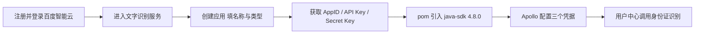

# 身份认证之百度 AI 服务：把身份证照片变成结构化信息的 OCR 接入

> 🔒 安全提示：文中示例的口令/密钥均为课程教学环境演示口径，生产环境的安全要求见《安全与合规须知》。

文件服务就位后，身份认证还剩最后一块准备工作：百度 AI。识别身份证上的姓名与身份证号，靠的就是它的文字识别能力。这一课同样不做编码，目标是把第三方平台开通、把凭据拿到、把配置挂上，让后续实现识别接口时伸手就能用。

## 先给结论

- 百度 AI（百度智能云）是第三方智能能力平台，提供语音识别、图像识别、文字识别等服务，身份认证用到的是文字识别（OCR）中的身份证识别。
- 接入路径固定四步：注册登录、进入文字识别服务、创建应用、获取 AppID / API Key / Secret Key 三个凭据。
- 这三个凭据是编程时证明合法身份的唯一依据，缺一个第三方就拒绝服务；示例中一律以 `example-*` 占位，绝不写真值。
- 用户中心 `consumer-service` 的 pom 中引入 `com.baidu.aip:java-sdk`（4.8.0 版本），并在 Apollo 的 `micro_service.files` 命名空间增加三项配置。
- 识别发生在用户中心（服务端），密钥不出后端，前端只拿识别结果。

## 平台定位：为什么认证要挂在百度 AI 上

百度 AI 平台聚集了大量智能能力：语音识别、图像识别、文字识别等等。对身份认证这个需求来说，要解决的问题很具体：用户上传的是一张身份证照片，平台需要从中拿到姓名和身份证号两个结构化字段。照片是图片，字段是文字，把图片里的文字抠出来，正是文字识别（OCR）的拿手戏，而且平台专门提供身份证识别这种细分能力，连证件正反面的版式差异都处理好了。

自己训练一套证件识别模型显然不现实，调用第三方现成能力是最优解。这与文件服务对接七牛云是同一个思路：专业能力交给专业平台，平台侧只做请求编排与结果处理。



这张图在讲从零到可用要走的完整链路，前四步在百度智能云控制台完成，后三步在自己的工程里完成。

## 平台侧准备：注册、选服务、创建应用

先访问百度智能云的登录页，自行注册并登录（支持短信验证码快捷登录）。登录后进入个人控制台，可用的服务非常多，要用的只是人工智能分类下的「文字识别」，点击进入。

进入文字识别后先创建应用，含义是声明「哪个应用将来要调用这项能力」：填写应用名称（如 P2P 项目对应的名字）、应用类型选工具类或其他即可，接口选择默认，写一句简单描述，提交创建。创建完成后，在应用详情里会得到三条关键信息：

- AppID：应用的编号；
- API Key：应用的公开标识；
- Secret Key：应用的私密密钥，默认不显示。

这三个值就是编程时证明「你是合法用户」的全部凭据。调用识别接口时必须同时提供，提供不了，平台就认定是非法请求，服务不可用。与七牛云的 AK/SK 同理，它们属于最高敏感级的配置：博客与代码示例一律以 `example-appid`、`example-ak`、`example-sk` 占位，实战时换成自己控制台里的值，且不能把真值提交进代码仓库或写进公开文档。

## 工程侧接入：一个依赖加三条配置

平台侧就绪后，回到工程。涉及百度 AI 的微服务只有用户中心（身份认证的识别阶段由它发起），按实战讲义口径做两件事。

第一件，在用户中心的 pom 文件里引入百度 AI 的 Java SDK：

```xml
<!-- 百度 AI 文字识别 Java SDK 版本按实战讲义口径 4.8.0 -->
<dependency>
    <groupId>com.baidu.aip</groupId>
    <artifactId>java-sdk</artifactId>
    <version>4.8.0</version>
</dependency>
```

第二件，登录 Apollo，找到 `consumer-service` 项目，在 `micro_service.files` 命名空间中增加三项配置（与文件服务的存储配置同处一个命名空间，讲义口径如此）：

```yaml
# 百度 AI 凭据配置 值一律 example- 占位 实际值取自百度智能云控制台的应用详情
baidu:
  ai:
    app-id: example-appid
    api-key: example-ak
    secret-key: example-sk
```

配置值必须来自自己控制台创建的那个应用，不能照抄别人的：AppID、API Key、Secret Key 三者绑定在同一个应用上，混用会导致鉴权失败。这三个值正是后续实现 `imageRecognition` 接口时要用的全部参数，配置就位即完成准备工作。

## 调用识别：SDK 的用法与返回结构

讲义把实现环节留给了实战，识别代码按官方 SDK 的主流用法补一份可运行的示例，包名按 `com.study.finance` 系改写：

```java
// 按百度 AI 官方 Java SDK 用法补全的示例 包名按 com.study.finance 系改写 凭据为 example- 占位
@Service
public class BaiduAiService {

    private final AipOcr client;

    public BaiduAiService(@Value("${baidu.ai.app-id}") String appId,
                          @Value("${baidu.ai.api-key}") String apiKey,
                          @Value("${baidu.ai.secret-key}") String secretKey) {
        // 三个凭据齐备 客户端才能创建
        this.client = new AipOcr(appId, apiKey, secretKey);
    }

    /** 识别身份证 返回姓名与身份证号
     *  @param image 身份证照片字节数组
     *  @param flag  正反面 取值 front 或 back */
    public Map<String, String> idcard(byte[] image, String flag) {
        JSONObject res = client.idcard(image, flag, new HashMap<>());
        // 识别结果在 words_result 节点 正面含姓名与公民身份号码
        JSONObject words = res.getJSONObject("words_result");
        Map<String, String> result = new HashMap<>();
        result.put("name", words.getString("姓名"));
        result.put("idCard", words.getString("公民身份号码"));
        return result;
    }
}
```

对照需求分析的第一阶段看，`AipOcr` 客户端封装了与百度 AI 平台的全部交互：凭据鉴权、照片上传、结果解析都在 SDK 内部完成，用户中心要写的只是把 `MultipartFile` 转成字节数组、按 `flag` 指定正反面、把 `words_result` 里的字段取出来放进 Map 返回给前端。识别失败（照片模糊、反光、非证件）时结果节点会缺字段，这正是认证流程里「识别不通过重新上传」那条分支的来源，实现时要对空结果做兜底。

准备阶段到此收口：文件服务与百度 AI 两个第三方都已开通并挂上配置，接下来就是按接口定义逐个实现用户中心的三个方法。

## 常见误区

- **三个凭据张冠李戴。** 错例：AppID 用 A 应用的，API Key 用 B 应用的。正解：AppID、API Key、Secret Key 必须来自控制台里同一个应用，错配即鉴权失败。
- **密钥写真值进仓库。** 错例：把 API Key、Secret Key 硬编码提交。正解：值放 Apollo 配置中心，仓库与文档里一律 `example-*` 占位，泄露后别人可用你的额度与身份调用服务。
- **前端直接调百度 AI。** 错例：把 SDK 和密钥下发到前端识别。正解：识别只能在服务端发起，密钥不出后端，前端只接收识别结果做回填确认。
- **忽略正反面参数。** 错例：不管传什么照片都用同一个接口姿势。正解：身份证识别接口按 `front` / `back` 区分版式，正反面字段结构不同，`flag` 参数传错会拿不到目标字段。

## 面试可能被问到的问题

1. 面试官追问：「身份证识别为什么选第三方 OCR 而不是自己实现？」
   答：证件识别涉及版式分析、图像矫正、文字检测与识别，自研成本极高；第三方 OCR 已按身份证版式做好细分能力，调用即得，平台侧只需请求编排与结果校验，成本收益差悬殊。
2. 面试官追问：「接入百度 AI 需要哪三个凭据？分别是什么？」
   答：AppID 是应用编号，API Key 是应用公开标识，Secret Key 是私密密钥。三者绑定同一应用，调用 SDK 时同时提供用于鉴权，缺一或错配都会被平台拒绝。
3. 面试官追问：「密钥应该放在哪里管理？」
   答：放配置中心（如 Apollo），按命名空间管理，服务启动时注入；不进代码仓库、不写进文档。示例与博客中用 `example-*` 占位，真值只在运行环境里。
4. 面试官追问：「OCR 识别失败怎么办？」
   答：结果节点会缺字段或返回错误码，服务端要做兜底：字段缺失即判定识别不通过，返回明确错误给前端，引导用户重新上传更清晰的照片，而不是把空数据入库。
5. 面试官追问：「识别结果为什么还要用户确认，后端不是会校验吗？」
   答：OCR 对照片质量敏感，可能识别错字符；让用户在页面上确认回填的姓名与身份证号，相当于加一道人工核对。后端在保存阶段再做与开户信息的机器比对，人工确认与机器校验各守一道关。

## 配套资料

- 讲义：`materials/docs/10/万信金融-身份认证-实战v1.0.md`，4 使用百度 AI 服务：注册登录、文字识别选服务、创建应用、获取 AppID / API Key / Secret Key、pom 引入 `com.baidu.aip:java-sdk` 4.8.0、Apollo `micro_service.files` 增加配置的完整口径。
- 讲义：`materials/docs/10/文件服务部署指南.md`，`micro_service.files` 命名空间的既有配置（存储源与存储空间名），百度 AI 凭据配置与之同命名空间。
- 代码：`materials/code/10/wanxinp2p/`，P2P 工程归档（目录保留原始命名，路径只列到该层级），可对照用户中心工程结构；百度 AI 识别的成品实现按讲义口径留白，正文 Java 示例为按官方 SDK 用法补全。
- 说明：`AipOcr` 调用示例为按百度 AI 官方 Java SDK 写法补全并注明，密钥一律 `example-*` 占位。
