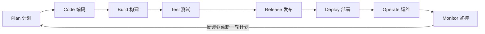
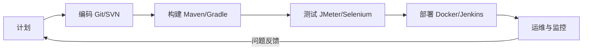

# DevOps 介绍：开发与运维打通的一套理念和落地它的工具链

项目开发完毕，接下来就是部署上线。把万信金融这样一套后端一堆微服务、前端两套工程、外加银行存管系统的系统搬到生产环境，靠一台一台服务器手工操作既慢又容易出错。部署实战这一章要讲的 DevOps，正是针对这个场景的方法论，先把概念和工具链搞清楚，后面的 Docker Compose 部署和持续集成才有落点。

## 先给结论

- DevOps 是 Development（开发）和 Operations（运维）两个词的缩写，是一套理念或方法，不是某一个具体软件。
- 它涵盖开发、测试、运维的整个过程，核心诉求是提高各岗位、各部门之间的沟通与协作质量，强调用自动化管理软件变更与集成，让构建、测试、发布更快捷可靠，最终按时交付软件。
- DevOps 是个闭环：计划、编码、构建、测试、发布、部署、运维、监控，一轮结束回到计划，持续滚动。
- 理念要落地靠工具，行业围绕它形成了一大批工具，组合起来叫 DevOps 工具链：Git/SVN、GitHub、Docker、Jenkins、Hudson、Ant/Maven/Gradle、Selenium、QUnit、JMeter 等等。
- 学过的 Git、Docker、Node、npm，以及接下来要学的 Jenkins 和 Gogs，都属于这条工具链。

## 什么是 DevOps：从岗位边界说起

字面拆开看：Dev 是 Development，开发；Ops 是 Operations，运维。这两个岗位平时分工明确：开发岗的主要工作是编码开发，运维岗负责项目部署、上线后的运营与监控。行业早期这两个岗位各干各的，交接基本靠文档和工单。

随着行业的发展，开发岗和运维岗的联系越来越紧密，甚至出现了工作重叠：开发要懂部署和容器，运维要懂脚本和流水线。两个部门怎么沟通、怎么协作、怎么整合，目的只有一个：保证项目质量与效率，让产品按时交付。

引用一个通行的定义：DevOps 是促进开发与运维部门之间沟通、协作与整合的一组过程、方法与系统的统称，主要通过自动化「构建、测试、发布」的方式，让整个交付过程变得更加快捷、可靠。抓三个关键词就够了：

**第一，它是理念不是工具。** DevOps 本身没有一个可下载的安装包，它是关于「开发与运维如何协作」的方法论，具体落地靠的是后面讲到的工具链。

**第二，自动化是它的手段。** 人工做的变更与集成又慢又容易错，自动化把构建、测试、发布这些重复劳动交给机器，这是整个 DevOps 体系里工具存在的原因。

**第三，按时交付是它的目的。** 沟通协作也好，自动化也好，最终都要落到「更快、更可靠地交付软件」上。

## DevOps 闭环：一个循环看懂全流程

DevOps 把软件的整个生命周期画成一个环，而不是一条单向流水线：



这张图在讲 DevOps 的循环：左边半个环偏开发（计划、编码、构建、测试），右边半个环偏运维（发布、部署、运维、监控），监控发现的问题与反馈回到计划阶段，驱动下一轮迭代。环的意义在于它不是「开发完了交给运维」的一次性交接，而是持续滚动、不断循环的过程。传统模式里开发和运维的分界线在这个环的中段，DevOps 要做的就是把这条线两侧的部门打通、流程接起来。

放到万信金融项目上理解这个闭环会非常具体：一个 P2P 网贷平台后端有用户中心、交易中心、还款中心、存管代理服务等一批微服务，前端有两套工程，还有独立的银行存管系统。任何一次需求变更，都要走完编码、构建、测试、发布、部署的完整一圈，环越长、服务越多，靠人扛就越吃力，这正是项目部署实战要引入工具链的原因。

## DevOps 工具链：理念靠什么落地

DevOps 兴起于 2009 年，近年来随着云计算与互联网的发展，基础设施与工具链也跟着繁荣起来。围绕这个理念，各个公司、各个团队推出了大量工具，覆盖开发、测试、运维的各个领域，这些工具组合到一起，统称 DevOps 工具链。常见的一批：

- 版本控制：Git、SVN，托管平台 GitHub 及同类产品；
- 构建工具：Ant、Maven、Gradle；
- 持续集成：Jenkins、Hudson；
- 容器与部署：Docker 及容器编排类工具；
- 测试类工具：Selenium、QUnit、JMeter。

工具多到一页图都摆不下，但不需要都精通。按环节归类去看，每个环节都有对应的工具支撑，实际项目里是按需选型、按链组合：



这张图在讲工具如何挂到闭环的每个环节上：编码环节靠版本控制，构建环节靠 Maven 一类工具，测试与部署各有专用工具，Jenkins 一类的持续集成工具则负责把多个环节串成自动流水线。

对照已学的课程内容会发现，这条链早就在用：Git 管代码、Node 与 npm 构建前端、Docker 打包运行环境，接下来项目部署实战要用的 Jenkins（持续集成）与 Gogs（局域网 Git 仓库）同样是工具链成员。整个部署实战章节做的事，本质上就是把工具链的几个关键工具组合起来，完成生产环境搭建与项目部署。

部署命令在这个体系里的真实样貌大致如下（示例为按本课写法补全，镜像名与端口按实际环境调整）：

```bash
# 代码提交到 Git 仓库 触发后续构建
git push origin master
# 构建产物导入 Docker 镜像
docker load -i consumer-service.tar
# 用 Docker Compose 编排启动一整套服务
docker-compose up -d
```

这三行命令分别对应工具链的编码、构建、部署三个环节，后面的课程会把它们组织成自动执行的过程，而不是每次手工敲一遍。

## 常见误区

- **把 DevOps 当成一个软件。** 错例：「安装一个 DevOps」。正解：DevOps 是方法论与理念，Jenkins、Docker 这些是实现它的工具，工具链的组合使用才叫践行 DevOps。
- **认为 DevOps 只和运维有关。** 错例：部署上线才涉及 DevOps，开发阶段用不上。正解：它涵盖开发、测试、运维全程，开发过程中的自动化构建与测试正是它的重要组成。
- **认为用了工具就等于有了 DevOps。** 错例：装了 Git 和 Docker 就宣称 DevOps 落地。正解：核心是打通部门与流程的协作文化，工具只是载体，流程不打通，工具堆再多也只是零散的自动化点。
- **追求工具链大而全。** 错例：把图谱上的工具全装一遍。正解：按项目阶段按需引入，当前项目的路径是 Docker Compose 先把部署做起来，再上持续集成工具。

## 面试可能被问到的问题

1. 面试官追问：「说说你对 DevOps 的理解？」
   答：DevOps 是 Development 与 Operations 的合成词，是一套涵盖开发、测试、运维全过程的方法论，目标是提高各岗位与部门之间的沟通协作质量，强调用自动化管理软件变更与集成，使构建、测试、发布快捷可靠，最终按时交付。理念落地靠 DevOps 工具链，如 Git、Docker、Jenkins 等。
2. 面试官追问：「DevOps 和 CI/CD 是什么关系？」
   答：CI/CD 是 DevOps 理念中自动化环节的具体实践：持续集成负责频繁合并代码并自动构建测试，持续交付与持续部署负责把构建产物自动化地发布。可以理解成 DevOps 是大理念，CI/CD 是其中最核心的工程实践，Jenkins 这类工具是实现 CI/CD 的载体。
3. 面试官追问：「微服务架构为什么更需要 DevOps？」
   答：微服务把单体拆成几十个独立部署的服务，部署频率高、服务间依赖复杂，手工部署既慢又容易出错，环境不一致问题也会放大。DevOps 的自动化工具链（容器、编排、持续集成）正好解决这类规模化交付问题，服务越多收益越明显。
4. 面试官追问：「举几个 DevOps 工具链中的工具，并说明它们负责哪个环节？」
   答：版本控制环节有 Git、SVN 及 GitHub 等托管平台；构建环节有 Maven、Gradle；持续集成环节有 Jenkins、Hudson；容器化部署环节有 Docker；测试环节有 JMeter、Selenium。它们分别挂在闭环的编码、构建、测试、部署环节上。
5. 面试官追问：「运维岗和开发岗的工作重叠是好事吗？」
   答：适度重叠是好事。开发了解部署与运行环境，写出的服务更易部署；运维了解开发流程，能用脚本与流水线承接频繁的发布。重叠倒逼两方共享自动化流程，这正是 DevOps 强调的协作整合，边界完全隔离的传统模式反而交付慢。

## 配套资料

- 讲义：`materials/docs/10/万信金融-讲义-项目部署v1.0.md`，1 DevOps 介绍：1.1 什么是 DevOps（Development 与 Operations 缩写、定义与自动化主张）、1.2 DevOps 工具链（2009 年兴起背景与 Git、Docker、Jenkins 等工具集）的完整口径。
- 讲义：`materials/docs/10/万信金融-生产环境-部署文档.md`，2 服务总览与 3 部署说明：项目实际要部署的服务清单与 Docker/Docker Compose 部署口径，可对照工具链在真实项目中的落位。
- 代码：本课为概念课，无配套源码包；正文 bash 命令为按本课写法补全的示例，真实部署命令与配置在后续部署课程中展开。
