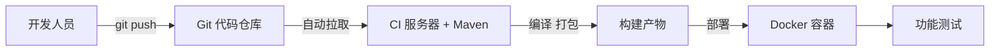
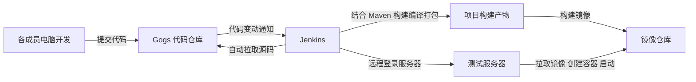

# 持续集成介绍：从提交代码到自动跑起来，中间全是机器的事

模块开发阶段，每个人的代码都躺在自己电脑里，看着相安无事；等所有人都说「做完了」再统一集成，报错往往一屏接一屏：接口对不上、依赖冲突、配置互相覆盖，测试人员提交回来的 bug 单能把排期直接打穿。问题不在某个人写得差，而在「集成」这件事被拖到了最后。持续集成要解决的正是这个拖字诀。

## 先给结论

- 持续集成（Continuous Integration，简称 CI）倡导团队成员经常性地集成各自的工作，甚至一天多次，每次集成都靠自动化构建完成。
- 自动化构建包含四个「自动」：自动获取仓库代码、自动编译、自动发布、自动测试，目标是尽早暴露集成问题。
- 一条完整 CI 流水线的主干是：开发者 push 代码到 Git 仓库，CI 服务器拉取代码并结合 Maven 构建，产物部署到 Docker 运行，再进入测试环节。
- 万信金融项目的工具链选型是：代码仓库用 Gogs，CI 服务器用 Jenkins，部署载体用 Docker，三者串起来就是后续几节要搭建的环境。
- 收益集中在四点：集成效率提升、问题修复更快、交付更快、产品质量更有保障。

## 传统流程卡在哪里

经典的协作流程是：项目经理把模块分给开发人员，各自并行开发并做单元测试，全部完成后统一集成部署到测试服务器，测试人员测出 bug 提交回来，开发修改后再集成、再测试，如此往复。这个流程最大的隐患在于集成的时机太晚。

**第一，模块之间依赖关系复杂，晚集成等于把矛盾攒着。** 各模块单独跑单元测试都能过，但模块间的接口约定、公共组件版本、配置项只在真正拼到一起时才会碰撞。攒到最后一次性集成，问题不是零散冒出来，而是成批爆发，而且互相纠缠，很难判断先修哪一个。

**第二，人工集成又慢又不可重复。** 拷代码、打包、上传、重启服务，每一步都靠人手执行，每次集成都要重来一遍，既耗时又容易因为某次漏了一步引入新问题。

持续集成的思路就是把「集成」从一次大事件变成一个日常动作：经常集成，甚至每天集成多次，而每一次集成全部交给自动化构建去完成。

## 一条 CI 流水线的主干

持续集成服务器（CI Server）是这条流水线的核心。配合流程图看会更直观，这张图讲的是从写代码到可测试环境之间的完整链路：



关键路径在中间两跳：CI 服务器自动从仓库取回整个项目的代码，与 Maven 结合完成编译打包，再把打包产物自动部署到 Docker 上启动起来。对开发者来说，自己要做的事被压缩成一步：小功能开发完，把代码 push 到 Git 仓库；从 push 到服务在新代码上跑起来，中间全部由 CI 工具接管。

落到具体命令上，这条流水线的每个环节都对应着熟悉的老朋友，只是以前由人敲，现在由 CI 服务器代敲：

```bash
# 持续集成流水线各环节对应的动作雏形（示例，按本课流程整理）
git push origin master                       # 1. 开发者推送代码到仓库
# 2. 仓库代码变动，通知 CI 服务器
mvn clean package -Dmaven.test.skip=true     # 3. CI 服务器结合 Maven 编译打包
docker-compose build && docker-compose up -d # 4. 构建镜像并启动容器，进入测试
```

## 万信金融项目的选型与流程

把流程图落到万信金融这个 P2P 项目上，链路基本一致，但每一环都有了具体的工具承担。这一节画面给出的工具链是：个人电脑通过 Git 连接 Gogs 或 GitLab 这类代码仓库，仓库对接 Jenkins，Jenkins 产出物交给 Docker 容器，最终运行在测试服务器上。本课的选型是 Gogs 加 Jenkins 加 Docker，前两者在后续两节安装配置。

这张图讲的是项目落地方案，从提交代码到测试的全部环节：



这张图的解读顺序是：Jenkins 收到仓库的通知后，自动从 Gogs 拉取整个项目的源码，交给 Maven 完成编译打包，把产物推送到镜像仓库；随后 Jenkins 远程登录测试服务器，让服务器从镜像仓库拉取镜像、创建容器并把项目启动。跑起来之后，测试人员就可以直接对新版本做功能验证。

整个链条里人的动作只剩一个：写完代码 push 上去。对比传统流程里反复出现的「拷代码、打包、上传、重启」，收益可以归纳成两条。

**第一，人力被解放。** 开发岗不必再扮演打包员，运维岗不必再盯着手动部署脚本敲命令，集成部署全自动完成。

**第二，集成测试前置到日常。** 平时就可以频繁地做集成测试，问题在提交当天就暴露出来，早发现早解决，开发的流程、效率、质量都随之提升。

## 常见误区

- **以为持续集成就是自动打包。** 错例：把 CI 理解成一个替人执行 `mvn package` 的按钮。正解：CI 覆盖获取代码、编译、发布、测试的完整链路，打包只是其中一环，部署与测试同样是流水线的组成部分。
- **以为要等所有模块开发完才有集成的必要。** 错例：个人模块没写完就不提交，攒到最后一起集成。正解：集成越频繁单次风险越小，小步提交让每次集成的变更范围可控，出问题也容易定位。
- **以为 CI 服务器会替代测试。** 错例：认为上了持续集成就不需要测试环节。正解：CI 把构建和部署自动化，让测试人员能更快拿到可测的新版本，功能验证与质量把关仍然要做。
- **以为工具选型只有一种。** 错例：认为做 CI 必须用某一特定产品组合。正解：代码仓库可选 Gogs、GitLab 或托管平台，CI 服务器可选 Jenkins 等，本课按内网自建、轻量易搭的思路选择 Gogs 加 Jenkins 加 Docker。

## 面试可能被问到的问题

1. 面试官追问：「什么是持续集成？它解决什么问题？」
   答：持续集成是一种团队协同实践，倡导成员经常集成各自的工作，甚至一天多次，每次集成通过自动化构建完成，包括自动获取代码、自动编译、自动发布和测试。它解决的是传统模式下集成时机太晚、模块间问题成批爆发、人工集成不可重复的问题，核心价值是尽早发现问题、尽快修复交付。
2. 面试官追问：「你们的持续集成流程是怎么走的？」
   答：开发者在本地完成开发后 push 代码到 Gogs 仓库，仓库代码变动通知 Jenkins，Jenkins 自动拉取源码并结合 Maven 编译打包，随后构建镜像推送，再远程登录测试服务器拉取镜像、创建容器并启动，最后在测试环境做功能验证。人的动作只有 push 代码这一步。
3. 面试官追问：「持续集成带来了哪些具体好处？」
   答：四个方面：自动化集成部署提高了集成效率；问题能更早暴露所以修复更快；可测版本产出更频繁所以交付更快；频繁小步集成让缺陷始终处于可控范围，产品质量更有保障。
4. 面试官追问：「CI Server 在流程里承担什么角色？」
   答：它是流水线的调度中枢，上游接收代码仓库的变动通知，自动拉取全量源码；中游驱动 Maven 完成编译打包；下游负责把构建产物部署到 Docker 并让服务在新代码上运行，全链路无需人工介入。
5. 面试官追问：「为什么部署环节选择 Docker？」
   答：Docker 把服务连同运行环境打包成镜像，构建产物在开发、测试环境之间以同一镜像流转，避免了「在我机器上能跑」的环境差异问题；配合容器秒级启动的特性，CI 流水线的部署环节可以做到快速且可重复。

## 配套资料

- 讲义：`materials/docs/10/万信金融-讲义-项目部署v1.0.md`，持续集成概念、P2P 项目持续集成流程与搭建持续集成环境的章节与正文口径一致。
- 讲义：`materials/docs/10/Gogs安装文档.md`、`materials/docs/10/Jenkins安装文档.md`，流水线两端工具的安装文档，对应后续两篇的实操步骤。
- 代码：`materials/code/10/wanxinp2p/`，P2P 工程归档（目录保留原始命名，路径只列到该层级），持续集成流水线构建的对象就是这套多模块工程。
- 说明：流水线命令雏形为按本课流程整理的示例；Gogs 与 Jenkins 的具体安装命令在后续两篇以安装文档原文给出。
