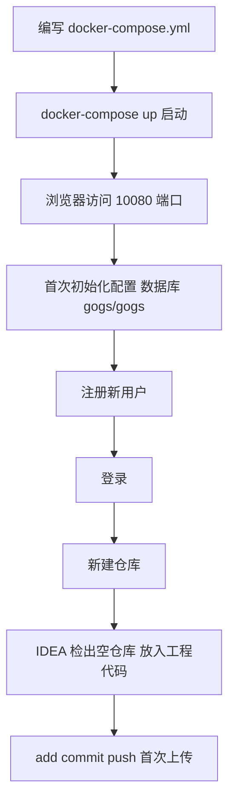

# Gogs 的安装和使用：给持续集成搭一个自己的代码仓库

持续集成的第一环是代码仓库：CI 服务器要从仓库拉代码，仓库要在代码变动时通知 CI 服务器。GitHub、码云这类在线托管平台对所有人开放，但企业项目放在公网平台上既不便管理也不合安全要求，内网自建一套 Git 服务才是常见做法。Gogs 就是为此而生的轻量选择。

## 先给结论

- Gogs 是一个用 Go 语言开发的开源代码仓库管理系统，以 Git 为底层，提供 Web 界面，功能与 GitHub 相似，企业通常用它在内网搭建自己的 Git 代码管理仓库。
- 与 GitLab 相比，Gogs 的优势是搭建最简单、最快速、最轻松，单一二进制分发且支持 Go 语言覆盖的所有平台，包括 Linux、Mac OS X、Windows 与 ARM。
- 本课用 Docker Compose 安装 Gogs，一个 `docker-compose.yml` 同时定义 Gogs 与它专用的 MySQL 5.7.21，一条 `docker-compose up` 拉起整套服务。
- 装好之后的使用路径：初始化配置、注册用户、登录、新建仓库，然后在 IDEA 里配置 Git、检出空仓库、放入工程代码，add、commit、push 三步完成首次上传。

## Gogs 在仓库选型里的位置

Git 是版本控制系统，负责把本地代码的每次修改记录成版本；而「仓库」指的是存放这些版本并提供协作能力的远程 Git 服务。GitHub 与码云是在线平台，功能几乎一致，码云可以理解为汉化版 GitHub，两者都是别公司在公网上对所有人开放的托管服务。GitLab 与 Gogs 则主攻企业内部或局域网自建场景。

个人测试用 GitHub 或码云直接免费托管即可；企业项目要自建时，Gogs 相比 GitLab 更轻，安装维护的成本小得多，这正是它被选为本课代码仓库的原因。装好后浏览器访问的效果与 GitHub、码云没有明显差别，用法也一样：注册账号、建仓库、push 代码。

## 安装：一个 compose 文件拉起两个容器

Gogs 内部需要一个数据库来存用户、仓库元数据等信息，本课直接复用 MySQL。安装文档给出的做法是新建一个 `gogs` 目录，在其中编写 `docker-compose.yml`，同时定义 Gogs 与专用 MySQL 两个服务：

```yaml
# 文件：gogs/docker-compose.yml，按 Gogs 安装文档原文整理
gogs:
  image: docker.io/gogs/gogs:latest
  links:
    - mysql-gogs:mysql
  ports:
    - "10022:22"
    - "10080:3000"
  volumes:
    - "./data:/data/gogs"
    - "./repo:/data/git/gogs-repositories"
  restart: always

mysql-gogs:
  image: docker.io/mysql:5.7.21
  ports:
    - "3306:3306"
  volumes:
    - ./mysql-gogs/mysql:/var/lib/mysql
    - ./mysql-gogs/conf.d:/etc/mysql/conf.d:rw
  environment:
    - MYSQL_DATABASE=gogs
    - MYSQL_USER=gogs
    - MYSQL_PASSWORD=gogs
    - MYSQL_ROOT_PASSWORD=root
  command: mysqld --lower_case_table_names=1 --character-set-server=utf8mb4 --collation-server=utf8mb4_general_ci
  restart: always
```

配置里有三处值得留意。`links` 把 MySQL 容器以别名 `mysql` 挂给 Gogs，Gogs 内部连库用的主机名就是 `mysql`；端口映射 `10080:3000` 把 Gogs 容器内的 3000 端口映射到宿主机 10080，`10022:22` 则是 SSH 协议用的 22 端口；MySQL 的启动参数强制了 `lower_case_table_names=1` 与 `utf8mb4` 字符集，这是 Gogs 建表能正常进行的前提。

启动只需要一条命令：

```bash
cd gogs
docker-compose up
```

启动完成后浏览器访问 `http://127.0.0.1:10080/`。初次访问需要等待一段时间，然后进入基本配置页，数据库用户名和密码填写 `gogs/gogs`，数据库地址、端口按前文 `docker-compose.yml` 的定义填写即可。初始化只需这一次，之后直接登录使用。

安装与首次上传的完整路径可以用一张图串起来：



这张图的关键分界在 D 到 G：初始化与注册是一次性的工作，新建仓库之后进入的才是日常开发节奏。

## 建仓库与推送代码

初始化成功后，通过注册页 `http://127.0.0.1:10080/user/sign_up` 新建用户，填写用户名、邮箱、密码即可，注册成功后登录，界面与平时使用 GitHub 或码云的体验一致。

登录后新建仓库：拥有者保持默认，仓库名称自己起，伟大的仓库名一般都很短，本课起名为 `p2p`；描述写一句介绍性的文字；`.gitignore` 模板选择 Java（项目是 Java 开发的，不选也可以，后续可以自己补）；其余选项保持默认，点击创建即可。创建完成后进入项目主页，页面上会给出这个仓库的 Git 地址，后面检出和推送都靠它。

接下来是把已经在 IDEA 里开发好的万信金融 P2P 工程推上去，操作分五步。

**第一步，在 IDEA 中集成 Git。** 打开 Settings 搜索 Git，把可执行文件路径指向本机安装的 Git，例如 `C:\Program Files\Git\bin\git.exe`；旁边还有一个让包含变更的父级目录显示不同颜色的选项，勾上便于区分改动位置，不勾也不影响功能。

**第二步，从 Gogs 检出空项目。** 通过 VCS 菜单里的检出功能选择 Git，填入刚才的仓库地址和本地目标目录，把空仓库检出到本地。

**第三步，把开发好的工程复制进去。** 将之前开发的项目代码整体复制粘贴到检出的目录中。

**第四步，创建 `.gitignore`。** 在工程根目录新建该文件，声明提交时忽略的内容，避免把本地产物和 IDE 配置推上仓库：

```text
# 工程根目录 .gitignore，按 Gogs 安装文档原文整理
.idea/
target/
*.iml
```

**第五步，add、commit、push 三连。** 先执行 add 把文件纳入版本控制，再 commit 提交到本地仓库，最后 push 到 Gogs 远程仓库。push 完成后刷新仓库主页，整个工程就都在上面了。

## 常见误区

- **以为 Gogs 和 GitHub 是同类场景的工具。** 错例：纠结要不要在内网也用在线托管平台。正解：GitHub 与码云是公网在线服务，Gogs 与 GitLab 面向企业内网自建，私密性与可控性不同，按项目归属选择。
- **以为安装 Gogs 还要单独配数据库。** 错例：手动装 MySQL 再逐项建库授权。正解：安装文档的 compose 文件已经把专用 MySQL 一并定义，环境变量里连库名、账号、密码都配好了，初始化页面照着填即可。
- **首次 push 忘记创建 `.gitignore`。** 错例：直接 add 全部文件，把 `target/` 编译产物、`.idea/` 配置、`*.iml` 都推上仓库。正解：检出后先放 `.gitignore` 再复制代码，让忽略规则从一开始就生效。
- **把初始化配置当成每次登录都要做的事。** 错例：每次访问 10080 都在找配置入口。正解：数据库等基本配置只在初次访问出现一次，之后正常登录使用即可。

## 面试可能被问到的问题

1. 面试官追问：「你们为什么自建代码仓库而不用 GitHub？」
   答：项目属于企业内部工程，源码放在公网托管平台有安全与合规风险，管理权限也不可控。用 Gogs 在局域网自建，功能与 GitHub 相似，团队协作、权限管理都在自己手里，而且它用 Go 语言开发，部署轻量，搭一套环境的成本很低。
2. 面试官追问：「Gogs 和 GitLab 都能自建，为什么选 Gogs？」
   答：Gogs 的定位是以最简单、最快速、最轻松的方式搭建自助 Git 服务，相比 GitLab 更轻量，通过独立的二进制分发，支持 Linux、Mac OS X、Windows、ARM 等平台。团队规模不大、只需要核心的仓库管理能力时，Gogs 的安装维护成本明显更低。
3. 面试官追问：「Gogs 安装时为什么要配一个专用 MySQL？」
   答：Gogs 的用户、仓库元数据等都要落到数据库里。安装文档用 Docker Compose 把 Gogs 和专用 MySQL 一起编排，MySQL 启动参数指定了表名小写敏感与 utf8mb4 字符集，保证 Gogs 初始化建表正常，专用实例也避免了和业务库互相干扰。
4. 面试官追问：「`.gitignore` 一般忽略什么？为什么？」
   答：常见的是 `.idea/`、`target/`、`*.iml` 这类 IDE 配置与编译产物。它们由本地环境自动生成，内容随构建变化，入库只会造成冲突和噪音，仓库里应该只保留真正需要版本控制的源码与配置。
5. 面试官追问：「把已有工程首次推送到空仓库，步骤是什么？」
   答：先在 IDEA 里配置本机 Git 路径完成集成，再从远程空仓库检出到本地目录，把工程代码复制进去并放好 `.gitignore`，然后依次执行 add、commit、push，三步之后代码就进入远程仓库了。

## 配套资料

- 讲义：`materials/docs/10/Gogs安装文档.md`，`docker-compose.yml` 全文、启动与初始化步骤、新建仓库与 Git 管理项目的操作清单均出自该文档。
- 讲义：`materials/docs/10/万信金融-讲义-项目部署v1.0.md`，其中 3.2.1 节对 Gogs 的定位与优势描述与正文一致。
- 代码：`materials/code/10/wanxinp2p/`，P2P 工程归档（目录保留原始命名，路径只列到该层级），推送到 Gogs 的工程主体。
- 说明：Gogs 注册页地址、端口映射、`.gitignore` 内容均按安装文档原文给出；IDEA 中菜单操作为按文档步骤与画面线整理的通用写法。
