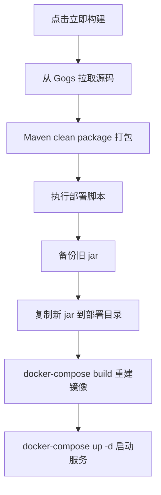
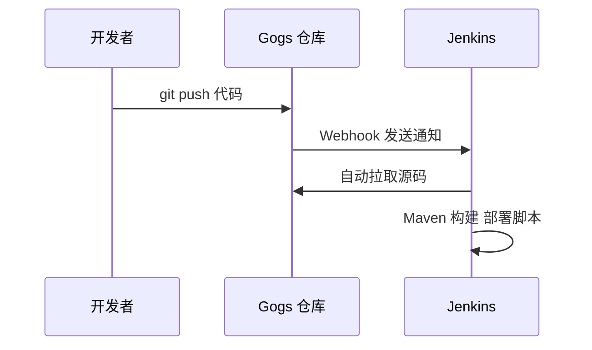

# Jenkins 构建任务实战：从手动点一次到提交代码自动跑

仓库 Gogs、CI 服务器 Jenkins 都装好配好了，持续集成流程还停在纸面上。让流程真正跑起来的载体，是 Jenkins 里的构建任务：持续集成流程图上的每一环，翻译成 Jenkins 的话术就是一个 Maven 类型任务的若干配置项。这一篇把任务建起来、手动跑通一次，再用 Gogs 的 Webhook 把「手动点构建」这最后一个人工动作也去掉，形成提交代码即自动构建的完整闭环。

## 先给结论

- 持续集成流程在 Jenkins 里的对应物是构建任务，任务类型选「构建一个 Maven 项目」，因为万信金融 P2P 工程本身就是 Maven 多模块工程。
- 任务的三项核心配置：源码管理填 Gogs 仓库地址并选择此前配置的凭据；Build 环节执行 `clean package -Dmaven.test.skip=true`；Post Steps 执行提前上传到服务器的部署脚本。
- 部署脚本的职责是备份旧 jar、把 Jenkins 打包出的新 jar 复制到部署目录、`docker-compose build` 重建镜像、`docker-compose up -d` 启动服务。
- 自动构建有定时触发与代码变动触发两种思路，本课选后者：没有人提交代码时定时构建毫无意义，push 触发才符合「经常集成」的本意。
- Gogs 侧配置 Webhook，推送地址格式固定为 `http(s)://<Jenkins 地址>/gogs-webhook/?job=<Jenkins 任务名>`，触发事件选 push；点击「测试推送」或在 IDEA 里 commit 加 push，Jenkins 就会自动开始新一轮构建。

## 创建任务：给流水线一个名字

回到 Jenkins 主界面，左侧菜单第一项就是「新建任务」。填一个任务名称，本课起名 `p2p`，名称可以随意，但要记得住，因为配置 Webhook 时任务名还要用；类型选择「构建一个 Maven 项目」，点确定进入配置页。任务列表里那些已经存在的条目就是其他构建任务，它们旁边的颜色状态后面会用到。

任务配置页的项很多，真正决定流水线走向的是三块：源码管理、Build、Post Steps。

**源码管理，告诉 Jenkins 从哪拉代码。** 选择 Git，仓库地址填 Gogs 上新建的那个仓库地址，例如 `http://192.168.100.10:10080/study/p2p.git`，格式与自己在 Gogs 项目主页上看到的地址一致；凭据一栏选择前面在凭据配置里添加的那条仓库账号密码，配置正确的话下拉列表里就能直接选到。这一步做完，Jenkins 就具备了自动获取整个项目源码的能力。

**Build 环节，告诉 Jenkins 怎么构建。** 命令在 Goals 输入框里填：

```bash
clean package -Dmaven.test.skip=true
```

就是最熟悉的先清理再打包，后面追加的参数用于跳过测试：打包过程中跑一遍全部测试类既拖慢构建也没有必要，功能验证放在部署之后由测试环节做。这条命令对应流程图里「结合 Maven 编译打包」那一环。

**Post Steps，告诉 Jenkins 构建成功后干什么。** 选择执行 shell，命令只有一行：

```bash
sh /home/p2p/scripts/deployP2P.sh
```

脚本要提前上传到服务器的某个位置，这里填的路径就是脚本在服务器上的真实位置，各人环境不同，路径不能照抄。脚本本体在课件里提供，下面拆开看它做了什么。

## 部署脚本：备份、替换、重建、启动

脚本按职责分成四段，以从讲义原文整理的版本为准（服务名按语义化命名改写，去掉了原始工程前缀）：

```bash
#!/bin/sh
# 时间戳
now_datetime=`date +%Y%m%d%H%M%S`
# 版本
app_version="1.0-SNAPSHOT"
# 全部服务（按本课工程模块整理，采用语义化命名）
service1="account-service"
service2="consumer-service"
service3="depository-agent-service"
service4="discover-server"
service5="gateway-server"
service6="repayment-service"
service7="transaction-service"
service8="uaa-service"
service12="content-search-service"

# 备份：把各服务当前在用的 jar 挪进按时间戳命名的备份目录
cd /home/p2p/wanxinp2p
mkdir ./bak/${now_datetime}
mv -v ${service1}/*.jar ${service2}/*.jar ${service3}/*.jar \
   ${service4}/*.jar ${service5}/*.jar ${service6}/*.jar \
   ${service7}/*.jar ${service8}/*.jar ${service12}/*.jar \
   -t ./bak/${now_datetime}/

# 复制 Jenkins 打包后的 jar 到部署目录（每个服务一条，此处列两条示意）
cp -v /var/lib/jenkins/workspace/p2p/${service1}/target/${service1}.jar \
      ./${service1}/${service1}-${app_version}.jar
cp -v /var/lib/jenkins/workspace/p2p/${service2}/target/${service2}.jar \
      ./${service2}/${service2}-${app_version}.jar

# 重新构建镜像并启动
/usr/local/bin/docker-compose build
/usr/local/bin/docker-compose up -d
```

**第一段是备份。** 先用 `date` 生成精确到秒的时间戳，在部署目录下建一个以时间戳命名的备份目录，再把各服务目录里现存的 jar 全部 `mv` 进去。这一步是给自己留退路：万一这次构建出的包有问题导致服务挂掉，还能找回上一个能跑的版本。

**第二段是替换。** Jenkins 拉取源码执行 `mvn package` 后，产物在各模块的 `target` 目录里，脚本逐个服务把新 jar 用 `cp` 复制到对应的部署目录，文件名带上版本号 `1.0-SNAPSHOT`。Jenkins 工作空间路径 `/var/lib/jenkins/workspace/p2p` 中的任务名与前面创建的任务对应。

**第三段和第四段是重建与启动。** `docker-compose build` 基于新 jar 重新构建各服务镜像，`docker-compose up -d` 让容器在新镜像上运行。到这里，从源码到运行中的服务，整条链路全部执行完毕。

## 手动跑一次：构建编号与控制台输出

任务保存后点击返回面板，列表里就能看到新建的 `p2p` 任务。点任务名旁边的「立即构建」，任务就开始执行了，这就是手动构建：点一次构建一次。

观察构建状态有几个固定的信号。

**第一，构建编号。** 每构建一次编号加一，界面上的 `#1` 表示第一次构建。`#5` 就是第五次，编号旁边的进度条在动，说明构建正在进行。

**第二，颜色状态。** 红色表示最近一次构建失败，蓝色表示成功，灰色表示任务创建之后还没有构建过。列表里多个任务的状态一眼就能扫出来。

**第三，控制台输出。** 点击进入某次构建，打开「控制台输出」，这里是排查问题的主战场：拉代码、Maven 各模块的编译打包、脚本执行，每个环节的日志都在里面滚动。看到 `BUILD SUCCESS` 只能说明打包这一步成功了，后面还有部署脚本的环节要继续跑，整个构建完成会给出最终的成功标记。构建过程相当耗时，几分钟是常态，期间耐心等控制台输出刷完即可。

任务名称旁边的下拉菜单里还有「重新配置」「删除」等选项，配置想调整就点重新配置回到配置页，不需要的任务可以整体删掉。每次构建时 Jenkins 会把源码检出到自己的工作空间目录里再执行打包，前文脚本里复制的 `/var/lib/jenkins/workspace/p2p` 正是这个工作空间，理解了这一点，脚本里那段路径从哪来就清楚了。

一次手动构建的完整链路可以用这张图概括，每个节点都能在控制台输出里找到对应的日志段：



构建失败也很正常，代码本身有问题或者任务配置填错都会失败。此时回控制台输出找报错位置，修正后重新点构建即可，手动构建的意义正是把流水线调试到能稳定跑通。

## 从手动到自动：为什么要 push 触发

手动构建跑通后，新的别扭出现了：构建动作本身还是要人点。每提交一次代码就得登录 Jenkins、找到任务、点一次菜单，虽然比纯手工部署好得多，但离「经常集成、全自动」的目标还差一步。让构建自动触发有两种常见做法。

**第一种是定时触发。** 在 Jenkins 任务里配一个定时器，比如每隔五分钟或每四个小时自动构建一次，频率完全自定义。问题在于定时器不看代码的脸色：四个小时里如果没有任何人提交代码，这次构建就是在原样重打一个没有任何变化的包，纯属浪费机器资源；反过来提交高峰期，两次定时构建之间的间隔又可能太长。

**第二种是代码变动触发。** 仓库里有代码 push 进来才构建，没人提交就不动。这才是持续集成「倡导经常集成、每次集成都由代码变动驱动」的本意，本课采用的是这一种。两种方式的差别摆在一张表里更直观：

| 对比维度 | 定时触发 | push 触发 |
|---|---|---|
| 触发条件 | 到点就构建，不看代码 | 代码有变动才构建 |
| 无提交时段 | 空转构建，浪费资源 | 完全静默 |
| 提交密集时段 | 两次构建间可能积压 | 逐次通知逐次构建 |
| 与持续集成理念的契合度 | 形似而神不似 | 本意所在 |

实现的技术载体是 Webhook，翻译过来叫钩子：Gogs 上安装的 Gogs 插件让 Jenkins 具备了接收钩子通知的能力，而 Gogs 侧要配置「有 push 时向哪里通知」。触发关系画出来是这样的：



这张图的时序就是自动构建的全部原理：通知的发起方是 Gogs，所以配置工作要在 Gogs 仓库侧完成。

## 配置 Webhook：三步接通通知

进入 Gogs 上自己的 `p2p` 仓库，按三步配置。

**第一步，找到入口。** 仓库页面的「仓库设置」里，点击「管理 Web 钩子」，再点「添加 Web 钩子」，类型选择 Gogs。

**第二步，填推送地址。** 格式是固定的，照着写：

```text
http(s)://<你的Jenkins地址>/gogs-webhook/?job=<你的Jenkins任务名>
```

换成实际环境就是 `http://192.168.100.10:8091/gogs-webhook/?job=p2p`：中间一段是 Jenkins 服务器的 IP 与端口，`/gogs-webhook/` 是固定写法不能改动，`job=` 后面的参数是 Jenkins 任务名，必须与创建任务时起的名字一字不差。数据格式保持默认，触发事件勾选「推送事件」，含义是只在有代码 push 时才通知。

一个仓库可以添加多条钩子，同时对接多个 Jenkins 任务；钩子列表里每条记录还能单独管理，配错了可以删除重建。这个地址的本质是 Jenkins 暴露给 Gogs 的一个接收接口，Gogs 只负责在 push 发生时往这个接口投递通知，剩下的事全部由 Jenkins 自己决定：找到 `job` 参数指定的任务，触发一轮新的构建。

**第三步，保存并测试。** 配置保存后，钩子列表里会出现这条记录。Gogs 提供了「测试推送」按钮，作用是模拟一次代码提交，验证整条通知链路通不通。点下测试推送后回到 Jenkins 刷新，不需要任何人点「立即构建」，新一轮构建已经自动出现并开始执行了，这就证明 Webhook 生效。

## 真实场景验证：改一行代码，看它自己跑

测试推送只是模拟，真实链路还差一发实弹验证，操作全在 IDEA 里完成。

随便挑一个文件改一点东西，比如空一行，让代码确实发生变化，然后走 Git 的固定动作：先 commit 提交到本地仓库，再 push 到 Gogs 远程仓库。push 显示成功的那一刻，事情已经交给机器了：Gogs 检测到 push，通过刚配置的钩子向 Jenkins 发出通知，Jenkins 自动拉取源码、执行 Maven 构建、跑部署脚本。回到 Jenkins 页面刷新，即使上一次构建还没结束，新一轮构建也已经自动排上并开始执行，控制台输出里能看到熟悉的构建日志在滚动。

到这里，开头那张持续集成流程图就完全落地了：开发者在 IDEA 里该怎么开发怎么开发，一个小功能写完，本地测一测就 commit 加 push；从 push 往后，通知、拉代码、构建、部署、启动，全部自动完成，一天集成多少次都不需要人工介入。传统开发流程里「最后统一集成、问题成批爆发」的局面，被日常化的自动集成彻底消解。这套环境搭起来之后，团队开发、运维两个岗位都从重复劳动里退了出来：开发只管写代码和提交，集成部署的细节由流水线保证每次都按同样的步骤执行，出问题时备份目录里永远留着上一个能跑的版本。

## 常见误区

- **以为构建失败说明任务建错了。** 错例：看到红色失败就推倒重来重建任务。正解：失败先看控制台输出定位环节，是代码问题还是配置问题；手动构建阶段的价值就是把这些问题在自动化之前暴露掉。
- **把 `BUILD SUCCESS` 当成整个构建成功。** 错例：日志里见到打包成功就关掉页面。正解：Maven 打包成功只是 Post Steps 的前置条件，备份、替换 jar、重建镜像、启动容器都在后面，要以构建的最终结果为准。
- **自动构建选择定时器。** 错例：为了「自动化」给任务配每四小时构建一次。正解：定时触发不看代码是否变化，空转构建浪费资源又拖慢响应；push 触发保证每次构建都对应一次真实的代码变更。
- **Webhook 地址随手写。** 错例：把任务名拼错，或改动了 `/gogs-webhook/` 固定路径，导致 Gogs 通知发出去 Jenkins 却不认。正解：地址三段式各就各位，Jenkins 地址与端口、固定路径、`job=` 后的任务名都要与实际环境一致，配完用「测试推送」验证。
- **以为部署脚本路径可以照抄。** 错例：把别人环境里的脚本路径原样填进 Post Steps。正解：脚本要提前上传到自己服务器的某个位置，Post Steps 填的是脚本在自己环境里的真实路径。

## 面试可能被问到的问题

1. 面试官追问：「Jenkins 里的构建任务都配了什么？」
   答：以万信金融项目的 Maven 多模块工程为例，任务类型选「构建一个 Maven 项目」。三项核心配置：源码管理选 Git，填 Gogs 仓库地址并绑定仓库账号的凭据；Build 环节执行 `clean package -Dmaven.test.skip=true`，打包并跳过测试；Post Steps 用执行 shell 调用部署脚本完成备份、替换 jar、重建镜像和启动容器。
2. 面试官追问：「构建后的部署脚本是你们自己写的吗？做了什么？」
   答：脚本按职责分四段：先用时间戳建备份目录把旧 jar 挪进去，给回滚留退路；再把 Jenkins 工作空间里各模块 target 下的新 jar 复制到部署目录；然后 `docker-compose build` 重建镜像；最后 `docker-compose up -d` 启动容器，服务就运行在新代码上了。
3. 面试官追问：「自动构建为什么不用定时任务实现？」
   答：定时任务不看代码状态，没有提交时也会空转构建，白白消耗资源，提交密集时响应又不够及时。用 Gogs 的 Webhook 做代码变动触发，每次构建都对应一次真实 push，才符合持续集成经常集成、尽早暴露问题的本意。
4. 面试官追问：「Webhook 自动触发的原理是什么？」
   答：Gogs 侧配置推送地址，格式为 Jenkins 地址加固定的 `/gogs-webhook/` 路径再加 `job=` 任务名参数，触发事件选 push。开发者 push 代码后 Gogs 主动向该地址发通知，Jenkins 收到后定位到对应任务，自动执行拉代码、构建、部署的完整流程，全程无需人工点击。
5. 面试官追问：「构建状态怎么判断？失败了怎么排查？」
   答：任务列表看颜色，蓝色成功、红色失败、灰色未构建；每次构建有递增编号，如 #1、#5。排查靠控制台输出，拉代码、Maven 编译打包、部署脚本的日志都在其中，按报错位置定位是代码问题还是配置问题，修正后重新构建。
6. 面试官追问：「你们从写完代码到能测，要等多久？」
   答：push 之后流程全自动，但构建本身耗时可观，微服务多模块工程打一次包加上镜像重建，几分钟到更久都有可能。这段时间不需要人守着，看控制台输出确认各环节通过，构建结束测试环境就已经是新版本，可以直接做功能验证。

## 配套资料

- 讲义：`materials/docs/10/万信金融-讲义-项目部署v1.0.md`，3.3 节创建持续集成任务、Maven 构建指令、`deployP2P.sh` 部署脚本原文与 Webhook 自动构建的配置说明均出自该文档。
- 讲义：`materials/docs/10/Jenkins安装文档.md`、`materials/docs/10/Gogs安装文档.md`，构建任务依赖的插件、凭据与仓库环境在这两份文档中安装配置。
- 代码：`materials/code/10/wanxinp2p/`，P2P 工程归档（目录保留原始命名，路径只列到该层级），构建任务打包的各服务模块即出自这套工程。
- 说明：部署脚本按讲义原文整理，服务名与工作空间路径按本课语义化命名口径改写；仓库地址、Jenkins 地址均为示例占位，Webhook 地址格式为讲义原文模板。
