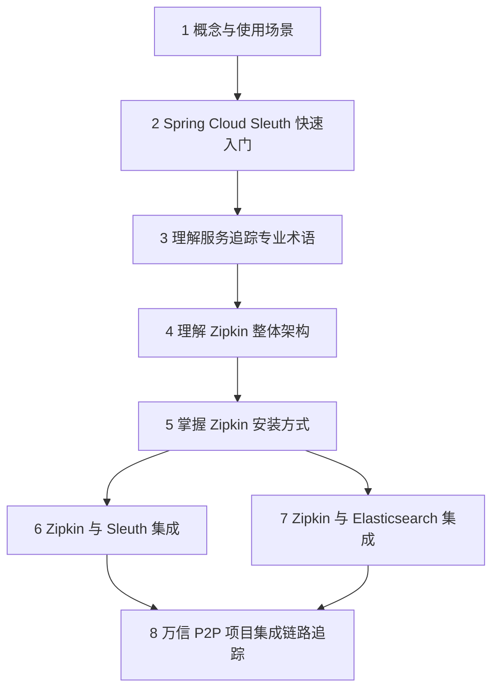
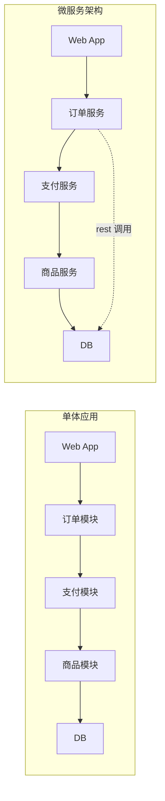
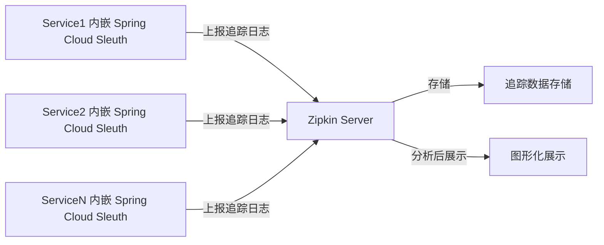
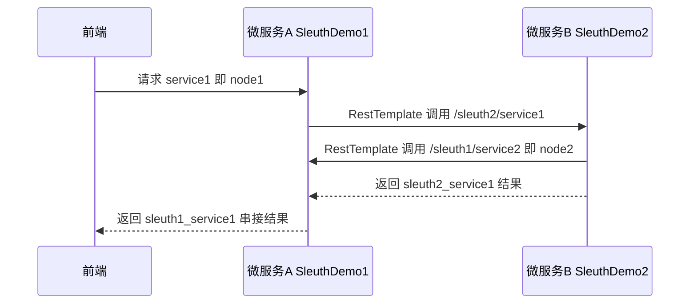

# 服务调用链路追踪全解：从问题分析到 Sleuth 接入与 traceId 实证

## 先给结论

- 万信金融项目「服务调用链路追踪」章节 6 课合并为一篇完整长文，按「学习目标→问题分析→解决方案→Sleuth 快速上手→入门案例→功能测试」的顺序，走完链路追踪的动机、方案选型与第一次实证。
- 系列要解决的问题起点：微服务化没有消灭复杂度，只是把它从业务本身转移到了服务间协作，一次前端请求在后端形成跨越几十个节点的调用链，任何一环出错或变慢都难定位；即使所有服务都正常，整体变慢也需要每一环的耗时数据才能分析。
- 排障需要三类信息：服务调用依赖图、链路错误信息、各阶段耗时信息；获取思路是在微服务调用前后记追踪日志，靠请求追踪编号把散落在各服务的日志串成一条链。
- 方案不必自研：Spring Cloud Sleuth 以 jar 形式嵌入每个微服务，负责在调用发生时自动产生追踪日志并上报；Zipkin 是独立服务端，负责汇总、存储并通过 UI 图形化展示调用链与依赖关系；Zipkin 默认数据存内存，生产可用还要集成 Elasticsearch 做持久化，这是本系列后续的独立知识点。
- 接入 Sleuth 只需两步：引入 `spring-cloud-starter-sleuth` 依赖、配置 `spring.sleuth.enabled=true`，业务代码零改动；接入生效的标志是每条日志前面多出 `[applicationName, traceId, spanId, export]` 四段追踪信息。
- 两个 ID 的分工要分清：traceId 标识一条完整请求链路，同链路内所有日志相同；spanId 标识链路上的一次具体调用，每次调用各不相同；export 在未对接追踪服务端时为 false，属正常状态。
- 入门案例用两个微服务加 RestTemplate 构造 A→B→A 的三跳调用链，功能测试的核对对象不是页面返回，而是两个服务控制台日志：同一链路 traceId 完全相同、spanId 各不相同，即证明追踪生效；图形化链路、Zipkin 集成与项目实战在后续课程展开。

## 第1部分：服务调用链路追踪-学习目标

万信金融项目的主线业务已经走完，持续集成与部署也搭好了流水线，第八章进入微服务高级部分。这一章开出的第一个课题是服务调用链路追踪：在几十个微服务互相调用的系统里，一次请求出了错、变慢了，问题到底出在哪个环节。这门课先用一段视频交代清楚教学目标，动工之前把学习地图铺开，每一块要达到什么程度、最后要落回项目的哪个位置。

### 为什么这一章从「目标」讲起

任何新知识点的学习路径都是一样的：先知道它是什么、用在什么场景，再学具体工具，最后落到自己的项目里。链路追踪这个课题尤其如此，因为它不是一个独立的功能点，而是横跨所有微服务的基础设施。在动手引依赖、配组件之前，需要先回答三个问题：要追踪的是什么、追踪到的数据长什么样、数据最终给谁看。

这三个问题的答案就藏在八条教学目标里。把八条目标按依赖关系排成一张学习地图，可以看到明显的递进结构：概念先行，工具随后，集成收尾，项目验证兜底。



这张图里 1 到 3 是打地基：没有「服务调用链路」这个概念，后面的一切工具都没有语境；没有 traceId、spanId 这类专业术语，日志里那一串数字也读不懂。4 到 7 是主体：Sleuth 负责在微服务内部产生追踪数据，Zipkin 负责把这些数据汇总存储并以图形化界面展示，两条集成路径分别解决「数据怎么送过去」和「数据怎么留下来」。第 8 条是归宿，所有演示案例跑通之后，回到项目里给网关、统一账户等真实微服务装上追踪。

### 四块内容分别要达到什么程度

**第一块，概念与使用场景，要求能说出来。** 这一块的认知目标是「能够说出服务调用链路追踪的概念以及使用场景」。微服务架构下每个前端请求在后端会形成一条调用链，链路上任何一环出错或变慢都会影响整个请求，链路追踪就是让这条链变得可见的技术。概念层面要能用自己的话讲清楚它解决什么问题，场景层面要能举出排障和性能分析两类典型用途。

**第二块，Spring Cloud Sleuth 快速入门，要求掌握接入。** Sleuth 属于 Spring Cloud 的组件，定位是调用链监控工具的客户端，集成在各微服务上负责产生调用链监控数据。这一块要亲手完成依赖引入与配置开启，并在控制台日志里认出 Sleuth 打上的追踪标记。

**第三块，Zipkin 的架构与安装，要求理解加掌握。** Zipkin 源自 Twitter 的开源项目，致力于收集服务的实时数据以解决微服务架构中的延迟问题，覆盖数据的收集、存储、查找和展现。要理解它的整体架构（服务端、数据存储、UI 展示三层），掌握以独立 jar 包方式启动 Zipkin 服务端的安装方法。

**第四块，两组集成，要求掌握方式并理解取舍。** Zipkin 与 Sleuth 的集成解决数据上报：微服务引入 zipkin 依赖、配置服务端地址，追踪日志自动上报。Zipkin 与 Elasticsearch 的集成解决数据持久化：通过 `STORAGE_TYPE` 与 `ES_HOSTS` 启动参数把存储切换到 ES。两条集成路线最后都要在万信金融 P2P 项目里真实演练，以登录功能为测试场景，验证 `gateway-server → uaa → account-service` 这条真实调用链能否在 Zipkin 界面完整呈现。

先把最终要写进工程里的东西预告出来，后面每一块学完都会回来对照。依赖层面是两个 starter：

```xml
<!-- 最终要加入公共 API 工程的依赖 按讲义口径整理 -->
<dependency>
    <groupId>org.springframework.cloud</groupId>
    <artifactId>spring-cloud-starter-sleuth</artifactId>
</dependency>
<dependency>
    <groupId>org.springframework.cloud</groupId>
    <artifactId>spring-cloud-starter-zipkin</artifactId>
</dependency>
```

配置层面是三个关键项：开启追踪、指定 Zipkin 服务端地址、设置采样率：

```yaml
# 集成完成后的核心配置预览 按讲义口径整理
spring:
  sleuth:
    enabled: true            # 开启 sleuth
    sampler:
      probability: 1         # 采样率 取值 0 到 1
  zipkin:
    base-url: http://localhost:9411   # zipkin 服务端地址
```

这两段现在看不懂没关系，它们就是八条目标里 2、6、8 三条的直接产物，学完对应章节再回头看会非常清晰。

### 学完之后手里多了什么

这一章交付的不是某个业务功能，而是一套排障能力。学完之后，面对一次失败的或缓慢的请求，手里多了三样东西：能查到这次请求经过了哪些服务、每个环节耗时多少、错误发生在哪一跳。Zipkin 的 UI 上可以直接看到整条链路与每个调用的耗时明细，也能以依赖图的形式看清微服务之间的调用关系。这些信息正是微服务排障最稀缺的资源，也是后续做性能优化时最硬的依据。

## 第2部分：服务调用链路追踪-问题分析

一个前端请求失败或者变得奇慢无比，报错信息却指向不了任何具体服务，日志散落在十几个节点上翻也翻不完。这是微服务团队几乎每天都可能撞上的场景，也是链路追踪这门课要解决的原始问题。在引入任何工具之前，先把问题本身拆开看清楚：它从哪来、难在哪、为什么靠人力和普通日志解不掉。

### 复杂度被转移到了哪里

分布式架构与微服务设计理念流行之后，系统被拆成若干个小服务。一个形象的类比：以前一个复杂的工作交给一个人干，这个人自然觉得负担太重；现在把这项工作拆成十份交给十个人，每个人手上的活确实简单纯粹了。

但工作总量没有变少，复杂度只是换了个地方待。原来是「一个人干十件事」的负担，现在是「十个人协作干十件事」的协调成本。十个人要完成彼此衔接的工作，就必须相互传递中间结果，映射到系统里，就是服务与服务之间的相互调用。调用关系越织越密，复杂度就转移到了服务协作的架构层面。

用下单这个经典例子对照看，差异一目了然：



左图里所有业务都在同一个进程内，模块之间是方法调用，出了问题断点一打全链路尽收眼底。右图里每个模块变成独立部署的服务，模块间通过 rest 调用协作，调用要过网络、要序列化、要依赖注册中心与负载均衡，任何一步都可能单独失败。随着业务不断扩张，服务之间互相调用会越来越复杂。

### 服务调用链路：一个必须先记住的名词

把上面这个过程正式命名。客户端（前端页面上的一个按钮）发起一次请求，后端多个不同的微服务协同处理、相互调用，最终产生请求结果，这个过程称为服务调用链路。

这个词可以拆开理解。「服务调用」指一次具体的调用动作，比如订单服务调用支付服务，这是单体时代就有的概念的分布式版本。「链路」指为完成一个任务而串起来的一串调用，订单调支付、订单调商品、商品调类目，这些调用首尾相接形成一条链。一个请求涉及多少个服务，链路上就有多少个节点。

链路本身不是坏事，调用两三次的简单链路即便出问题，人工排查、打日志也完全应付得来。真正的问题是链路会随着业务扩张失控。

### 失控之后的两种痛

**第一，出错时找不到错在哪。** 实际系统里前端发一次请求，后端微服务之间的调用可能达到几十次甚至上百次，服务还有集群部署，请求会在多个服务器节点之间跳来跳去，一层套一层。复杂的微服务架构系统中，几乎每一个前端请求都会形成复杂的分布式服务调用链路，一次请求少则经过三四次服务调用，多则跨越几十个甚至上百个服务节点。

在这样的前提下，链路中任何一个依赖服务出现延迟过高或者错误，都可能引起整个请求失败。此时要回答「问题发生在哪」就非常困难：是订单服务的问题、商品服务的问题，还是调用过程本身的问题，又或是网络的问题？调用的层级太深、次数太多、跨越的节点太多，单靠人力翻日志定位错误位置，成本高到不现实。更糟的是，即使作为这个分布式系统的设计者和开发者，也很难清楚说出某个服务的完整调用链路，况且链路还是动态变化的。

**第二，没出错但整体变慢时更难找原因。** 还有一种情况是所有微服务节点都工作正常，没有任何一个明确报错，但整个请求就是特别慢，用户等待时间特别长。要分析这种性能问题，必须知道每个微服务执行业务花了多长时间：某个环节正常只要 10 毫秒，实际却花了 1 秒，瓶颈才浮得出来。也就是说需要拿到链路上每个环节的耗时明细，而这些耗时信息分散在各服务的日志里，人工收集汇总同样困难重重。

两类问题指向同一个根源：缺少对调用链路的系统性记录。日志当然都打印了，但它们分散在几十个服务各自的输出里，格式、时间、上下文互不关联，等于手里攥着一堆碎片却拼不出完整地图。

看看故障现场的真实观感。订单服务的控制台里可能只有这么一行（示例为按本课写法补全的日志样式）：

```text
# 订单服务控制台输出
2024-05-20 14:23:01 INFO  [order-service] OrderController: 提交订单成功, 正在调用支付服务
2024-05-20 14:23:03 ERROR [order-service] OrderController: 调用支付服务超时, 耗时 2030ms
```

而同一时刻，支付服务、商品服务的控制台里各自滚动着成百上千行来自其他请求的输出，哪几行属于刚才那次失败的下单请求，完全无从判断：

```text
# 支付服务控制台输出 混杂着大量其他请求的日志 无法辨认归属
2024-05-20 14:22:58 INFO  [payment-service] PayController: 收到支付请求 amount=100
2024-05-20 14:22:59 INFO  [payment-service] PayController: 收到支付请求 amount=250
2024-05-20 14:23:01 INFO  [payment-service] PayController: 收到支付请求 amount=88
```

人工要做的事是把几十个输出窗口里的相关行按时间戳挑出来、排好序、再推断因果，这在故障正在发生的几分钟里基本不可能完成。所谓日志很全但等于没有，说的就是这种状态。

## 第3部分：服务调用链路追踪-解决方案

排障缺的是三类信息，拿到了就能定位问题。可是「拿到」这两个字说来容易：日志方案听起来谁都会做，做起来却处处是坑，从人工记录到成熟追踪系统的每一步演进都有明确的理由。这一课把这条演进路完整走一遍，终点是行业现成的开源方案：Spring Cloud Sleuth 负责采集，Zipkin 负责汇总分析与图形化展示。

### 排障需要哪三类信息

解决问题得先有线索。一次请求失败或变慢，要把原因定位出来，至少要拿到三类信息。

**第一，服务调用依赖图。** 要弄清楚本次请求需要经过哪些服务才能顺利完成：A 调 B 再由 B 调 C，还是 A 直接调 C 再调 D？如果服务间的调用关系都捋不清，后续的排障无从谈起。依赖图还服务于另一个目的：看清依赖关系之后才能评估哪些服务是关键路径，进而做架构优化。

**第二，服务调用链路错误信息。** 请求出错时，要能快速定位是哪个环节出的问题。比如请求链路是 A 调 C、C 再调 D，如果 C 这一跳失败了，应该能在数据里一眼看到失败发生在 C 而不是 D。各调用环节的可用性数据同时也能支撑后续的可用性分析。

**第三，链路各阶段的耗时信息。** 请求变慢时要做性能分析，依据就是每一跳的耗时：A 调 B 花了 3 毫秒，B 调 C 花了 6 毫秒，而某条调用花 30 毫秒，瓶颈在哪一跳便一目了然，优化才有靶子。

三类信息对应三种故障形态：整体失败查错误，整体变慢查耗时，架构调整查依赖。做链路追踪方案前先把这三样作为验收标准，后面任何工具都要用这个标准检验。

### 最早的方案：在调用前后记日志

怎么得到这三类信息？思路其实很朴素：在合适的位置记录日志。「合适的位置」指微服务被调用的前后，每次调用前记一条，调用完成后记一条，事后对这些日志做汇总分析。

这条路确实能走通。调用前记录调用了哪个服务、哪个方法以及开始时间，调用后记录完成时间，两个时间戳相减就是本次调用的耗时，第二、三类信息都有了；把所有服务的日志按时间排起来，调用先后顺序就还原出依赖关系，第一类信息也有了。追踪日志长什么样，讲义里给了一个经典示例：

```text
# 追踪日志示例 出自课程讲义 同一次请求的两条日志
请求追踪编号   服务    方法      执行前时间          执行完成时间
1201         服务A   send     1458702548786000   1458702548886000
1201         服务B   receive  1458702548926000   1458702549526000
```

关键在第一列的请求追踪编号。编号 1201 的两条日志分别属于服务 A 和服务 B，因为编号相同，就能确定它们是同一次请求触发的两个服务调用：这次请求经历了服务 A 的 `send` 和服务 B 的 `receive` 完成整条链路。没有这个编号，日志就只是孤立的行；有了它，日志才能重新拼成链。

### 土办法的两个硬伤

方案可行，但把它落到真实项目里会立刻撞上两堵墙。

**第一，工作量太大。** 项目里的微服务数量多、调用点遍布各处，要在每个服务的每个调用前后手工插入日志代码，还要设计日志格式、处理时间戳精度，改造和维护成本都相当可观。不是做不到，而是投入产出完全不划算。

**第二，日志是纯文本，不便于观察和分析。** 就算日志都记下来了，汇总分析面对的仍是海量文本。上一节那条追踪日志表格已经是加工过的样子，原始日志远没有这么友好。理想状态是分析结果能以图形化的方式呈现：一条调用链画出来，每个节点多长耗时、哪一跳出错，看一眼就明白。纯文本到图形化展示之间，还差着一整套存储、查询、绘制的系统。

把这两个硬伤串起来看，结论自然浮现：需要一个专门的系统来干这件事，让它自动记录日志、自动汇总分析、并把结果图形化展示出来。这就是成熟完善的服务调用链路追踪系统：用来在生产环境跟踪、记录问题，直观呈现每个 service 之间的调用关系和消耗的时间。

### 系统不用自己写：Sleuth 加 Zipkin

追踪系统需要，但不需要自己实现，行业里已有成熟框架和产品。Spring Cloud Sleuth 加 Zipkin 就是 Java 开源体系中的成熟方案，两者的分工正好对应追踪系统的两半：



这张图就是整个解决方案的架构。每个微服务里都嵌着 Spring Cloud Sleuth，它以 jar 的形式随应用一起运行，在服务调用发生时完成追踪日志的采集，并把这些日志上报给 Zipkin Server。Zipkin 在另一端接收所有服务上报的日志，进行汇总与分析，一方面把追踪数据落到存储里，另一方面把分析结果以图形化形式呈现给使用者。观察界面时一目了然，定位问题快速直观。

手工方案与这套方案的对应关系可以逐项核：请求追踪编号、服务名、方法、前后时间戳，这些字段 Sleuth 都会自动生成并打进日志，之前分析过的三类信息在 Zipkin 的界面上分别对应链路视图、错误标红与耗时明细。开发者要做的只剩两件事：在微服务里引入 Sleuth，把 Zipkin 服务端跑起来。这两个动作分别就是下一课「快速上手」与 Zipkin 安装的主题。

## 第4部分：服务调用链路追踪-快速上手

上一课确定了方案：Sleuth 采集、Zipkin 展示。这一课先把客户端那一半装起来。Sleuth 的接入被公认为 Spring Cloud 组件里最省事的一档，两步完成：引依赖、开开关。真正的看点不在接入本身，而在接完之后日志多出来的那一段：一段方括号里的四个字段，就是链路追踪全部数据的最小单元。

### Sleuth 在方案里的位置

先明确 Sleuth 是什么、不是什么。Sleuth 属于 Spring Cloud 的组件，定位是调用链监控工具的客户端：它直接放在各个微服务当中，在服务调用发生时负责产生监控数据。产生数据的方式上一课已经推演过，就是在调用前后记录日志，Sleuth 把这件事自动化了，不需要业务代码做任何配合。

Sleuth 只管产生数据。数据怎么汇总、怎么分析、怎么画成链路图，都不是它的职责，那是 Zipkin Server 的活。所以接入 Sleuth 之后，在只装了客户端的阶段，能看到的效果就是日志里多出的追踪信息；要看到图形化链路，还得等 Zipkin 那一半。这个边界在动手前必须清楚，否则装完 Sleuth 找不到 Zipkin 界面，容易误以为接入失败。

接入的完整动作只有两步，画出来是这样：


图中没有出现任何编码环节，两步全是依赖与配置层面的动作，这正是 Sleuth 设计上的卖点。

### 第一步：引入 Maven 依赖

在现有工程的基础上加一个依赖即可。工程要能正常使用 Spring Cloud 组件，前提是版本管理到位，所以完整的 pom 有三块：parent 锁定 Spring Boot 版本，properties 声明 Spring Cloud 版本，dependencyManagement 引入 Spring Cloud 依赖清单。按讲义示例的版本口径整理如下：

```xml
<parent>
    <groupId>org.springframework.boot</groupId>
    <artifactId>spring-boot-starter-parent</artifactId>
    <version>2.1.3.RELEASE</version>
    <relativePath/>
</parent>

<properties>
    <java.version>1.8</java.version>
    <project.build.sourceEncoding>UTF-8</project.build.sourceEncoding>
    <project.reporting.outputEncoding>UTF-8</project.reporting.outputEncoding>
    <spring-cloud.version>Greenwich.RELEASE</spring-cloud.version>
</properties>

<dependencies>
    <dependency>
        <groupId>org.springframework.boot</groupId>
        <artifactId>spring-boot-starter-web</artifactId>
    </dependency>
    <!-- sleuth 客户端 唯一新增的依赖 -->
    <dependency>
        <groupId>org.springframework.cloud</groupId>
        <artifactId>spring-cloud-starter-sleuth</artifactId>
    </dependency>
</dependencies>

<dependencyManagement>
    <dependencies>
        <dependency>
            <groupId>org.springframework.cloud</groupId>
            <artifactId>spring-cloud-dependencies</artifactId>
            <version>${spring-cloud.version}</version>
            <type>pom</type>
            <scope>import</scope>
        </dependency>
    </dependencies>
</dependencyManagement>
```

真正新增的只有 `spring-cloud-starter-sleuth` 一项，web 依赖是工程本就有的。版本对应关系靠 `dependencyManagement` 里的 `spring-cloud-dependencies` 托管，业务 pom 里不用写死 sleuth 自己的版本号。

### 第二步：开启 sleuth 开关

配置文件里加一行。以 `application.properties` 为例：

```properties
# 是否开启 sleuth
spring.sleuth.enabled=true
```

默认值本来就是 true，这行显式写出来更多是起到声明作用：接手项目的人一眼能看到链路追踪是被开启的。生产上如果某个服务暂时不想参与追踪，把它设为 false 即可单独关闭，不影响其他服务。

### 接完之后观察什么：日志里的四个字段

依赖加上、开关打开、重启服务，随便发一个请求再看控制台，日志行首多出了一段方括号内容，这就是 Sleuth 打上的追踪信息。日志格式为：

```text
# 引入 Sleuth 后每条日志多出的追踪段
[applicationName, traceId, spanId, export]

# 实际样例 同一服务在一次请求里的两条日志（示例为按本课写法补全）
[SleuthDemo1, 5412f04ee3a9d510, 5412f04ee3a9d510, true] INFO SleuthDemo1 - 收到请求 node1
[SleuthDemo1, 5412f04ee3a9d510, 8b93f0a1c2d4e6f8, true] INFO SleuthDemo1 - 远程调用完成
```

四个字段逐个拆开：

| 字段 | 含义 |
|---|---|
| applicationName | 应用名称，即 `application.properties` 中 `spring.application.name` 属性的值 |
| traceId | 一个请求分配的 ID 号，用来标识一条请求链路 |
| spanId | 表示一个基本的工作单元，一个请求可以包含多个步骤，每个步骤拥有自己的 spanId |
| export | 布尔类型，表示是否要将该信息输出到类似 Zipkin 这样的追踪服务端进行收集和展示 |

这四段就是链路追踪的数据原型。Sleuth 在发起每个请求时生成 traceId 与 spanId：同一个请求链路的 traceId 是一样的，无论请求经过多少个服务；每次调用生成的 spanId 的值是不一样的，一次链路里有多少个调用步骤，就有多少个不同的 spanId。对照方案课的三类信息：traceId 把散落各服务的日志归到同一次请求（对应依赖图的还原基础），spanId 区分链路上的每个步骤（对应耗时的最小计量单元），export 标记哪些数据值得送出去。

有了 traceId，上一课追踪日志示例表里的「请求追踪编号 1201」就有了真实世界的对应物，只是这个编号由 Sleuth 自动生成、自动附加，业务代码一行不用写。

## 第5部分：服务调用链路追踪-入门案例

两步接入 Sleuth 之后，日志里确实多了 `[应用名, traceId, spanId, export]`。但单服务单请求看到的还只是「一个 traceId 一条日志」，链路追踪的核心价值在于跨服务：同一 traceId 能不能跨越两个甚至更多服务把日志串起来。这一课用一个刻意简化的入门案例来验证这件事，两个微服务互调形成一条链，发一次请求，对照两个服务的控制台日志找答案。

### 案例设计：一条 A 到 B 再回 A 的链

案例目标是一句话：创建两个微服务，通过 RestTemplate 实现服务之间的调用，形成调用链。为了让链路有足够长度又不引入无关复杂度，调用设计成来回三跳：



图中 1 号位是 A 的 `node1`，2 号位是 B 的 `service1`，3 号位是 A 的 `service2`。一次前端请求把三个节点全部穿过，链路轨迹为 A → B → A。A 有两个方法（发起调用并承接 B 的回调），B 只有一个方法（承接调用并回调 A），分工与链路形状一一对应。

### 工程搭建与接入 Sleuth

两个 Maven 工程分别是 `SleuthDemo1` 与 `SleuthDemo2`，坐标 groupId 按 `com.study.finance` 系改写。pom 与快速上手课完全一致：parent 用 Spring Boot 2.1.3.RELEASE，Spring Cloud 版本 Greenwich.RELEASE，依赖里除了 `spring-boot-starter-web` 与 `spring-cloud-starter-sleuth`，再加 lombok 简化日志对象获取。

配置文件只差名字、路径、端口三个值。微服务 B 的完整配置如下：

```properties
spring.application.name=SleuthDemo2
server.servlet.context-path=/sleuth2
server.port=58012
# 是否开启 sleuth
spring.sleuth.enabled=true
```

微服务 A 把三行值换成 `SleuthDemo1`、`/sleuth1`、`58011`，其余一字不差。应用名务必配好：它就是日志追踪段第一列的来源，两个服务靠它区分归属。

启动类与平时唯一的区别是多了一个 RestTemplate 的 Bean。RestTemplate 是 Spring 提供的远程调用工具，在服务之间发起 HTTP 请求；入门案例就用它完成服务间调用：

```java
// 微服务A启动类 微服务B完全同构 仅类名不同 包名按 com.study.finance 系改写
@SpringBootApplication
public class SleuthDemo1Application {
    public static void main(String[] args) {
        SpringApplication.run(SleuthDemo1Application.class, args);
    }

    @Bean
    public RestTemplate getRestTemplate() {
        return new RestTemplate();
    }
}
```

Bean 定义在启动类上，Controller 里直接 `@Autowired` 注入就能用。

### Controller：三个节点，两次调用

微服务 A 的 Controller 需要两个方法：`node1` 打印一条日志后通过 RestTemplate 远程调用微服务 B，`service2` 只打印日志并返回，作为 B 回调的终点：

```java
// 微服务A的Controller 包名按 com.study.finance 系改写
@RestController
@Slf4j
public class TestController {

    @Autowired
    private RestTemplate restTemplate;

    /** 链路节点1 打日志并远程调用微服务B */
    @GetMapping("service1")
    public String node1() {
        log.info("sleuth1_service1");
        String sleuth2_service1 =
                restTemplate.getForObject("http://localhost:58012/sleuth2/service1", String.class);
        return "sleuth1_service1--->" + sleuth2_service1;
    }

    /** 链路节点3 承接微服务B的回调 到此链路结束 */
    @GetMapping("service2")
    public String node2() {
        log.info("sleuth1_service2");
        return "sleuth1_service2";
    }
}
```

`getForObject` 的两个参数分别是请求地址与响应类型，B 那边返回的都是字符串，类型给 `String.class` 即可。返回值用 `--->` 把各节点结果串接起来，浏览器里就能直接读出完整轨迹。

微服务 B 的 Controller 只需要一个方法，写法与 A 的 `node1` 同构：打日志，再回调微服务 A 的 `service2`：

```java
// 微服务B的Controller 包名按 com.study.finance 系改写
@RestController
@Slf4j
public class TestController {

    @Autowired
    private RestTemplate restTemplate;

    /** 链路节点2 承接微服务A的调用 并回调微服务A的 service2 */
    @GetMapping("service1")
    public String node1() {
        log.info("sleuth2_service1");
        String sleuth1_service2 =
                restTemplate.getForObject("http://localhost:58011/sleuth1/service2", String.class);
        return "sleuth2_service1--->" + sleuth1_service2;
    }
}
```

到这里代码全部就绪：两个工程、两份只差端口的配置、两个 Controller 共三个节点方法。请求地址要细心对照对方的配置文件来写，路径敲错链路就断在半路。

### 功能测试：从返回串到日志串

启动两个服务，浏览器访问 `http://localhost:58011/sleuth1/service1`，请求沿 A → B → A 走完三跳，页面返回：

```text
sleuth1_service1--->sleuth2_service1--->sleuth1_service2
```

结果串正好按调用顺序把三个节点串起来，功能层面链路已通。验证追踪则回到控制台：SleuthDemo1 与 SleuthDemo2 的输出里各有一行日志（示例为按本课写法补全的日志样式）：

```text
[SleuthDemo1, 5412f04ee3a9d510, 5412f04ee3a9d510, true] INFO SleuthDemo1 - sleuth1_service1
[SleuthDemo2, 5412f04ee3a9d510, 9c07d3b1e8a25f46, true] INFO SleuthDemo2 - sleuth2_service1
[SleuthDemo1, 5412f04ee3a9d510, 3fd82c90ab6e1740, true] INFO SleuthDemo1 - sleuth1_service2
```

三行日志分布在两个不同服务的控制台里，traceId 完全相同，spanId 各不相同：这正是快速上手课给出的规律在跨服务场景下的实证。Sleuth 在请求进入 A 时生成 traceId，并通过 RestTemplate 发起的调用把它传递给 B，B 的日志因此带上同一个 traceId。对照方案课手工方案里的追踪日志表，服务名、编号、时间戳那些字段，现在全部由 Sleuth 自动补齐，一次编码都没写。散落的日志可以被串起来，链路追踪的核心承诺已经兑现；下一课起引入 Zipkin，让这条链直接画在界面上。

## 第6部分：服务调用链路追踪-功能测试

把 `spring-cloud-starter-sleuth` 依赖加进微服务之后，控制台日志的每一行 INFO 后面会多出一对方括号，里面除了应用名还多出几串十六进制字符。这些字段是什么含义、同一次请求在两个服务里的日志怎么对上号，光看概念记不住，跑一遍功能测试就全明白了。

### 测试环境与调用链路

Sleuth 入门案例由两个微服务组成：微服务 A 的端口是 58011，上下文路径 `/sleuth1`；微服务 B 的端口是 58012，上下文路径 `/sleuth2`。两个服务里各写了一个 Controller，请求链路被设计成一个环：浏览器先请求微服务 A 的 service1，A 通过 `RestTemplate` 远程调用微服务 B 的 service1，B 再远程调用回微服务 A 的 service2，链路到此结束。每个入口方法里都埋了一句 `log.info`，用来让 Sleuth 有日志可挂。


这张图讲的是一次请求触发三次服务调用的环形链路。解读关键在于次数：链上一共三个调用节点，那么整条链路应该只有一个 traceId、三个 spanId，这是随后核对日志的预期标准。

### 功能测试的完整流程

两个微服务分别启动，等控制台出现启动完成信息后，把两边的控制台日志清空，避免旧日志干扰观察。然后浏览器访问 `http://localhost:58011/sleuth1/service1`，页面会返回一串拼接结果：

```text
sleuth1_service1--->sleuth2_service1--->sleuth1_service2
```

这串输出是三个方法逐层拼接出来的：微服务 A 的 service1 返回时拼上了 B 的返回值，B 的 service1 返回时又拼上了 A 的 service2 的返回值。它只能证明调用链走通了，对于链路追踪来说这个页面输出本身不重要，重点全在控制台日志里。

微服务 A 的 Controller 代码如下，另一个服务结构相同：

```java
package com.study.finance.sleuthdemo1.controller;

import lombok.extern.slf4j.Slf4j;
import org.springframework.beans.factory.annotation.Autowired;
import org.springframework.web.bind.annotation.GetMapping;
import org.springframework.web.bind.annotation.RestController;
import org.springframework.web.client.RestTemplate;

@Slf4j
@RestController
public class TestController {

    @Autowired
    private RestTemplate restTemplate;

    /** 微服务A的入口 被浏览器调用 同时会远程调用微服务B */
    @GetMapping("service1")
    public String node1() {
        log.info("sleuth1_service1");
        String sleuth2_service1 = restTemplate.getForObject(
                "http://localhost:58012/sleuth2/service1", String.class);
        return "sleuth1_service1--->" + sleuth2_service1;
    }

    /** 微服务A的终点 被微服务B回调 链路到此结束 */
    @GetMapping("service2")
    public String node2() {
        log.info("sleuth1_service2");
        return "sleuth1_service2";
    }
}
```

### 日志里多出来的四个字段

清空后的控制台在请求打进来时各打印一行日志。对比引入 Sleuth 之前：以前的格式是 `时间 INFO [应用名] 消息`，方括号里只有应用名；现在方括号里多出三段内容，格式为 `[applicationName, traceId, spanId, export]`。以微服务 A 侧的一条日志为例（ID 取值以实际运行为准）：

`INFO [sleuth-demo1, 272fd0a38b4f6952, 272fd0a38b4f6952, false]`

四个字段的含义如下：

| 字段 | 含义 |
|---|---|
| applicationName | 应用名称，即 `spring.application.name` 属性的值 |
| traceId | 一个请求分配的 ID 号，用来标识一条请求链路 |
| spanId | 一个基本的工作单元，一个请求可以包含多个步骤，每个步骤都有自己的 spanId |
| export | 布尔类型，表示是否要将该信息输出到 Zipkin 这类追踪服务端进行收集和展示 |

四段里最关键的是中间两个 ID。用一个简化的例子就能把关系说清：浏览器发来一次请求，这次请求分配到 traceId 为 1；请求链上发生了三次服务调用，每次调用各生成一个 spanId，分别是 2、3、4。不管链上发生了多少次调用，这些 spanId 对应的 traceId 永远是同一个 1。正是因为多个 spanId 共享同一个 traceId，才能判定这些调用属于同一次请求，它们共同组成了一条服务调用链。

回到真实日志验证这个规律：微服务 A 控制台里的 traceId 与微服务 B 控制台里的 traceId 完全一致，因为它们属于同一次请求；而三次调用各自产生的 spanId 互不相同，第一次调用一个值，第二次调用一个值，第三次又是一个值。数一数日志行数也能对上：一条链路，一个 traceId，三个 spanId。

### export 为什么现在是 false

export 取值为 `false` 时，Sleuth 收集到的追踪信息只以普通日志行的形式打印在控制台，分析全靠人工去读这些纯文本。纯文本日志的局限在前面已经暴露得很明显：信息是有了，但分散在各个服务的控制台里，观察和分析都不方便。

等后面把 Zipkin 接进来，这个值就会变成 `true`：表示这些追踪信息要上传给追踪服务端，由服务端收集后用图形化的方式展示出来，到那时人工翻日志这一步就可以省掉了。这一轮测试的目标就是把纯文本阶段的两件事做扎实：认得日志格式，以及会用 traceId 把跨服务的日志串成一条链。

## 常见误区

- **把链路追踪当成一个业务功能来学。** 错例：以为学完要在项目里写一个「追踪模块」。正解：Sleuth 与 Zipkin 是基础设施组件，接入靠依赖与配置，业务代码几乎零改动。
- **以为 Sleuth 和 Zipkin 是一个东西。** 错例：混用两个名词，以为装一个组件就完事。正解：Sleuth 是嵌入各微服务的客户端，负责产生追踪数据；Zipkin 是独立服务端，负责收集、存储与展示，两者各司其职。
- **忽略 Elasticsearch 集成这一块。** 错例：只学 Sleuth 与 Zipkin 的对接就收工。正解：Zipkin 默认把监控数据存内存，服务重启数据即丢，生产可用的部署必须配合持久化存储，ES 集成是本章明确的教学目标之一。
- **跳过概念与术语直接配组件。** 错例：照抄配置跑通了案例，却说不出 traceId 是什么。正解：专业术语（如一条请求链路的标识、一次调用的标识）是读日志和读 Zipkin 界面的前提，概念不过关，后面每一步都似懂非懂。
- **以为调用链路是设计缺陷，可以避免。** 错例：抱怨微服务调用太多，想把链路压短了再上线。正解：服务调用链路是分布式架构的必然产物，要做的是让它可观测，而不是消灭它。
- **以为调用次数少就不需要追踪。** 错例：觉得一次请求只调两三次服务，出错自己翻翻日志就行。正解：链路会随业务扩张自然增长到几十上百次调用，追踪能力要在链路可控时提前建好，等失控再补代价更大。
- **以为报错了才需要排查工具。** 错例：系统不报错就不关心链路。正解：所有节点都正常但整体变慢的情形更常见也更难查，没有各环节耗时数据，性能问题基本无从分析。
- **以为多打日志就能解决问题。** 错例：在每个服务里疯狂加打印，想着总有一份日志能对上。正解：日志分散在几十个服务里且彼此没有关联标识，人工汇总的时间成本在故障发生时根本不可接受。
- **以为追踪系统要自己从零开发。** 错例：看完手工记日志的思路，打算在项目里写一套通用的调用日志组件。正解：Sleuth 加 Zipkin 已经是成熟开源方案，自己开发等于重造轮子，还要独自承担存储、并发上报、界面展示等所有工程问题。
- **以为记录日志就够了，不需要展示工具。** 错例：只给每个服务接上自动日志，认为排障时 grep 一下就行。正解：日志是纯文本，跨几十个服务做汇总与图形化观察靠文本工具做不到，Zipkin 的存储、查询与 UI 是方案不可缺的一半。
- **以为请求追踪编号可有可无。** 错例：日志里只记服务名和时间，不记统一编号。正解：没有统一编号，来自不同服务的日志无法归属到同一次请求，链路拼不起来；编号是追踪日志的灵魂字段。
- **把耗时分析简单等同于看接口响应时间。** 错例：只统计每个接口的总耗时。正解：要的是链路上每一跳的耗时明细，才能区分瓶颈在调用方还是被调方，总耗时只能说明慢，说明不了慢在哪。
- **以为装了 Sleuth 就能看到 Zipkin 界面。** 错例：接入 Sleuth 后反复刷新 9411 端口找不到链路数据。正解：Sleuth 只负责产生追踪数据，采集展示是 Zipkin Server 的职责，对接 Zipkin 是后续独立的集成步骤。
- **以为接入 Sleuth 要改业务代码。** 错例：在 Controller 里手工生成请求 ID 并塞进每条日志。正解：Sleuth 自动生成 traceId、spanId 并通过日志框架附加到每条日志，接入只需引依赖加配置，业务代码零改动。
- **把 traceId 和 spanId 混为一谈。** 错例：用 traceId 相同来判断「是同一次调用」。正解：traceId 标识整条请求链路，同链路内所有日志相同；spanId 标识链路上的一次具体调用，每次调用各不相同，判断两个调用是否为同一跳要看 spanId。
- **以为 `spring.sleuth.enabled=true` 不写追踪就不生效。** 错例：找不到这行配置就手动乱加别的配置项。正解：该开关默认值就是 true，显式写出是声明的良好习惯；真正决定接入成败的是依赖有没有正确引入、版本有没有被托管。
- **以为两个服务要写不一样的接入代码。** 错例：认为被调用方 B 需要额外配置才能参与追踪。正解：Sleuth 的接入对发起方与被调方完全一致，都是依赖加开关；traceId 的跨服务传递由 RestTemplate 请求头自动完成，不需要手工传递。
- **忘记配 `spring.application.name`。** 错例：应用名留默认值，日志里两个服务长得一样，分不清归属。正解：应用名是追踪段第一列的来源，也是 Zipkin 里区分服务的依据，接入前必须显式配置。
- **RestTemplate 请求地址写错端口或上下文路径。** 错例：调用 B 时写成 58011 或漏掉 `/sleuth2` 前缀，请求 404，链路中断。正解：地址要对照对方配置的 `server.port` 与 `server.servlet.context-path` 拼出来，两处都不能省。
- **以为本案例已经完成链路追踪建设。** 错例：看到日志 traceId 相同就认为追踪系统搭完了。正解：现阶段数据只存在于各服务的控制台日志里，分散查看依然不便，Zipkin 集成与持久化是后面的必经环节。
- **以为要自己写代码生成 traceId 和 spanId。** 错例：在业务方法里手动造 ID 再塞进日志。正解：Sleuth 在每次请求和每次远程调用时自动生成这两个 ID 并织入日志格式，开发人员只管照常写 `log.info`。
- **以为页面输出就是测试结果。** 错例：看到浏览器返回了拼接字符串就认为测试完成。正解：页面输出只能证明调用链走通，链路追踪的核对对象是两个服务控制台日志中的 traceId 与 spanId。
- **以为两个服务的日志对不上号。** 错例：在 B 服务的控制台里找不到「对应」的日志就认为追踪失败。正解：拿 A 侧日志里的 traceId 到 B 侧去比对，同一链路的 traceId 必然相同，spanId 必然不同。
- **以为 export 为 false 说明配置出了问题。** 错例：反复检查 `application.properties` 找错误配置。正解：未接入追踪服务端时 export 默认就是 `false`，这是正常状态。

## 面试可能被问到的问题

1. 面试官追问：「你们项目里有链路追踪吗？为什么要有？」
   答：有。项目用 Spring Cloud Sleuth 加 Zipkin 组成分布式追踪系统。微服务架构下一次前端请求会在后端形成跨越几十个节点的调用链，任何一环出错或变慢都难定位，链路追踪让整条链路的调用关系、耗时、错误位置可视化，是排障和性能分析的基础设施。
2. 面试官追问：「Sleuth 和 Zipkin 分别负责什么？」
   答：Sleuth 以 jar 形式嵌入在每个微服务里，负责在服务调用发生时产生追踪数据，也就是追踪日志；Zipkin 是独立的服务端，负责汇总所有服务上报的日志，进行存储、分析，并通过 UI 以图形化方式展示调用链路与依赖关系。
3. 面试官追问：「Zipkin 为什么要和 Elasticsearch 集成？」
   答：Zipkin 默认把监控数据放在内存里，服务一旦重启数据就全部丢失。Zipkin 提供可插拔存储，支持内存、MySQL、Cassandra 和 Elasticsearch，换成 ES 之后追踪数据落盘持久化，生产环境才可用，同时也能支撑更大规模的查询。
4. 面试官追问：「学链路追踪的正确路径是什么？」
   答：先理解概念与场景，明确要解决什么问题；再学客户端组件 Sleuth 的接入；然后学 Zipkin 的架构与安装；最后做两组集成（Sleuth 上报、ES 持久化），并回到真实项目验证。这个顺序保证每一步都有前一步的语境支撑。
5. 面试官追问：「在你们项目里链路追踪集成到什么程度？」
   答：在公共 API 工程引入 Sleuth 与 Zipkin 依赖，通过配置中心统一开启追踪并指定 Zipkin 服务端地址与采样率，相关微服务关联同一份配置。以登录功能做过验证，网关到统一账户服务的调用链在 Zipkin 界面上可以完整看到。
6. 面试官追问：「什么是服务调用链路？」
   答：客户端发起的一次请求，在后端会经过多个不同的微服务协同处理，微服务之间相互调用，最终产生请求结果，这个过程就叫服务调用链路。其中单次调用是「调用」，为完成一个任务串起来的一串调用是「链路」。
7. 面试官追问：「微服务化之后每个服务都变简单了，为什么排障反而更难？」
   答：因为复杂度被转移了。单体时代所有逻辑在一个进程里，复杂度集中在业务本身；微服务化后每个服务简单纯粹，但复杂度转移到服务间协作的架构层面，一次请求会引发几十次跨服务调用，出错或变慢时定位困难，这是架构层面的新问题。
8. 面试官追问：「请求变慢但没有服务报错，你怎么定位？」
   答：要看链路上每个环节的耗时。把各服务调用前后的时间戳收集起来对比，正常 10 毫秒的环节如果实际花了 1 秒，瓶颈就在那里。这类数据靠人工从分散的日志里拼非常困难，需要链路追踪系统自动记录并汇总。
9. 面试官追问：「一次请求的调用链一般有多长？」
   答：没有固定值，取决于业务复杂度。简单链路三四次调用就完成；复杂的微服务系统中一次请求可能跨越几十甚至上百个服务节点，且服务有集群部署，请求还会在多个服务器之间跳转，链路是动态变化的。
10. 面试官追问：「为什么不能靠人工翻日志解决链路排障？」
   答：三个原因。一是日志分散在几十个服务的输出里，收集本身成本很高；二是各服务的日志之间缺少统一的关联标识，无法确定哪些日志属于同一次请求；三是日志是纯文本，人工比对时间戳和调用顺序既慢又容易错。这三个缺口正是链路追踪系统要补的。
11. 面试官追问：「链路追踪系统需要采集哪些信息？」
   答：至少三类。一是服务调用依赖图，了解一次请求经过哪些服务，用于梳理和优化依赖关系；二是链路错误信息，快速定位故障发生在哪个环节；三是各阶段的耗时信息，请求变慢时用于性能分析。这三类信息分别对应架构优化、错误定位和性能优化三种诉求。
12. 面试官追问：「为什么在调用前后记日志就能还原调用链？」
   答：调用前后各记一条日志，就有服务名、方法、执行前时间戳和执行完成时间戳；前后时间戳相减得到单次调用耗时，所有服务的日志按时间和编号排序就还原出调用的先后顺序，也就是依赖关系。追踪日志里的请求追踪编号保证同一请求的日志能被识别和串联。
13. 面试官追问：「手工记录调用日志的方案有什么问题？」
   答：两个硬伤。一是工作量大，微服务数量多、调用点多，逐个改造的编码和维护成本很高；二是日志是纯文本，不便于汇总观察，更做不到图形化展示，而图形化的链路视图恰恰是排障效率的关键。
14. 面试官追问：「Spring Cloud Sleuth 和 Zipkin 是怎么分工的？」
   答：Sleuth 以 jar 的形式嵌入在每个微服务里，是调用链监控工具的客户端，负责在调用发生时产生追踪日志并上报；Zipkin 是独立的服务端，负责接收所有服务上报的日志，进行汇总、分析和存储，并通过 UI 图形化展示调用关系与耗时。
15. 面试官追问：「追踪日志里最重要的字段是什么，为什么？」
   答：请求追踪编号。同一次请求触发的多个服务调用产生的日志共享同一个编号，分析时靠它把散落在不同服务里的日志识别并串成一条完整链路；没有它，日志只是孤立的记录，无法回答「这些调用属于哪次请求」。
16. 面试官追问：「Spring Cloud Sleuth 在链路追踪方案里承担什么角色？」
   答：它是调用链监控工具的客户端，以 jar 形式集成在各微服务上，在服务调用发生时自动产生追踪日志，即链路监控数据。它只负责采集，数据的存储、分析与图形化展示由 Zipkin 完成。
17. 面试官追问：「项目里怎么接入 Sleuth，要几步？」
   答：两步。引入 `spring-cloud-starter-sleuth` 依赖，并在配置中设置 `spring.sleuth.enabled=true`。无需修改任何业务代码，重启后日志即出现追踪信息。
18. 面试官追问：「日志里的 `[应用名, traceId, spanId, export]` 各是什么意思？」
   答：应用名是 `spring.application.name` 的值；traceId 是一次请求分配的 ID，标识一条完整请求链路，同链路内所有日志相同；spanId 标识一个基本工作单元，一次请求包含多个步骤，每个步骤有自己的 spanId；export 是布尔值，表示该信息是否要输出到 Zipkin 这类追踪服务端收集展示。
19. 面试官追问：「怎么用日志判断两条记录属于同一次请求？」
   答：比对 traceId。同一个请求链路的 traceId 相同，无论日志出自哪个服务；在此基础上再用 spanId 区分链路内的不同调用步骤。先按 traceId 圈出整条链，再按 spanId 拆出每一步。
20. 面试官追问：「export 字段有什么实际用途？」
   答：它标记该条追踪信息是否需要上报给追踪服务端。对接 Zipkin 后，export 为 true 的数据会被采集上报用于集中存储和展示；在未对接服务端或关闭上报时，它帮助区分哪些日志带有可上报的追踪数据。
21. 面试官追问：「你的链路追踪入门案例是怎么设计的？」
   答：建两个微服务 SleuthDemo1 与 SleuthDemo2，通过 RestTemplate 形成三跳调用链：前端请求 A 的 service1，A 调 B 的 service1，B 再回调 A 的 service2。案例不含业务逻辑，目的就是构造跨服务调用，验证同一 traceId 能否贯穿两个服务。
22. 面试官追问：「为什么用 RestTemplate 而不用 Feign 做服务间调用？」
   答：入门案例刻意保持最小依赖，不引入注册中心，直接按 IP 和端口发 HTTP 请求，RestTemplate 足够且代码直观。后续与 Zipkin 集成的进阶案例会升级为 Eureka 加 Feign 的组合，Feign 底层同样会传递追踪信息。
23. 面试官追问：「怎么验证链路追踪真的生效了？」
   答：两个手段。功能层面，浏览器访问入口地址，返回串按顺序包含三个节点，说明调用链走通；追踪层面，对比两个服务控制台的日志，发现 traceId 完全相同而 spanId 各不相同，说明同一次请求的日志已被成功关联。
24. 面试官追问：「traceId 是怎么从一个服务传到另一个服务的？」
   答：Sleuth 会在 RestTemplate 这类发起远程调用的组件上做增强，把当前上下文里的 traceId 与 spanId 写入请求头；被调服务的 Sleuth 从请求头中提取这些值继续沿用，于是链路上所有服务的日志共享同一个 traceId，整个过程业务代码无感知。
25. 面试官追问：「这个案例离生产可用的追踪系统还差什么？」
   答：还差三块。一是 Zipkin 服务端，把日志从控制台收集起来做集中存储与图形化展示；二是采样率控制，生产流量大时不需要全量采集；三是数据持久化，Zipkin 默认存内存，重启即丢，要接 Elasticsearch 等存储方案。
26. 面试官追问：「traceId 和 spanId 分别是什么？两者什么关系？」
   答：traceId 是一次请求分配的 ID 号，标识一条完整的请求链路；spanId 是一次基本工作单元（通常对应一次服务调用）的 ID。一次请求会包含多次调用，每次调用产生一个不同的 spanId，但它们共享同一个 traceId，靠这个共享关系把多次调用串成一条调用链。
27. 面试官追问：「引入 Sleuth 之后日志格式发生了什么变化？」
   答：由普通格式变为 `[applicationName, traceId, spanId, export]` 四段。applicationName 取自 `spring.application.name`；traceId 标识请求链路；spanId 标识链路上的工作单元；export 是布尔值，表示是否把信息输出到追踪服务端收集展示。
28. 面试官追问：「export 字段什么时候是 false，什么时候是 true？」
   答：只引入 Sleuth、没有对接追踪服务端时是 false，追踪信息仅以本地日志形式存在；接入了 Zipkin 这类服务端并完成上报配置后变为 true，日志会上传给服务端做图形化展示。
29. 面试官追问：「你们项目中怎么验证链路追踪已经生效？」
   答：启动两个相互调用的微服务，清空控制台后从前端发一次请求，分别核对两个服务控制台的日志：同一链路 traceId 相同、每次调用的 spanId 不同、链路调用次数与 spanId 数量一致，满足这三点即生效。
30. 面试官追问：「Sleuth 生成追踪信息需要侵入业务代码吗？」
   答：不需要。Sleuth 以 jar 形式嵌入应用，在请求进入和微服务间调用发生时自动生成 traceId 与 spanId 并织入日志，业务代码只需正常打日志即可被追踪。

## 配套资料

- 讲义：`materials/docs/10/服务调用链路追踪.md`，八条教学目标、四块内容划分、Sleuth 与 Zipkin 的定位描述均出自该讲义第 1、2、3 章。
- 代码：`materials/code/10/wanxinp2p/`，P2P 工程归档（目录保留原始命名，路径只列到该层级），本章第 8 条目标要集成的就是这套工程。
- 说明：本章入门案例的示例工程代码未随资料包归档，讲义中已给出完整代码清单，后续各篇博客中的示例均按讲义写法整理并将包名改写为 `com.study.finance` 系。
- 讲义：`materials/docs/10/服务调用链路追踪.md`，1.1 问题分析一节：单体应用与微服务架构的调用对比、复杂度转移的表述、链路失控与排障困难的结论均出自该节。
- 说明：调用链示意图按讲义 1.1 节的单体与微服务对比图重绘；本课无配套源码包，文中示例与类比均为按本课写法补全。
- 讲义：`materials/docs/10/服务调用链路追踪.md`，1.2 解决方案一节：三类信息的划分、追踪日志示例表（编号 1201）、纯文本日志的局限、Sleuth 加 Zipkin 方案的架构描述均出自该节。
- 说明：手工记日志的方案演示未随资料包归档，文中日志片段与讲义追踪日志示例表为按本课写法整理；Sleuth 与 Zipkin 的接入细节见后续快速上手与入门案例两篇。
- 讲义：`materials/docs/10/服务调用链路追踪.md`，2.1 快速上手一节：Sleuth 定位描述、两步接入流程、pom 与配置示例、`[applicationName, traceId, spanId, export]` 日志格式及四字段解释均出自该节。
- 说明：本课示例工程未随资料包归档，pom 与配置按讲义 2.1 节原样整理（版本 Spring Boot 2.1.3.RELEASE、Spring Cloud Greenwich.RELEASE），文中日志样例为按本课写法补全。
- 讲义：`materials/docs/10/服务调用链路追踪.md`，2.2 入门案例一节：案例简介、SleuthDemo1 与 SleuthDemo2 的依赖、配置、启动类与 Controller 代码、功能测试输出均出自该节。
- 说明：本课示例工程未随资料包归档，代码按讲义 2.2 节整理，原 groupId 已按规范改写为 `com.study.finance` 系；控制台日志样例为按本课写法补全。
- 讲义：`materials/docs/10/服务调用链路追踪.md`， Sleuth 日志格式说明、入门案例功能测试与四个字段的官方解释。
- 代码：`materials/code/10/wanxinp2p/`， 万信金融 P2P 工程归档（目录保留原始命名，路径只列到该层级），可对照真实微服务工程的日志与调用结构。
- 说明：本课无 Sleuth 入门案例的独立源码包，Controller 与端口配置示例为按本课写法补全，包名按 `com.study.finance` 系改写。
