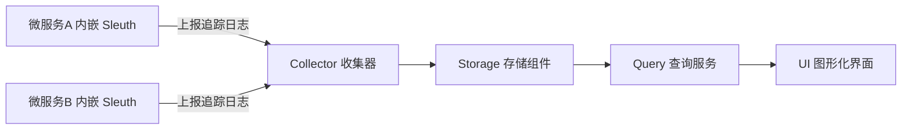

# Zipkin 简介：把分散各处的纯文本追踪日志，收拢成一张图形化调用链

Sleuth 能把追踪信息打在日志里，但那是纯文本，而且分散在每个服务自己的控制台。入门案例里只有两三次调用，肉眼翻一翻还能忍；真实业务一次请求背后可能是几十次微服务调用、跨越几十个服务节点，控制台哗啦啦刷出一整屏日志，靠人工逐行比对 traceId 定位问题几乎不可行。需要专门的产品把纯文本日志收起来、算清楚、画出来，Java 体系里常用的就是 Zipkin。

## 先给结论

- Zipkin 是 Twitter 开源的分布式追踪系统，负责追踪数据的收集、存储、查找和展现。
- 它自带 UI 组件，能用图形化界面直观展示调用链路、各环节耗时与依赖关系；也提供 REST API 供程序化查询。
- 存储是可插拔的，支持 In-Memory、MySQL、Cassandra、Elasticsearch；默认存内存，重启即丢。
- 服务端就是一个可执行 jar 包，`java -jar` 启动后默认监听 9411 端口，浏览器访问即得 UI。

## Zipkin 是什么，解决什么问题

一句话说清定位：Sleuth 是「客户端」，负责在每个微服务内部产生追踪日志；Zipkin 是「服务端」，负责把所有服务的日志汇总、分析并以图形化方式展示。两者是天生的一对，组合起来才构成完整的分布式追踪方案。

Zipkin 源自 Twitter 的开源项目，诞生的动机就是解决微服务架构中的延迟问题：它致力于收集服务的实时数据，回答「这次请求慢在哪一环」「这次失败出在哪个服务」这类问题。具体能力可以拆成四件事：收集各个服务器上请求链路的追踪数据；存储这些数据；提供查找与检索能力，包括 REST API 接口来辅助查询跟踪数据，实现对分布式系统的监控；以及通过 UI 组件直观搜索跟踪信息、分析请求链路明细，比如查询某段时间内各请求的处理耗时。

存储层面它提供灵活的可插拔数据存储方式，从内存到 MySQL、Cassandra、Elasticsearch 都可以接。这一点很关键：默认的内存存储只适合演示，生产环境必须换成持久化存储，否则 Zipkin 一重启，积累的链路数据全部丢失。

## Zipkin 的内部结构

Zipkin 服务端内部通常按职责拆成四个部分，理解了它们，数据怎么流动就清楚了。



这张图讲的是追踪数据从产生到展示的完整流向。解读关键路径：各微服务里由 Sleuth 产生的追踪日志，先由 Collector 收集器接收并校验，然后写入 Storage 存储组件（选内存还是 Elasticsearch 由部署时决定），Query 查询服务再从存储中检索数据，最终由 UI 以调用链时间轴的形式呈现给使用者。微服务侧只管上报，Zipkin 内部怎么分工对使用者是透明的。

## 部署启动：一个 jar 包搞定

Zipkin 服务端以 jar 包形式发布，从 Maven 中央仓库即可下载。课程使用的是 2.12.9 版本，下载得到 `zipkin-server-2.12.9-exec.jar`，也可以直接从资料包中获取。启动命令就是最普通的 `java -jar`：

```bash
java -jar zipkin-server-2.12.9-exec.jar
```

命令行窗口执行后稍等片刻，控制台出现 Spring Boot 的启动横幅与日志，只要没有报错，Zipkin 服务端就算启动完成了。

启动成功后用浏览器访问 `http://localhost:9411/`，这是 Zipkin 的默认端口，看到它的查询界面即说明安装成功。界面上此刻还查不到任何链路数据，这是正常的：服务端只是具备了收集与展示能力，微服务侧还没有把日志上报过来。怎么让 Sleuth 产生的追踪日志流向这个服务端，属于集成环节要解决的问题。

## 常见误区

- **以为 Zipkin 能自己产生追踪数据。** 错例：只启动 Zipkin 服务端就等着看调用链。正解：追踪日志由嵌入微服务的 Sleuth 产生，Zipkin 只负责收集、存储与展示，两边缺一不可。
- **以为 9411 访问不到就是安装失败。** 错例：UI 上查无数据就回头重装 jar 包。正解：端口能访问说明服务端正常，没数据通常是因为微服务侧还没配置上报地址，或还没有请求触发。
- **以为默认配置就能用于生产。** 错例：直接拿内存存储的 Zipkin 上线。正解：默认数据存内存，服务重启即丢失，生产环境必须配置 MySQL 或 Elasticsearch 等持久化存储。
- **以为追踪日志会永久保留。** 错例：隔了几天再去 UI 里找某次请求的链路。正解：数据有存储介质的保留策略约束，重要问题应尽早排查或接入持久化存储。

## 面试可能被问到的问题

1. 面试官追问：「Zipkin 和 Sleuth 分别负责什么？」
   答：Sleuth 是客户端，以 jar 形式嵌入各微服务，负责在调用发生时产生追踪日志并上报；Zipkin 是服务端，负责汇总所有服务上报的追踪数据，进行存储、查询分析，并通过 UI 图形化展示调用链路与耗时。
2. 面试官追问：「Zipkin 由哪几部分组成？」
   答：通常拆为四部分：Collector 收集器接收各服务上报的数据，Storage 负责存储，Query 提供查询服务（含 REST API），UI 以图形化界面展示调用链。数据流向是收集、入库、查询、展示。
3. 面试官追问：「Zipkin 支持哪些存储方式，默认是什么，有什么问题？」
   答：支持 In-Memory、MySQL、Cassandra、Elasticsearch 等可插拔存储。默认是内存，服务端挂掉或重启后监控数据全部丢失，生产环境要切换成 MySQL 或 Elasticsearch 等持久化方案。
4. 面试官追问：「怎么把 Zipkin 服务端跑起来？」
   答：从 Maven 中央仓库下载可执行 jar，例如 zipkin-server-2.12.9-exec.jar，执行 java -jar 启动，控制台无报错即启动完成，默认端口 9411，浏览器访问 http://localhost:9411 看到查询界面即安装成功。
5. 面试官追问：「为什么说 Sleuth 加 Zipkin 才是完整的追踪方案？」
   答：Sleuth 只解决了「数据从哪来」：在微服务内自动生成 traceId、spanId 并织入日志；但日志是纯文本且分散在各服务本地。Zipkin 解决「数据怎么用」：集中收集、持久化存储、检索分析并图形化展示，两者组合才能在生产环境快速定位延迟与故障。

## 配套资料

- 讲义：`materials/docs/10/服务调用链路追踪.md`， Zipkin 简介章节，含下载地址、启动命令、可插拔存储方式与 UI 能力说明。
- 说明：本课无 Zipkin 部署类源码包，启动与访问步骤按讲义原文整理；架构组件划分为业界通行口径，讲解为按本课写法补全。
