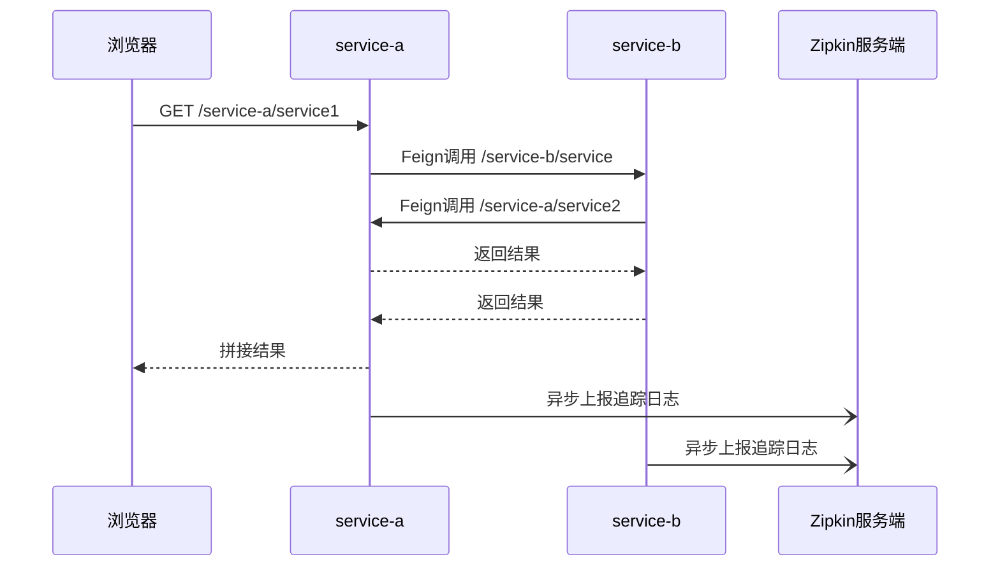

# Sleuth 与 Zipkin 集成实战：从接入配置到调用链可视化与异常定位

Sleuth 单打独斗的时代，追踪信息只能以纯文本躺在各服务的控制台里，人工翻日志分析链路费时费力。这一课把 Sleuth 与 Zipkin 真正接起来：微服务里产生的追踪日志自动上报给 Zipkin 服务端，在图形化界面上看调用链、看耗时、看异常，连出错的环节都会标红。整个案例还会顺手把注册中心和 Feign 声明式调用换进来，让它更贴近真实项目的形态。

## 先给结论

- 集成只需三步：微服务引入 `spring-cloud-starter-zipkin` 依赖（自带 Sleuth 桥接），配置 `spring.zipkin.base-url` 指向 Zipkin 服务端，按需设置采样率。
- 上报打通后，控制台日志的 export 字段从 `false` 变为 `true`，追踪日志开始流向 Zipkin。
- Zipkin 的 UI 能展示整条调用链的时间轴：每个服务的请求方式、路径、命中的 Controller 方法、每段调用的耗时一目了然，traceId 与 spanId 也完整保留。
- 采样率取值 0 到 1，控制 Zipkin 采集多少数据；采样率并非越高越好，要在数据丰富度与采集压力之间权衡，演示场景直接取 1。
- 链路中任何环节抛异常，Zipkin 会把对应 span 标红，点进去能看到异常详情，异常发生在哪个服务、哪个方法直接可见。

## 案例设计：把入门案例改造成贴近生产的形态

案例的业务场景仍然是那个环形调用链：浏览器请求微服务 A 的 service1，A 调 B，B 再调回 A 的 service2。改造点有三处：引入 Eureka 作为服务注册与发现中心；服务间调用从 `RestTemplate` 换成 Feign 声明式调用；每个微服务集成 Sleuth 并把追踪日志上报给 Zipkin 服务端，最终由 Zipkin 图形化展示链路。

整套系统涉及注册中心、服务 A、服务 B 四个角色，加上外部的 Zipkin 服务端，数据流向如下：



这张图讲的是一次请求的完整生命周期。解读关键路径：前半段是业务调用链，A 到 B、B 回 A 共两次远程调用；后半段是追踪链路，A 与 B 各自把 Sleuth 生成的追踪日志上报给 Zipkin 服务端，业务返回与日志上报互不阻塞。注册中心在这条链路里承担的是 Feign 按服务名寻址的职责，图中省略了注册与发现的过程。

## 工程结构：一个父工程统一管理三个模块

案例涉及注册中心、服务 A、服务 B 三个工程，用 Maven 父工程统一做依赖管理。父工程继承 Spring Boot，聚合三个子模块，并在 `dependencyManagement` 里锁定 Spring Cloud 版本：

```xml
<parent>
    <groupId>org.springframework.boot</groupId>
    <artifactId>spring-boot-starter-parent</artifactId>
    <version>2.1.3.RELEASE</version>
    <relativePath/>
</parent>

<groupId>com.study.finance</groupId>
<artifactId>sleuth-zipkin-demo</artifactId>
<packaging>pom</packaging>

<modules>
    <module>discovery-server</module>
    <module>service-a</module>
    <module>service-b</module>
</modules>

<dependencyManagement>
    <dependencies>
        <dependency>
            <groupId>org.springframework.cloud</groupId>
            <artifactId>spring-cloud-dependencies</artifactId>
            <version>Greenwich.RELEASE</version>
            <type>pom</type>
            <scope>import</scope>
        </dependency>
    </dependencies>
</dependencyManagement>
```

注册中心模块与平时搭建的 Eureka 没有任何区别：`pom.xml` 引入注册中心依赖，配置文件里指定应用名与端口号 58020，关掉自我注册与拉取，启动类加 `@EnableEurekaServer` 注解。这套流程已经非常熟练，直接复用即可。

## 依赖引入：zipkin starter 是集成的关键

服务 A 与服务 B 的依赖完全相同。除 web、Eureka 客户端、OpenFeign、Hystrix（熔断相关的配套依赖，后续课程会展开）之外，集成的核心是 `spring-cloud-starter-zipkin`：

```xml
<dependencies>
    <dependency>
        <groupId>org.springframework.boot</groupId>
        <artifactId>spring-boot-starter-web</artifactId>
    </dependency>
    <!-- Zipkin客户端 自带Sleuth 负责产生并上报追踪日志 -->
    <dependency>
        <groupId>org.springframework.cloud</groupId>
        <artifactId>spring-cloud-starter-zipkin</artifactId>
    </dependency>
    <dependency>
        <groupId>org.springframework.cloud</groupId>
        <artifactId>spring-cloud-starter-netflix-eureka-client</artifactId>
    </dependency>
    <dependency>
        <groupId>org.springframework.cloud</groupId>
        <artifactId>spring-cloud-starter-openfeign</artifactId>
    </dependency>
</dependencies>
```

这里有一个容易忽略的细节：Zipkin 的 starter 是客户端性质的依赖，它把 Sleuth 一并带了进来。也就是说微服务内部有两个角色在协作，Sleuth 负责在请求与调用发生时产生追踪日志，Zipkin 客户端负责把这些日志上报给外部的 Zipkin 服务端。一个管生产，一个管运输，分工不要混。

## 服务间调用：Feign 代理与 Controller

两个服务互调，所以各自都要有一份指向对方的 Feign 代理接口。服务 A 里的代理指向服务 B：

```java
package com.study.finance.servicea.agent;

import org.springframework.cloud.openfeign.FeignClient;
import org.springframework.web.bind.annotation.GetMapping;

@FeignClient(name = "trace-service-b")
public interface ServiceBAgent {

    /** 通过服务名调用服务B的service接口 */
    @GetMapping("/service-b/service")
    String service();
}
```

服务 B 里的代理结构对称，指向服务 A 的 `/service-a/service2` 路径。Controller 层把调用链串起来，服务 A 的代码如下：

```java
package com.study.finance.servicea.controller;

import com.study.finance.servicea.agent.ServiceBAgent;
import org.springframework.beans.factory.annotation.Autowired;
import org.springframework.web.bind.annotation.GetMapping;
import org.springframework.web.bind.annotation.RestController;

@RestController
public class ServiceAController {

    @Autowired
    private ServiceBAgent serviceBAgent;

    /** 链路入口 浏览器请求这里 */
    @GetMapping("service1")
    public String service1() {
        String serviceb = serviceBAgent.service();
        return "service-a-service1" + "--->" + serviceb;
    }

    /** 链路终点 被服务B回调后整个调用结束 */
    @GetMapping("service2")
    public String service2() {
        return "service-a-service2";
    }
}
```

服务 B 的 Controller 同样注入自己的 Feign 代理，`service` 方法里先回调服务 A 的 service2，再拼接返回值。启动类用 `@SpringCloudApplication` 组合注解并追加 `@EnableFeignClients`，开启 Feign 客户端扫描：

```java
package com.study.finance.servicea;

import org.springframework.boot.SpringApplication;
import org.springframework.boot.autoconfigure.SpringBootApplication;
import org.springframework.cloud.client.SpringCloudApplication;
import org.springframework.cloud.client.discovery.EnableDiscoveryClient;
import org.springframework.cloud.openfeign.EnableFeignClients;

@SpringCloudApplication
@EnableFeignClients
public class ServiceABootstrap {

    public static void main(String[] args) {
        SpringApplication.run(ServiceABootstrap.class, args);
    }
}
```

至此调用链的路径也补齐了：浏览器请求 `/service-a/service1`，A 通过 Feign 请求 B 的 `/service-b/service`，B 通过 Feign 回调 A 的 `/service-a/service2`，层层返回后浏览器拿到拼接串。

服务 B 这边完全对称：代理接口取名为 `ServiceAAgent`，`@FeignClient` 指向服务名 `trace-service-a`，方法映射到 `/service-a/service2`；Controller 注入这份代理，在 `service` 方法里先发起回调、拿到返回值后再拼接自己的前缀返回。编码时有一个容易踩的小坑值得提前提醒：`@GetMapping` 的路径一定要与对方 Controller 上的路径对齐，还不要忘了对方配置文件里配了 `server.servlet.context-path`，Feign 的映射路径必须把上下文路径也写全，否则运行时拿到的是 404 而不是业务结果。双方启动类结构一致，只是类名与所在包不同，服务 B 侧同样用 `@SpringCloudApplication` 加 `@EnableFeignClients` 组合。

服务名与端口的对应关系整理成一张表，后面测试时反复要用：

| 工程 | 应用名 | 端口 | 上下文路径 |
|---|---|---|---|
| discovery-server | trace-discovery | 58020 | 无 |
| service-a | trace-service-a | 58021 | /service-a |
| service-b | trace-service-b | 58022 | /service-b |
| Zipkin 服务端 | zipkin-server | 9411 | 无 |

## 三条配置打通上报链路

功能代码之外，集成真正生效靠配置文件里的三段设置。以服务 A 为例：

```properties
spring.application.name=trace-service-a
server.port=58021
server.servlet.context-path=/service-a
eureka.client.serviceUrl.defaultZone=http://localhost:58020/eureka/
# 开启Sleuth
spring.sleuth.enabled=true
# 指定zipkin server地址 上报追踪日志
spring.zipkin.base-url=http://localhost:9411
# 采样率 取值范围0-1
spring.sleuth.sampler.probability=1
```

三段配置各司其职。`spring.sleuth.enabled=true` 打开 Sleuth 开关，请求与调用发生时它才会生成追踪日志；`spring.zipkin.base-url` 告诉 Zipkin 客户端该往哪上报，只配了地址其余的事客户端自动完成；`spring.sleuth.sampler.probability` 设定采样率。服务 B 的配置结构完全一致，只是应用名、端口 58022、上下文路径 `/service-b` 不同。两边都要配，因为每个微服务都会产生自己的追踪日志。

## 测试前的关键细节：采样率

追踪日志由 Sleuth 产生，采集多少却由 Zipkin 决定，这个可控的数据量就是采样率，取值范围 0 到 1，本质是一个百分比。取值为 1 表示百分之百采集：假设一次请求包含四次微服务调用，四次调用产生的日志全部上报；取值 0.5 则只采集其中一半。

直觉上采样率越高越好，数据丰富、细节完整，展示出来的链路信息也更全。理论上确实如此，但实际开发中并不是采样率越高越好：采集率越高，数据的体量与上报的压力也越大。一次请求几十次调用、跨越几十个服务节点的系统如果全部百分百采集，一天下来的数据量非常惊人，采集本身会给服务与网络带来可观负担。所以采样率没有标准值，视系统规模与排查需求而定。

当前案例是个演示性质的 demo，微服务之间只调用两三次，数据量极小，采样率直接设为 1 做全量采集。反之如果这时把采样率设得很低，少数请求可能压根采样不到，演示效果就出不来了。

还有一点值得留意：采样率决定的是「采不采这条链路」，而不是「采这条链路里的哪些 span」。一条链路一旦被采样命中，链上所有服务产生的 span 都会完整上报，不会出现半个链路的情况，Zipkin 才能靠同一 traceId 把整条链拼起来。理解了这一点，也就理解了为什么采样率要做成全局配置而不是按服务各配各的。

## 正常链路测试：从控制台到 UI 时间轴

启动顺序建议按依赖关系来：Zipkin 服务端先起，注册中心随后，两个微服务最后，这样微服务一启动上报通道就已经就绪。改过配置的服务要重启才能生效，演示中加了采样率配置，两个服务都重启了一遍。全部启动完毕后，把两个微服务的控制台日志清空，保证接下来看到的每一行都是这次测试产生的。

浏览器访问 `http://localhost:58021/service-a/service1`，页面返回 `service-a-service1--->service-b-service--->service-a-service2`，与改造前完全一致。这一点本身就是一个观察结论：加入注册中心、换成 Feign、接入 Zipkin 之后，业务层的输出没有任何变化，链路追踪对业务代码是透明的，这也是它能在生产项目里低成本低侵入铺开的原因。

真正的变化在控制台。日志格式还是熟悉的 `[应用名, traceId, spanId, export]` 四段，traceId 链路内一致、每次调用的 spanId 各不相同，但第四段的取值从 `false` 变成了 `true`：

`INFO [trace-service-a, ddbbcc256a353723, ddbbcc256a353723, true]`

export 为 true 意味着 Zipkin 已经开始工作，这些日志正在被采集并上报。此时浏览器访问 `http://localhost:9411/`，点击查找按钮，稍等片刻列表里出现了刚产生的链路记录，服务名 service-a 与 service-b 都在。可能需要等一小会儿，上报是异步的，不是请求一返回数据就在。

点击这条链路进入详情页，整条服务调用链以时间轴形式展开：请求先到 service-a，再到 service-b，又回到 service-a，每一行 span 右侧标注了这次调用花费的时间，耗时长的环节一眼可见。这正是纯文本日志做不到的事。

## Span 详情里藏着什么

时间轴上每一行 span 都可以继续点开，能看到比控制台日志丰富得多的信息。以耗时 2.267ms 的那次调用为例，详情分两部分。上半部分是服务调用时间记录，按事件列出每个时间点：

| Date Time | Relative Time | Annotation | Address |
|---|---|---|---|
| 请求发生时刻 | 2.424ms | Client Start | trace-service-a |
| 请求发生时刻 | 142.177ms | Server Start | trace-service-b |
| 稍后时刻 | 957.646ms | Client Finish | trace-service-a |

三个事件勾勒出一次远程调用的完整生命周期：客户端发起（Client Start）、服务端开始处理（Server Start）、客户端收到响应（Client Finish），用相邻事件的时间差就能算出网络耗时与处理耗时各占多少。Relative Time 一列以整条链路的起点为基准，把多次调用放到同一把时间尺上对比，谁先谁后、谁拖慢了整体，不需要任何换算就能读出来。下半部分是请求参数表：

| Key | Value |
|---|---|
| http.method | GET |
| http.path | /service-b/service |
| mvc.controller.class | ServiceBController |
| mvc.controller.method | service |
| Client Address | 127.0.0.1:53992 |

请求方式、请求路径、命中的 Controller 类与方法、客户端 IP 与端口全部记录在案，traceId 与 spanId 也在详情里完整保留。详情里还会出现一个 parent id，从字面看是「父 ID」：调用是有先后顺序的，第二步调用的 parent id，值就是第一步调用产生的 spanId，靠它把 span 之间的父子层级关系记录下来。有了图形化界面之后，日常排查基本不用再手工比对这几个 ID，但理解它们是看懂详情的前提。

## 异常链路测试：红色告警与快速定位

链路追踪的另一半价值在异常场景。测试前故意制造一个异常，在服务 B 的 Controller 里加一句除零运算，位置就放在方法开头：

```java
@GetMapping("service")
public String service() {
    int i = 1 / 0; // 故意制造除零异常 验证Zipkin对异常链路的收集
    String service2 = serviceAAgent.service2();
    return "service-b-service" + "--->" + service2;
}
```

重启服务 B，再次发起请求：浏览器返回 500 错误，服务 B 的控制台抛出除零异常，这些都在预料之中。此时不盯着控制台，直接刷新 Zipkin 的 UI。链路列表里最新一条记录的颜色明显不同：正常链路是浅蓝色，这条是红色。红色即表示这条链路中出现了异常请求。

点开红色链路，两个服务的 span 详情对比非常说明问题：服务 A 访问服务 B 时只收到一个 500 提示，因为异常不是在 A 这边发生的，A 作为调用方只能拿到失败状态码；而服务 B 这边的详情里有明确的异常信息，除零错误一目了然。异常发生在哪个服务、哪个方法、什么原因，图形化界面上直接给出答案。

放到生产视角，这套能力的价值就完全释放了：项目上线后每天发生海量请求，每次请求背后是多次微服务调用，全部被 Zipkin 采集。某个业务出现问题时，打开 UI 先看颜色，红色就是出事的位置，再点开详情看异常与耗时，很快就能锁定问题发生的位置与原因，有针对性地去解决。异常链路与正常链路在上报机制上没有任何区别，Sleuth 照常生成追踪信息，Zipkin 照常收集，只是在展示层根据调用结果做了颜色区分，这套机制不需要为异常场景做任何额外配置。

## 常见误区

- **以为 sleuth 与 zipkin 两个依赖都要单独引入。** 错例：`spring-cloud-starter-sleuth` 和 `spring-cloud-starter-zipkin` 都写进 pom。正解：引入 zipkin starter 即可，它自带 Sleuth 与上报客户端，重复引入徒增版本管理负担。
- **以为采样率设得越高越好。** 错例：生产环境一律 `probability=1` 全量采集。正解：采样率越高数据越全，但采集压力与数据体量也越大，应按系统调用规模权衡；demo 数据量小可以设 1，生产常取 0.1 这类较低比例。
- **以为配置完 base-url 立刻能在 UI 看到数据。** 错例：发完请求马上刷新 9411 查无数据，就断定配置失败。正解：上报是异步行为，需要稍等片刻；同时确认 export 字段已变 true，再排查地址与端口。
- **以为调用方服务里的 500 就是根因。** 错例：看到 service-a 的 span 里报 500 就去改服务 A。正解：状态码会沿调用链向上传递，异常真正发生的服务详情里才有完整异常信息，红色 span 要顺着链路往里层看。

## 面试可能被问到的问题

1. 面试官追问：「Sleuth 与 Zipkin 集成要做哪几件事？」
   答：三件事。微服务引入 spring-cloud-starter-zipkin 依赖，它自带 Sleuth 与上报客户端；配置文件开启 Sleuth 并用 spring.zipkin.base-url 指定服务端地址；按需通过 spring.sleuth.sampler.probability 设置采样率。之后请求发生时日志自动生成并异步上报。
2. 面试官追问：「采样率是什么？设成多少合适？」
   答：采样率控制 Zipkin 采集多少比例的追踪数据，取值 0 到 1，1 为全量采集，0.5 为一半。它不是越高越好：数据越丰富，采集压力与存储成本越大，生产环境按调用规模权衡，通常取较低比例；演示或排查特定问题时可以临时调高。
3. 面试官追问：「怎么判断上报已经打通？」
   答：发一次跨服务请求后看控制台日志的 export 字段，从 false 变为 true 说明采集与上报已生效；再访问 Zipkin UI 点击查找，能看到对应链路记录，且服务名与请求路径一致，即为完全打通。
4. 面试官追问：「在 Zipkin 里怎么定位一个慢请求或异常请求？」
   答：UI 列表按时间列出链路记录，异常链路显示为红色，正常为蓝色。点开链路可以看到整条调用链的时间轴与每个 span 的耗时，找出耗时最长或标红的环节；再点开该 span 详情，能看到请求方式、路径、命中的 Controller 方法、客户端地址以及完整异常信息。
5. 面试官追问：「parent id 是什么，和 spanId 什么关系？」
   答：span 之间有父子层级，反映调用的先后依赖。一次调用的 parent id 是发起它的上一次调用（父调用）的 spanId。例如链路上第一步调用的 spanId 为 A，第二步调用由它发起，第二步的 parent id 就等于 A。UI 展开时间轴时正是靠这个字段还原层级关系。
6. 面试官追问：「你们的追踪链路上，Zipkin 客户端上报会影响业务请求的耗时吗？」
   答：上报是异步进行的，业务响应返回后客户端才把追踪日志发送给 Zipkin 服务端，日志发送失败也不阻断业务，因此在设计上不影响主链路耗时；但采样率过高时，日志产生与传输本身的资源开销会增加，这也是生产环境要控制采样率的原因之一。

## 配套资料

- 讲义：`materials/docs/10/服务调用链路追踪.md`， Sleuth 与 Zipkin 集成章节（工程结构、依赖、配置、采样率说明、正常与异常测试全过程）。
- 代码：`materials/code/10/wanxinp2p/`， 万信金融 P2P 工程归档（目录保留原始命名，路径只列到该层级），项目集成链路追踪时可对照其微服务结构与配置组织。
- 说明：本课无 Sleuth 与 Zipkin 集成案例的独立源码包，父工程、Feign 代理、Controller 与配置示例为按本课写法补全，包名按 `com.study.finance` 系改写；span 详情表格取自讲义测试截图内容。
