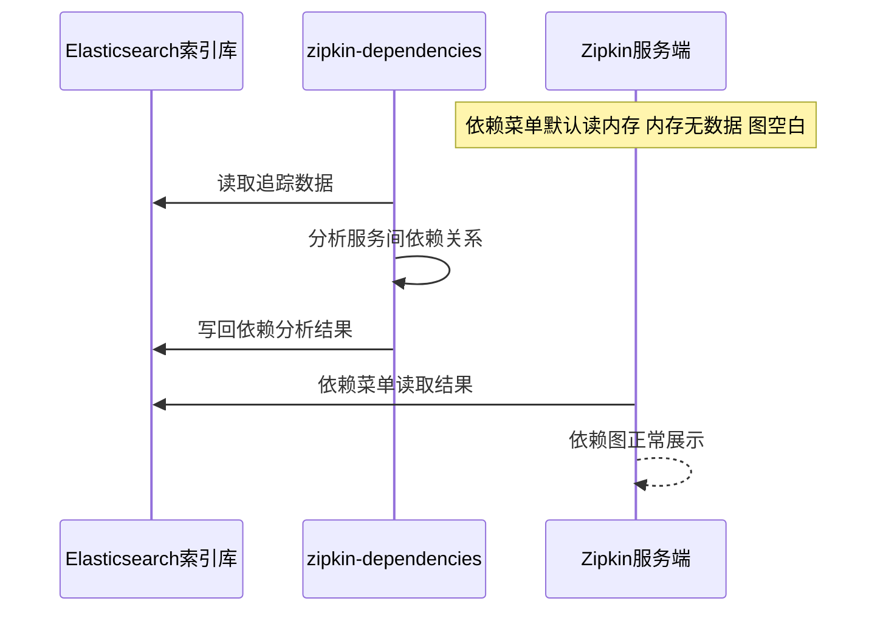

# Zipkin 依赖分析：图形化微服务依赖图，以及 ES 存储后的失效补法

微服务一多，谁调用谁、谁依赖谁就成了一笔糊涂账，接手陌生系统时尤其如此。Zipkin 里藏着一个好用的功能叫依赖分析：以图形化方式把微服务之间的依赖关系画出来，谁指向谁、箭头从哪到哪一眼看穿。这个功能点一下菜单就能用，但有一个隐蔽的坑：一旦追踪日志存进了 Elasticsearch，它就悄悄失效了。这一课把功能和坑一起讲透。

## 先给结论

- 依赖分析能让 Zipkin 以图形化方式展示微服务之间谁依赖谁、谁调用谁，入口是 UI 上的「依赖」菜单，支持按时间段查询。
- 它默认从内存中读取追踪数据再做分析，所以追踪日志一旦改存 Elasticsearch，依赖图就会变成空白。
- 官方给出的解法是 zipkin-dependencies：一个独立的 jar 程序，运行时同样指定存储类型与 ES 地址，它会从数据源读取追踪数据完成依赖分析。
- 启动命令：`java -DSTORAGE_TYPE=elasticsearch -DES_HOSTS=http://localhost:9200 -jar zipkin-dependencies-2.4.1.jar`。
- zipkin-dependencies 不是服务，跑一次就退出；生产环境要持续输出依赖图，需要自己配定时脚本或定时任务周期性执行。

## 依赖分析是什么，看什么

依赖回答的是架构层面的问题：这个系统里有哪些服务，服务之间的调用关系长什么样。入门案例里微服务 A 依赖微服务 B，B 又回调 A，点开 Zipkin UI 的「依赖」菜单，两个服务节点之间用箭头相连，A 调 B、B 调 A 的关系以图形化形式直接呈现，比翻日志或画图猜要直观得多。

界面上还能设置查询条件，按时间段（某月某日几点到几点）筛选，点分析按钮就对这段时间内的链路做一次依赖分析。

两个服务的 demo 里看不出这个功能的威力，服务太少，画不画图都记得住。放到真实项目里完全是另一回事：万信金融 P2P 项目后台有一堆微服务相互调用，登录链路上网关、统一账号、用户认证几个服务交错调用，在这样的规模下打开依赖图，所有服务的调用关系用箭头一目了然，对理解系统结构、评估改动影响范围都有直接帮助。

## 内存态下的标准用法

先看正常路径。在追踪数据还存内存的阶段（Zipkin 未集成 ES 时启动），使用流程非常短：启动 Zipkin 服务端 `java -jar zipkin-server-2.12.9-exec.jar`，启动两个微服务，多发几次请求，访问 9411 确认有数据，然后点「依赖」菜单，图就出来了。


这张图在讲依赖图的数据从哪来。解读关键路径：A 与 B 互调产生的 span 都上报到 Zipkin，Zipkin 依据这些 span 的父子关系聚合出服务间调用关系，因为数据就在内存里，点开菜单即读即画，零额外操作。

## 存进 ES 之后，图没了

集成 Elasticsearch 之后再来点「依赖」，页面空白，图不见了。这不是集成出了故障，原因一句话能说清：依赖分析默认从内存中读取数据进行分析，而现在追踪数据全部存进了 ES 索引库，内存里已经没有数据可供分析，功能自然失效。



这张图在讲补救工具的工作位置。解读关键路径：zipkin-dependencies 从 ES 读取追踪数据，分析出依赖关系后写回数据源，Zipkin 的依赖菜单再从数据源拿到结果绘图，内存这个「默认数据源」被彻底绕开。

## zipkin-dependencies 的运行方法

jar 包通过网络下载即可获得（课件资料里已提供），运行方式与启动 Zipkin 服务端几乎一样，同样是两个参数指定数据源：

```bash
java -DSTORAGE_TYPE=elasticsearch -DES_HOSTS=http://localhost:9200 -jar zipkin-dependencies-2.4.1.jar
```

`STORAGE_TYPE` 指定从哪类数据源取数，`ES_HOSTS` 指定 ES 的地址与端口，与集成 ES 时的 Zipkin 启动参数完全同款。命令敲下去程序开始跑，中途会输出一些与 Hadoop 相关的告警信息，不影响分析结果，不用管它。程序正常执行完会看到一个表示完毕的单词 DONE，然后进程自动退出。此时再回到 Zipkin UI 点「依赖」并刷新，依赖图回来了，而且图上的数据是当天的最新链路分析结果。

实操层面复述一遍上节课的坑：从 PDF 复制命令时，`-D` 的横杠容易因换行丢失，jar 包名也容易复制走样，启动报「无法访问 jarfile」先逐字核对命令。

## 它不是服务：一次性程序的生产化改造

使用时有一个性质必须牢记：zipkin-dependencies 不是一个服务。它不会常驻运行，`java -jar` 跑起来就是一个普通程序，执行完分析、写回结果就结束了，命令行窗口随之退出。这与 Zipkin 服务端那种启动后一直监听端口的常驻形态完全不同。

这带来一个使用上的不方便：分析结果是一次性的快照，新请求产生的追踪数据不会自动更新依赖图。要持续拿到新鲜的依赖关系，就得周期性地执行它。生产环境的常规做法是写一个定时脚本，或者用项目里的定时任务框架（万信金融 P2P 项目里就练过定时任务的实现）让它每隔五分钟或一小时跑一次，跑一次就做一次最新数据的依赖分析。定时间隔按自己对依赖图时效性的要求权衡即可，实现上没有任何难度，本质上就是给一个一次性命令加调度。

## 常见误区

- **以为依赖分析坏了要重装 Zipkin。** 错例：集成 ES 后依赖页面空白，把 Zipkin 删了重装。正解：这是设计如此，依赖分析默认读内存数据，换存储后必须借助 zipkin-dependencies 从数据源重新分析。
- **把 zipkin-dependencies 当成长驻服务。** 错例：跑完发现进程退出了，以为程序异常崩溃。正解：它是一次性程序，看到分析完成标志正常退出即成功；要周期性输出需自行配定时脚本或定时任务。
- **忽略运行中途的告警信息干扰。** 错例：看到与 Hadoop 相关的告警就中断程序排查。正解：这些告警不影响分析结果，等程序执行完毕看到完成标志再验证依赖图。
- **命令直接从 PDF 粘贴。** 错例：`-D` 参数横杠在换行处丢失，启动报无法访问 jarfile。正解：粘贴后逐字核对参数与 jar 包名再执行。

## 面试可能被问到的问题

1. 面试官追问：「Zipkin 的依赖分析功能是干什么用的？」
   答：它以图形化方式展示微服务之间的依赖与调用关系，UI 上点依赖菜单即可查看，支持按时间段分析。服务数量多的系统里，它能直观呈现谁调用谁，帮助理解系统结构与定位问题影响范围。
2. 面试官追问：「为什么追踪数据存到 ES 后依赖分析就失效了？」
   答：因为依赖分析默认从内存读取数据做分析。集成 ES 后追踪数据写入索引库，内存里没有数据，依赖图就空了。官方提供 zipkin-dependencies 工具，从 ES 等数据源读取数据完成依赖分析。
3. 面试官追问：「zipkin-dependencies 怎么用，有什么特性要注意？」
   答：它是一个独立 jar，运行命令与 Zipkin 集成 ES 时同款，指定 STORAGE_TYPE 和 ES_HOSTS 即可。注意它是一次性程序，跑一次分析一次就退出，不是常驻服务；生产上要用定时脚本或定时任务周期执行。
4. 面试官追问：「依赖分析的数据是怎么算出来的？」
   答：Zipkin 聚合每条链路里各服务的 span，span 之间靠 traceId 关联、靠 parentId 表达调用层级，据此推断出服务之间的调用关系，聚合成服务级依赖图。内存存储时即时分析，ES 存储时由 zipkin-dependencies 离线算好写回。
5. 面试官追问：「生产环境你们怎么让依赖图保持更新？」
   答：用定时任务周期性运行 zipkin-dependencies，例如每隔几分钟或一小时执行一次，每次执行都会基于数据源里的最新追踪数据重新分析并写回结果，依赖菜单读到的就是近期链路的依赖快照。

## 配套资料

- 讲义：`materials/docs/10/服务调用链路追踪.md`，「3.4 依赖分析」章节（依赖分析入口、ES 存储后失效的原因、zipkin-dependencies 命令与一次性特性说明）。
- 说明：zipkin-dependencies-2.4.1.jar 为课件提供的工具包，本课无独立源码包；依赖图、启动命令与运行现象均以讲义与本课演示为准，入门案例沿用 `materials/docs/10/服务调用链路追踪.md` 中 Sleuth 与 Zipkin 集成章节的工程结构，包名按 `com.study.finance` 系改写。
