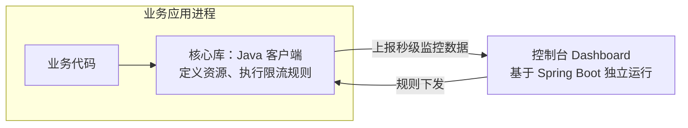

# Sentinel 简介：阿里开源的轻量级流量控制框架

问题分析已经说清了系统超载的后果，下一个问题是：限流到底怎么实现？自己从零写一套？还是找现成的框架？这一节给出 Sentinel 的完整画像：它是谁、从哪来、能做什么、由什么组成，以及和曾经流行的 Hystrix 相比强在哪里。

## 先给结论

- 实现限流不必自己造轮子，行业里有成熟的框架，框架内部采用计数器、令牌桶、漏桶、滑动窗口等限流算法。
- Sentinel 是阿里巴巴开源的、面向分布式服务架构的轻量级流量控制框架，以流量为切入点，从流量控制、熔断降级、系统负载保护等多个维度保护服务稳定性。
- 它有四大特征：丰富的应用场景、完备的实时监控、广泛的开源生态、完善的 SPI 扩展点。
- Sentinel 由两部分组成：核心库（Java 客户端）与控制台（Dashboard），本课程重点学习其中的流量控制能力。

## 用算法限流，还是用框架限流

限流的原理其实是算法。设想一个景点一天最多服务 5000 人，第 5001 个人来了怎么办？让他在大门口排队，出来一个放进去一个，出来两个放进去两个。这个「超过就排队」的思路就是最朴素的限流算法。

行业内常见的限流算法有好几种，每种都能用一句话说清：计数器算法按固定时间窗口累计请求数，超过阈值就拒绝；漏桶算法让请求以恒定速率通过，多余的先排队；令牌桶算法以固定速率发放令牌，请求拿到令牌才能通过，允许一定程度的突发；滑动窗口算法把时间窗口切得更细，让统计更平滑。这些算法的细节暂且不用深究，作为开发者，要实现限流直接使用行业中成熟的框架即可，框架内部会替你实现这些算法。

选谁？本课程的选择是 Sentinel。Sentinel 译为「哨兵」，替系统站岗放哨的定位从名字就开始了。

## Sentinel 是谁：一段被双十一验证过的历史

Sentinel 是阿里巴巴开源的、面向分布式服务架构的轻量级流量控制框架。它的「轻量」指的是核心库不依赖任何框架和库，接入成本低；它的「面向分布式」指的是专治微服务之间互相调用时的稳定性问题。

它的发展历程分三段：2012 年诞生，主要功能是入口流量控制；2013 到 2017 年，在阿里巴巴集团内部迅速发展，成为基础技术模块，覆盖了所有核心场景，积累了大量流量整形场景和生产实践经验；2018 年正式开源。

这段历史里最硬的背书是应用场景：Sentinel 承接了阿里巴巴近 10 年双十一大促流量的核心场景，例如秒杀这种突发流量控制、消息削峰填谷、下游不可用时实时熔断。能在全球最大规模的流量洪峰下活下来的框架，成熟度毋庸置疑。

## 三大核心能力与四个特征

Sentinel 以流量为切入点，从多个维度保护服务稳定性，三大核心能力分别是流量控制、熔断降级和系统负载保护：流量控制决定每秒放多少请求进来，熔断降级在下游不可用时及时断开调用避免被拖垮，系统负载保护在系统负载过高时自动减少接入流量。本课程聚焦其中的流量控制，也就是限流这一块。

官方总结的四个特征，对应四种使用价值：

- **丰富的应用场景**：秒杀、削峰填谷、熔断下游不可用应用，大促级流量场景已经反复验证。
- **完备的实时监控**：控制台中可以看到接入应用的单台机器秒级数据，甚至 500 台以下规模集群的汇总运行情况。
- **广泛的开源生态**：与 Spring Cloud、Dubbo、gRPC 等框架都有开箱即用的整合模块，引入依赖、简单配置即可接入。
- **完善的 SPI 扩展点**：通过实现扩展点可以快速定制逻辑，例如定制规则管理、适配数据源。

顺带一提，开发者对「框架自带监控界面」这件事并不陌生，此前接触链路追踪时，Sleuth 配合 Zipkin 就是用图形化控制台看调用链路。Sentinel 的监控思路与此类似，控制台把运行数据变成看得见的图表。

与更早流行的 Hystrix 相比，Sentinel 的优势相当明显（下表为面向读者的对照补充）：

| 对照维度 | Hystrix | Sentinel |
|---|---|---|
| 主要手段 | 线程池隔离与熔断 | 流量控制、熔断降级、系统负载保护多维度 |
| 限流能力 | 无专门的限流模型 | 核心能力，支持 QPS、并发线程数等多种阈值类型 |
| 规则动态性 | 配置改动不够灵活 | 规则动态可调，支持对接配置中心 |
| 维护状态 | 已进入维护期，更新停滞 | 持续演进，生态活跃 |

## 两部分组成：核心库加控制台

Sentinel 整体分成两部分，理解了这个划分，后面所有的实操都会各归其位：



这张图讲的是两部分的分工与交互：核心库嵌在业务应用进程里，负责定义资源和执行规则，是限流真正发生的地方；控制台独立部署，收集核心库上报的监控数据，把运行状态图形化呈现，还能向应用下发规则。

**第一，核心库（Java 客户端）。** 不依赖任何框架或库，能运行于所有 Java 运行时环境，同时对 Dubbo、Spring Cloud 等框架也有较好的支持。日常编码中用的注解和 API 都来自这一部分。

**第二，控制台（Dashboard）。** 基于 Spring Boot 开发，打包后可以直接运行，不需要额外的 Tomcat 等应用容器。启动控制台只需一条命令（需 JDK 1.8 及以上）：

```bash
# 启动 Sentinel 控制台，监听 9999 端口
java -Dserver.port=9999 -jar sentinel-dashboard.jar
```

业务应用侧只需在配置文件里指明控制台地址，监控数据就会自动上报：

```properties
# 指定 Sentinel 控制台地址
spring.cloud.sentinel.transport.dashboard=localhost:9999
```

控制台的具体部署与页面操作细节，会在本单元后续的图形化控制台部分专门演示。

## 常见误区

- **以为要先把四种限流算法学透才能用 Sentinel。** 错例：在计数器、令牌桶的数学细节里停留太久。正解：框架内部已经封装了算法，先用起来，算法细节作为进阶阅读再回头补。
- **把 Sentinel 和限流画等号。** 错例：认为它只是个限流工具。正解：流量控制只是切入点，熔断降级、系统负载保护同样是它的能力维度。
- **以为控制台是必装组件。** 错例：控制台没启动就认定 Sentinel 用不了。正解：核心库是执行主体，控制台只负责监控展示与规则管理，纯代码方式定义规则时没有控制台也能完整限流。
- **以为监控数据要自己采集上报。** 错例：自己写代码统计 QPS 再展示。正解：核心库内置秒级统计，配置好控制台地址后数据自动上报，500 台以下规模集群的汇总都能直接看。

## 面试可能被问到的问题

1. 面试官追问：「介绍一下 Sentinel，它解决什么问题？」
   答：阿里巴巴开源的、面向分布式服务架构的轻量级流量控制框架，以流量为切入点，通过流量控制、熔断降级、系统负载保护等维度保护服务稳定性。2012 年诞生、2018 年开源，承接过近 10 年双十一核心流量场景。
2. 面试官追问：「常见的限流算法有哪些？」
   答：计数器算法按时间窗口累计请求数；漏桶算法让请求恒定速率通过；令牌桶算法按速率发令牌、允许适度突发；滑动窗口算法细分统计窗口让计数更平滑。框架内部通常直接封装这些算法。
3. 面试官追问：「Sentinel 和 Hystrix 有什么区别？」
   答：Hystrix 以线程池隔离和熔断为主，缺少专门的限流模型，且已进入维护期；Sentinel 是多维度保护，限流是核心能力，规则支持动态调整、可对接配置中心，控制台开箱即用，生态仍在活跃演进。
4. 面试官追问：「Sentinel 的核心库和控制台分别负责什么？」
   答：核心库是 Java 客户端，不依赖任何框架，运行在业务进程内，负责资源定义与规则执行；控制台基于 Spring Boot 独立运行，负责图形化监控和规则管理，两部分通过监控上报与规则下发交互。
5. 面试官追问：「Sentinel 如何做到低侵入接入？」
   答：核心库不依赖任何框架或库，可在所有 Java 运行时环境运行；对 Spring Cloud、Dubbo、gRPC 等主流框架提供适配模块，引入依赖并简单配置即可接入，业务代码几乎不用改。

## 配套资料

- 讲义：`materials/docs/10/Sentinel实现限流.md`，Sentinel 定位、发展历史、特征与两部分组成的描述均出自「1.2 Sentinel 简介」小节。
- 讲义：`materials/docs/10/SpringCloud Hystrix服务熔断.md`，Hystrix 服务熔断的讲义，可与本节对照表结合阅读。
- 说明：控制台启动命令与 `transport.dashboard` 配置按讲义口径整理；Hystrix 对照表为面向读者的知识补充。
