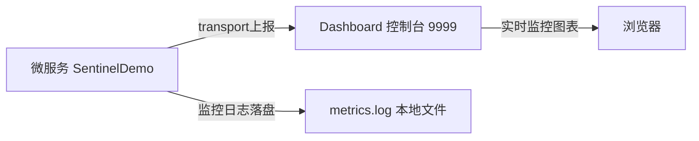

# Sentinel Dashboard 图形化控制台：把纯文本监控数据变成可读的实时大盘

Sentinel 入门案例跑通之后，限流效果已经能在页面上看到：快速刷新就出现「系统繁忙，请稍候」。但要看限流的详情，只能去翻客户端落盘的监控日志文件，那是一堆纯文本数字，什么时候通过几个、拒绝几个、响应多快，全靠肉眼在字缝里找。Sentinel 配套的 Dashboard 图形化控制台就是为解决这个问题准备的：同一份数据，以图表方式实时呈现。这一课完成控制台的下载启动、应用接入与实时监控观察。

## 先给结论

- Dashboard 是一个基于 Spring Boot 的独立 jar，用 `java -Dserver.port=9999 -jar sentinel-dashboard.jar` 即可启动，默认账号与密码都是 `sentinel`。
- 应用接入控制台只需一行配置：`spring.cloud.sentinel.transport.dashboard=localhost:9999`，加完必须重启微服务。
- 接入后控制台的实时监控页展示每个资源的通过 QPS、拒绝 QPS 与响应时间曲线，数据来源就是客户端原本落盘的那份监控日志。
- 控制台里 `hello` 与 `/hello` 是两个东西：前者是 `@SentinelResource` 定义的业务资源，对其配置了限流，有拒绝次数；后者是 Controller 的请求入口，Sentinel 只做监控统计，不限流。
- 生产环境更常见的做法是通过控制台设置流控规则，规则参数 resource、grade、count 与代码方式一一对应。

## Dashboard 是什么，数据从哪来

Sentinel 分为核心库与控制台两部分。核心库是 Java 客户端，嵌在微服务里负责资源定义与规则校验，不依赖任何框架也能运行；控制台（Dashboard）基于 Spring Boot 开发，打包后是一个可直接运行的 jar，不需要额外装 Tomcat 之类的应用容器。

两者分工明确：客户端在服务运行时持续记录每个资源的调用情况，通过次数、拒绝次数、响应时间都写在监控日志里；控制台把这些日志数据收集起来，转换成图形化的实时大盘。接入前后的数据链路：



这张图在讲监控数据的两条去处。解读关键路径：客户端的监控数据既落在本地日志文件（接入前人工查看的来源），也通过 transport 组件上报给 Dashboard（接入后的图形化来源），两条通道互不影响，接入控制台不改变限流本身的行为。

## 下载启动与登录

控制台 jar 从网上下载，课程课件里已提供。启动命令只指定一个端口：

```bash
java -Dserver.port=9999 -jar sentinel-dashboard.jar
```

要求 JDK 1.8 及以上版本。启动过程就是一个标准 Spring Boot 应用的启动，控制台跑起来后浏览器打开 `http://localhost:9999`，会先进入登录页，默认账号和密码都是 `sentinel`。

登录进去此刻是空的：应用还没接入，没有数据上报，控制台自然无物可展示。这时候去微服务侧疯狂刷新页面也无济于事，缺的就是接入那一行配置。

## 应用接入：一行配置加一次重启

在微服务的配置文件里增加 Dashboard 的地址配置。入门案例的 `application.properties` 完整内容如下，新增的只有最后一行：

```properties
spring.application.name=SentinelDemo
server.port=5000
server.servlet.context-path=/sentinel
# 设置 dashboard 的地址
spring.cloud.sentinel.transport.dashboard=localhost:9999
```

这行配置告诉客户端把监控数据上报到哪里。加上它重启微服务，然后按老办法产生流量：浏览器访问 `http://localhost:5000/sentinel/hello`，慢速刷几次，再快速刷几次触发限流。

回到控制台刷新，应用名 SentinelDemo 出现在列表里，左侧菜单包含实时监控、流控规则、降级规则、热点规则、系统规则、授权规则、机器列表等条目。点开实时监控，资源 `hello` 的曲线已经画出来：横轴是时间，几点几分；纵轴分别是通过的次数、拒绝的次数与响应时间。快速刷新触发的限流在拒绝 QPS 曲线上有清晰尖峰，慢速刷新阶段则只有通过量的平缓波动。这些数据全部来自客户端落盘的那份监控日志，控制台只是把它从纯文本变成了图形，文件名形如 `SentinelDemo-metrics.log.yyyy-MM-dd`。

## hello 与 /hello：资源与请求入口的区别

监控页的资源列表里通常能看到两行：不带斜杠的 `hello` 和带斜杠的 `/hello`，很多人第一次都会困惑。区分它们要回到入门案例的代码：

```java
package com.study.finance.sentinel.service;

import com.alibaba.csp.sentinel.annotation.SentinelResource;
import org.springframework.stereotype.Service;

@Service
public class TestService {

    @SentinelResource(value = "hello", blockHandler = "exceptionHandler")
    public String hello() {
        return "Hello Sentinel";
    }

    /** 限流后的兜底处理 */
    public String exceptionHandler(FlowException e) {
        e.printStackTrace();
        return "系统繁忙，请稍候";
    }
}
```

`hello` 是 `@SentinelResource` 注解显式定义的资源，入门案例对它配置了 QPS 限流规则，所以它的监控行里有拒绝次数。Controller 那一侧则是一个普通的请求入口：

```java
package com.study.finance.sentinel.controller;

import com.study.finance.sentinel.service.TestService;
import org.springframework.beans.factory.annotation.Autowired;
import org.springframework.web.bind.annotation.GetMapping;
import org.springframework.web.bind.annotation.RestController;

@RestController
public class TestController {

    @Autowired
    private TestService testService;

    @GetMapping("hello")
    public String hello() {
        return testService.hello();
    }
}
```

Sentinel 对这类进入 Controller 的请求 URL 会自动做监控统计，列表里的 `/hello` 指的就是它。注意只是监控，不限流：反复刷新请求入口，`/hello` 这一行只有通过次数在涨，拒绝次数始终为零，因为限流规则是配在 `hello` 资源上的。资源与请求入口是两个维度的东西，前者由代码注解或规则显式圈定，后者由框架自动统计，控制台里逐行看数据时要先分清自己盯的是哪一个。

## 用控制台配规则

除了看监控，控制台还能直接下发规则。在流控规则页面新增一条规则，核心参数与代码方式完全对应：`resource` 是资源名，`grade` 是限流类型（QPS 或并发线程数），`count` 是限流阈值。对着 `hello` 资源配一条 QPS 阈值 1 的规则，效果与入门案例里用代码写 `FlowRule` 一模一样。

控制台改规则比改代码重启灵活得多，但也要清楚它的定位：手动在控制台设置的规则一般仅用于测试和演示，生产环境通常通过动态规则源来管理，把规则存到配置中心或数据库，客户端监听变更实时生效。监控看趋势、控制台调规则验证，两件事都不需要重启应用，这是图形化控制台带来的最直接效率提升。

## 常见误区

- **以为控制台不显示数据是 Sentinel 出了故障。** 错例：登录进 Dashboard 后页面空白，来回刷新前端页面也没用。正解：应用还没接入，先在微服务配置里加 `spring.cloud.sentinel.transport.dashboard` 并重启服务，再产生请求流量。
- **以为 `/hello` 也会被限流。** 错例：看到列表里有 `/hello` 就以为请求入口也有拒绝次数，刷新半天没出现。正解：限流规则配在哪个资源上，拒绝就发生在哪个资源上；`/hello` 是请求入口的自动统计，只监控不限流。
- **以为 Dashboard 需要单独部署 Tomcat。** 错例：把 jar 丢进 Tomcat 的 webapps 里部署。正解：控制台基于 Spring Boot 打包，`java -jar` 直接运行，自带容器。
- **以为控制台改了规则就不用管代码里的规则了。** 错例：代码里 `FlowRule` 写死阈值，控制台改了没生效就困惑。正解：代码方式与控制台方式都会写入规则集合，以加载顺序为准；生产环境建议走动态规则源，避免两处手动维护互相覆盖。

## 面试可能被问到的问题

1. 面试官追问：「Sentinel 的核心库和控制台分别是什么角色？」
   答：核心库是 Java 客户端，嵌入微服务，负责资源定义、规则校验与指标记录，不依赖框架；控制台基于 Spring Boot 打包成 jar 独立运行，负责收集客户端上报的监控数据做图形化展示，也支持在界面上配置流控、降级、热点、系统、授权等规则。
2. 面试官追问：「微服务怎么接入 Sentinel Dashboard？」
   答：在配置文件里加 spring.cloud.sentinel.transport.dashboard 指定控制台地址与端口，重启应用。客户端启动后通过 transport 组件与控制台建立连接并上报监控数据，控制台的应用列表与实时监控随即出现该应用与它的资源。
3. 面试官追问：「控制台里的监控数据是从哪来的？」
   答：来自客户端记录的资源调用指标。客户端本来就会把每次调用的通过量、拒绝量、响应时间落在本地监控日志（形如应用名-metrics.log.yyyy-MM-dd），接入 Dashboard 后这些数据同时上报给控制台，控制台聚合后以 QPS 与响应时间曲线展示，数据本身没有新增采集成本。
4. 面试官追问：「`hello` 和 `/hello` 在控制台里为什么是两条数据？」
   答：hello 是 @SentinelResource 注解定义的业务资源，受配置的流控规则约束，有限流拒绝数据；/hello 是框架自动统计的请求入口 URL，只做监控不参与限流，除非对它单独配规则。一个是显式资源，一个是自动统计入口，维度不同。
5. 面试官追问：「通过控制台设置限流规则和生产环境的规则管理是一回事吗？」
   答：不是。控制台手动设置规则直观灵活，但属于手动方式，一般用于测试演示；生产环境推荐动态规则源方案，规则存储在配置中心、数据库等统一位置，客户端实现 ReadableDataSource 接口监听规则中心实时获取变更，控制台推送规则到规则中心，避免应用重启和规则丢失。

## 配套资料

- 讲义：`materials/docs/10/Sentinel实现限流.md`，「2.2 Sentinel-Dashboard 图形化控制台」章节（启动命令、登录账号、监控日志文件名）与「2.3 限流规则详解」章节（resource、grade、count 参数与动态规则说明）。
- 说明：本课无 Sentinel 入门案例的独立源码包，`TestService`、`TestController` 与 `application.properties` 为按本课画面与讲义写法补全的可运行示例，包名按 `com.study.finance` 系改写。
