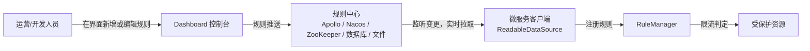

# Sentinel 动态规则：把限流阈值从代码里搬出去

入门案例的规则定义藏在 `@PostConstruct` 方法里：`rule.setCount(2)` 一行，阈值 2 就焊死在了 Java 代码中。想把它调成 10，就得改代码、重新编译、重启应用；在 Dashboard 上手改的规则更脆弱，应用一重启就烟消云散，因为规则只活在内存里。规则这种天生多变的配置，写在代码里既不灵活又麻烦。Sentinel 针对这个问题给出的答案是动态规则：把规则挪到文件、数据库或配置中心里，客户端监听变更、实时生效。

## 先给结论

- 用 Java 代码或 Dashboard 设置限流规则都属于手动方式，官方定位是测试和演示；生产环境一般通过动态规则源管理规则。
- 动态规则就是把规则涉及的参数与值存到文件、数据库或配置中心，客户端动态获取，规则变更不再依赖改代码重启。
- Sentinel 的 DataSource 接口提供了对接任意配置源的能力，实现分拉取式与推送式两条路线。
- 官方推荐架构：控制台设置规则后推送到统一的规则中心，客户端实现 ReadableDataSource 接口监听规则中心实时获取变更。
- 以 Apollo 为例，引入 `sentinel-datasource-apollo` 依赖，创建 `ApolloDataSource` 并注册到对应的 RuleManager，客户端即可随 Apollo 配置变化自动更新规则。

## 写死的规则差在哪

入门案例的这段代码，问题就出在值与代码绑定：

```java
List<FlowRule> rules = new ArrayList<>();
// 测试限流规则
FlowRule rule = new FlowRule();
rule.setResource("hello");
rule.setGrade(RuleConstant.FLOW_GRADE_QPS);
rule.setCount(2);
rules.add(rule);
// 加载限流规则，使其生效
FlowRuleManager.loadRules(rules);
```

两点不妥。**一是值写死在代码里。** 阈值 2、资源名 hello 都是硬编码，业务量一变就要动代码，重新走一遍编译发布流程，对开发人员是纯负担。**二是改动必须重启。** 线上限流阈值临时放宽再收紧是常见操作，每次都重启应用显然不现实。用 Dashboard 手动改规则虽然即时，但规则只存于应用内存，重启即丢，同样不能托付生产。解决思路每个开发者都熟悉：值不写代码里，存到数据库，或者像万信金融 P2P 项目那样存到 Apollo 配置中心，用的时候读出来。做到这一点，靠的就是 Sentinel 的动态规则。

## 动态规则的定位与两条实现路线

讲义把话说得很明确：代码方式和 Dashboard 方式都属于手动方式，不够灵活，一般仅用于测试和演示；生产环境上一般通过动态规则源来动态管理限流规则，很多时候限流规则会被存储在文件、数据库或者配置中心当中。Sentinel 的 DataSource 接口提供了对接任意配置源的能力，按数据流向分两条路线。

**拉取式，客户端定期轮询。** 客户端主动向规则管理中心定期轮询拉取规则，规则中心可以是 RDBMS、文件，甚至版本控制系统。实现方式简单，缺点是无法及时获取变更：轮询间隔之内发生的规则变化，客户端感知不到。

**推送式，规则中心主动通知。** 规则中心统一推送，客户端通过注册监听器的方式时刻监听变化，Nacos、ZooKeeper、Apollo 这类配置中心都走这条路。实时性和一致性都有更好的保证。实现上，拉模式最简单的方式是继承 `AutoRefreshDataSource` 抽象类，实现 `readSource()` 方法，从指定数据源读取字符串格式的配置数据；推模式最简单的方式是继承 `AbstractDataSource` 抽象类，在构造方法中添加监听器，同样实现 `readSource()` 读取配置。

官方推荐的整体流程是三段式：



这张图讲的是规则的生产、存储与消费链路。关键在中间一环：规则中心是唯一的持久化归属，控制台只负责把人填的规则推过去，客户端只负责从这儿听，两端都无状态，规则改一次全链路实时生效。

## 以 Apollo 为例：两件事接入动态规则

万信金融 P2P 项目的大部分配置本来就托管在 Apollo 配置中心，把限流规则也放进去顺理成章。Sentinel 官方对 Apollo 做了适配，接入只做两件事。

**第一件，引入适配依赖：**

```xml
<dependency>
    <groupId>com.alibaba.csp</groupId>
    <artifactId>sentinel-datasource-apollo</artifactId>
    <version>1.6.2</version>
</dependency>
```

**第二件，创建 ApolloDataSource 并注册到规则管理器：**

```java
// namespaceName 对应 Apollo 的命名空间名称
// ruleKey 对应规则存储的 key
// defaultRules 对应连接不上 Apollo 时的默认规则
ReadableDataSource<String, List<FlowRule>> flowRuleDataSource =
        new ApolloDataSource<>(namespaceName, ruleKey, defaultRules, source ->
                JSON.parseObject(source, new TypeReference<List<FlowRule>>() {}));
FlowRuleManager.register2Property(flowRuleDataSource.getProperty());
```

构造方法的四个参数对应着「从哪读、读哪条、读不到怎么办、读到了怎么转」四个问题。namespaceName 指定 Apollo 的命名空间，所有配置都存在某个命名空间里，必须先告诉框架去哪个空间找；ruleKey 指定规则存储的 key，配置在 Apollo 里是键值对，规则值挂在等号前的 key 上，知道 key 才能取到值；defaultRules 是兜底，连接不上 Apollo 时用它充当默认规则，示例里传空串；最后一个参数是个转换函数，从 Apollo 读到的是 JSON 串，业务里要的是 Java 对象，所以用 `JSON.parseObject` 配合 `TypeReference` 把 JSON 数组反序列化成 `List<FlowRule>`，泛型集合是因为一个资源的规则可能有多条，数组转 Java 对象，集合最合适。

规则数据最终的去向没有变：还是交给 RuleManager。`register2Property` 代替了入门案例里的 `loadRules`，区别在于它注册的是一条会随数据源自动刷新的规则通道，Apollo 上改一次配置，客户端立刻拿到新规则，不需要重启。万信金融 P2P 项目的网关限流正是按这套写法落地，届时数据源类型从 `FlowRule` 换成网关专用的 `GatewayFlowRule`，代码骨架完全一致。

## 常见误区

- **以为控制台配的规则是持久化的。** 错例：在 Dashboard 上配好规则就认为万事大吉，应用重启后限流失效。正解：控制台规则默认存内存，重启即丢；生产环境必须接动态规则源，控制台只作为推送入口。
- **混淆拉取式与推送式的时效。** 错例：用数据库存规则、定时轮询，却期望规则秒级生效。正解：拉取式只能做到轮询间隔级别的时效，要实时一致就选推送式，接配置中心并注册监听器。
- **把 defaultRules 当成必配的初始规则。** 错例：纠结第四个参数不知道填什么。正解：它是连接不上配置中心时的兜底默认值，demo 与本课场景传空串即可，规则主体始终以配置中心为准。
- **以为接入数据源后就不需要 RuleManager。** 错例：创建完 `ApolloDataSource` 就去发请求验证。正解：数据源只负责读配置，还差注册这一步，`register2Property` 把数据源属性挂到规则管理器上，规则才真正生效。

## 面试可能被问到的问题

1. 面试官追问：「什么是 Sentinel 的动态规则，解决什么问题？」
   答：把限流规则从代码与内存中挪出来，存到文件、数据库或配置中心，客户端通过 DataSource 接口动态获取。解决的是手动方式规则写死、修改要重启、控制台规则重启即丢的问题，让规则变更不依赖发布流程且实时生效。
2. 面试官追问：「拉模式和推模式的数据源怎么实现，各有什么优缺点？」
   答：拉模式客户端定期轮询规则中心，规则中心可以是 RDBMS、文件等，实现简单，继承 AutoRefreshDataSource 实现 readSource 即可，缺点是变更不及时；推模式由规则中心主动推送，客户端注册监听器，继承 AbstractDataSource 在构造方法中加监听，基于 Nacos、ZooKeeper、Apollo 等配置中心，实时性与一致性更好。
3. 面试官追问：「官方推荐的规则管理链路是什么样的？」
   答：控制台负责设置规则并推送到统一的规则中心，规则中心持久化存储，客户端实现 ReadableDataSource 接口监听规则中心，实时获取变更并注册到 RuleManager 生效。三段各司其职，规则只有一个持久化归属。
4. 面试官追问：「ApolloDataSource 的构造参数都有什么含义？」
   答：四个参数。namespaceName 指定 Apollo 命名空间，ruleKey 指定规则对应的配置 key，defaultRules 是连不上 Apollo 时的默认规则，最后一个参数是转换函数，把读到的 JSON 串通过 JSON.parseObject 加 TypeReference 反序列化成规则对象集合。
5. 面试官追问：「loadRules 和 register2Property 有什么区别？」
   答：loadRules 是一次性静态加载，加载完规则就固定了；register2Property 注册的是数据源属性，数据源侧配置变化时规则会自动刷新，是动态规则的接入方式。前者适合 demo，后者适合生产。

## 配套资料

- 讲义：`materials/docs/10/Sentinel实现限流.md`，「2.3.3 动态规则」小节（手动方式的定位、拉取式与推送式实现、官方推荐流程、Apollo 适配的依赖与代码）。
- 代码：`materials/code/10/wanxinp2p/`，万信金融工程归档（目录保留原始命名，路径只列到该层级）；父工程 `pom.xml` 的依赖管理中含 `sentinel-datasource-apollo` 1.6.2，与讲义一致。
- 说明：本课动态规则示例不单独建工程，落地代码在网关限流实现篇给出；`ApolloDataSource` 示例按本课讲义与画面口径整理，包名按 `com.study.finance` 系改写。
