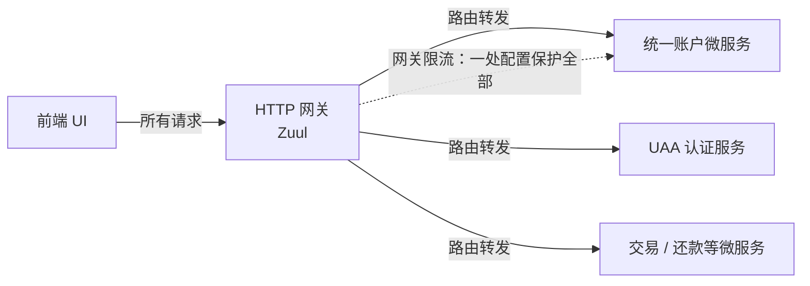
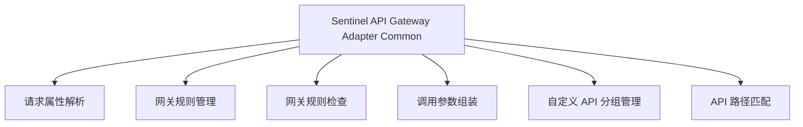

# Sentinel 网关限流：把限流从每个方法挪到系统唯一入口

Sentinel 入门案例的玩法在 demo 里很顺：找到要保护的方法，加一个 `@SentinelResource` 注解，再用代码或控制台配一条规则。可这套动作放到万信金融 P2P 这样的真实项目里就走不通了，一个大项目里需要保护的资源成百上千，逐个找方法加注解、逐个配规则，维护成本高到没法玩。限流这件事需要一个天然的收口位置，而前后端分离架构恰好给了它：所有请求必经的网关。这一课讲 Sentinel 的网关限流模式，也是把 Sentinel 落进 P2P 项目前的最后一块概念拼图。

## 先给结论

- 项目级限流应该做在网关层：前端发出的任何请求都要先过网关，在网关限流一处配置即可保护所有下游资源，不必给每个方法加注解。
- Sentinel 支持整合 Spring Cloud Gateway、Zuul 等主流网关进行限流。
- Sentinel 1.6.0 引入了 Sentinel API Gateway Adapter Common 模块，其中包含网关限流的规则和自定义 API，是网关集成的公共底座。
- Zuul 侧的集成点是三个过滤器：Pre 过滤器在请求路由之前做限流，Post 过滤器在路由之后恢复资源，Error 过滤器处理异常。
- Spring Cloud Gateway 侧的集成点是 SentinelGatewayFilter（Route ID 识别、API 路径匹配）与 BlockRequestHandler（限流请求处理）。

## 资源级限流在项目里为什么玩不起来

入门案例给 hello 方法配限流的完整动作是：先定位要保护的资源，加 `@SentinelResource` 注解声明资源名和兜底方法，再通过 `FlowRule` 定义规则加载生效。demo 只有一个方法，这套动作三五分钟搞定；换成真实项目，问题立刻暴露。一个大项目里受保护的资源太多太多了，难道要找到每一个方法，在每一个方法上贴注解，再为每一个资源维护规则？方法数以百计，注解散落在各处，规则散落在各处，谁也说不清系统现在到底有几条限流在生效。这种做法在项目里玩不起来，demo 玩法与项目玩法的分水岭就在这里。

网关限流的思路是换一个施力点：不去逐个圈资源，而是在所有流量的必经之路上设一道闸。

## 网关是天然的单点收口

万信金融 P2P 项目采用前后端分离架构，请求链路是固定的三段式：

这张图讲的是限流施力点的迁移。前端不管发任何请求都要先经过网关，再由网关转发给具体的某个微服务。既然入口唯一，限流加在网关上就够了：不需要进入每个微服务找谁需要保护，也不需要给方法贴注解，一道闸守住所有下游资源。这就叫通过 Sentinel 实现网关限流，它和入门案例的资源级限流是两种不同的玩法。

## Sentinel 的网关适配模块

限流加在网关上，前提是 Sentinel 认识网关。Sentinel 支持整合 Spring Cloud Gateway、Zuul 等主流网关，具体靠 Sentinel 1.6.0 引入的 Sentinel API Gateway Adapter Common 模块：这个模块包含网关限流的规则和自定义 API，职责就是让 Sentinel 与各网关完成集成适配。集成之后，网关就不再是普通的网关，而是带有限流功能的网关。

公共模块对两类网关提供的接入件不同。Zuul 是基于过滤器的架构，模块提供三个过滤器：ZuulPreFilter 在请求路由之前执行 API 匹配并做限流操作，是限流的主要执行者；ZuulPostFilter 在路由之后恢复资源现场；ZuulErrorFilter 负责业务异常记录与异常后的处理，三者最终都对接 Fallback 处理。Spring Cloud Gateway 侧则是 SentinelGatewayFilter 与 BlockRequestHandler，前者负责 Route ID 识别与 API 路径匹配，后者定义被限流请求的处理方式。

公共模块内部的能力可以拆成六块：

这张图讲的是适配模块的内部构成。六个能力覆盖了网关限流的完整生命周期：请求进来先做属性解析，规则管理与规则检查决定放不放行，API 分组与路径匹配决定这条请求算哪个资源，参数组装负责把判定所需的信息凑齐。

## 网关流控规则的资源口径

网关限流的规则对象与普通流控规则同源，但资源口径变了：普通流控规则的资源是 `@SentinelResource` 声明的方法名或请求 URL，网关流控规则的资源通常是路由 ID，即网关路由配置里的服务名。规则字段里专门有一个 resourceMode 区分两种口径：0 表示按路由 ID 匹配，1 表示按自定义 API 分组匹配。自定义 API 分组是公共模块提供的另一层抽象，可以把一批路径归到一个组里，对组整体限流；规则里还预留了 paramItem 参数项，支持针对请求中的某个参数做更细粒度的限流。

万信金融 P2P 项目采用 Spring Cloud Zuul 作为网关、Apollo 作为配置中心，网关限流的资源就对应 Zuul 的 routes 配置，例如统一认证服务在路由表里的 `uaa-service`。这层对应关系是下一课动手实现时最容易出错的地方：资源名必须照着网关的路由配置写，不能凭感觉起名。

## 常见误区

- **以为网关限流也要加 `@SentinelResource` 注解。** 错例：在网关工程的业务方法上四处贴注解。正解：网关限流的资源由路由 ID 或 API 分组定义，Sentinel 通过适配过滤器自动识别请求归属的资源，不需要注解。
- **把 resourceMode 与 grade 混为一谈。** 错例：以为 resourceMode 是 QPS 或线程数。正解：resourceMode 决定资源按什么口径匹配（0 路由 ID，1 自定义 API 分组），grade 才是阈值类型（1 为 QPS，2 为并发线程数），两个字段各管一层。
- **以为 API 分组就是 Zuul 的路由。** 错例：把自定义 API 分组当成另一份路由配置。正解：路由是转发规则，API 分组是限流维度的资源聚合，把多个路径打包成一个资源来限流，与转发无关。
- **以为任意版本的 Sentinel 都支持网关限流。** 错例：老版本里找网关相关依赖找不到。正解：网关适配能力从 Sentinel 1.6.0 起，由 Sentinel API Gateway Adapter Common 模块提供。

## 面试可能被问到的问题

1. 面试官追问：「为什么项目级限流要做在网关上，而不是像 demo 那样给方法加注解？」
   答：大项目里受保护资源众多，逐个加注解、逐个配规则的维护成本无法接受。前后端分离架构下所有请求必经网关，在网关限流一处配置即可保护全部下游微服务资源，规则集中、口径统一。
2. 面试官追问：「Sentinel 怎么和主流网关做集成？」
   答：Sentinel 1.6.0 引入 API Gateway Adapter Common 模块，包含网关限流规则与自定义 API。对 Zuul 提供三个过滤器，Pre 过滤器在路由前限流，Post 过滤器恢复资源，Error 过滤器处理异常；对 Spring Cloud Gateway 提供 SentinelGatewayFilter 与 BlockRequestHandler。
3. 面试官追问：「网关流控规则的资源和普通流控规则有什么不同？」
   答：普通流控规则的资源是注解声明的方法名或请求 URL；网关流控规则的资源通常是路由 ID，通过 resourceMode 可切换为自定义 API 分组。规则字段上多了 intervalSec 统计窗口、burst 突发容量、maxQueueingTimeoutMs 排队超时与 paramItem 参数限流等网关专属项。
4. 面试官追问：「API 分组限流是什么，什么时候用？」
   答：自定义 API 分组把一组路径聚合为一个限流资源，适合一个业务能力横跨多个路由或路径前缀的场景，对组整体设阈值，避免逐路径配规则的碎片化。
5. 面试官追问：「网关限流和资源级限流可以同时存在吗？」
   答：可以。网关层负责入口总量的粗粒度控制，保护所有下游服务；微服务内部仍可对核心方法做细粒度的资源级限流。两层各管一段，常见生产组合是网关粗控加服务内精控。

## 配套资料

- 讲义：`materials/docs/10/Sentinel实现限流.md`，「3 实现万信金融 P2P 网关限流」章节开篇与「3.1 网关限流概述」小节（整合 Gateway 与 Zuul 的支持、1.6.0 引入的适配模块、整体架构）。
- 代码：`materials/code/10/wanxinp2p/`，万信金融工程归档（目录保留原始命名，路径只列到该层级），网关工程位于其 `wanxinp2p-gateway-server/` 子目录。
- 说明：适配模块内部六项能力与两类网关接入件的划分取自本课讲义架构图；网关流控规则的 resourceMode 与 paramItem 字段说明按官方通行口径补全，下一课在项目里实际用到的是路由 ID 模式。
