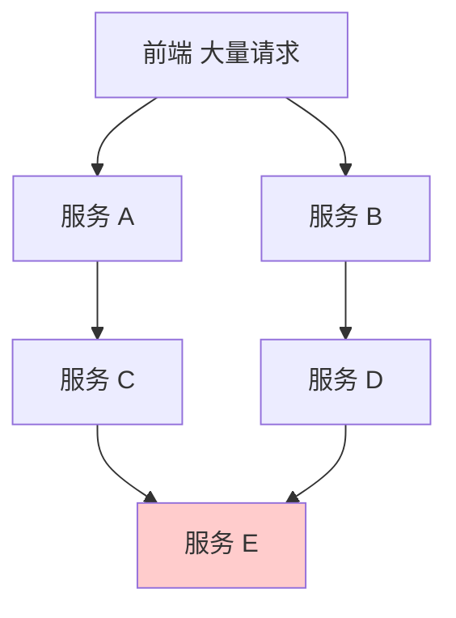
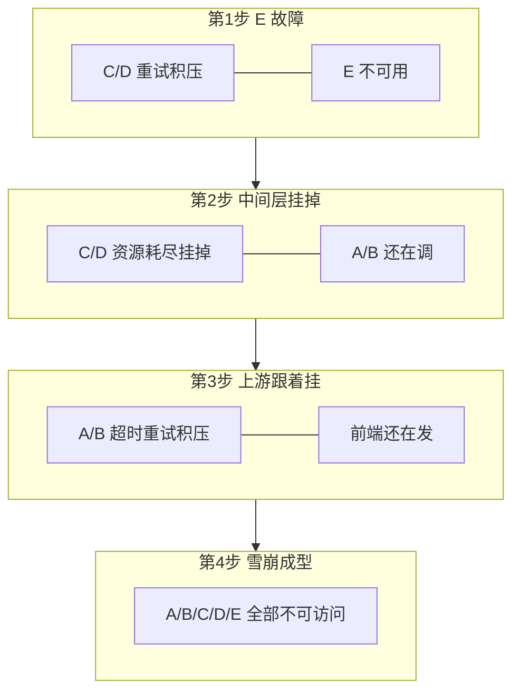

# 服务熔断概述：从雪崩效应到保险丝思想

超时和重试是每个做远程调用的开发者都会配的「标配」，配上了就以为万事大吉。可恰恰是这套看似完善的机制，在下游服务故障时会变成压垮自己的最后一根稻草：重试在积压，线程在等待，内存和 CPU 在燃烧，故障顺着调用链向上游一层层传染，直到整片服务全部倒下。这一节把「服务熔断」从零讲起：雪崩是怎么发生的，保险丝的类比为什么贴切，熔断与降级又如何配合。

## 先给结论

- 微服务每次业务请求都会形成调用链，超时与重试机制看似完善，实则是雪崩隐患：下游故障时，上游的等待与重试会积压并耗尽自身资源。
- 一台服务故障沿着调用链引发连锁反应、拖垮一大片服务，这种现象叫雪崩效应。
- 解决思路借自现实生活的保险丝：为微服务加装熔断器（也叫断路器），依赖服务持续出错时自动断开，后续请求不再真正发出。
- 熔断发生时消费方直接返回失败，体验太差，所以在本地准备备用降级方法，返回默认值或缓存数据，这就是服务降级。
- 熔断器是系统稳定性的最后一重保障。

## 看似完善的超时重试，埋着什么雷

微服务架构中，为了完成一次业务请求往往需要多个服务协作，每次调用都会产生一条调用链。服务之间通过 RPC 或 HTTP 互相调用时，一般都会设置调用超时、失败重试等机制，确保请求最终能成功执行。这套配置单看每一项都没毛病，问题出在极端场景下它会反转成帮凶。

设想两个访问量很大的服务 A 和 B，A 依赖 C，B 依赖 D，而 C 和 D 又都依赖 E，形成两条调用链：A 到 C 到 E，B 到 D 到 E。前端不断发请求到 A 和 B，A 和 B 于是不断调用 C 和 D。



这张图画的是故障起点：E 因为某种原因不能正常工作了。接下来按时间推进，事故分成四步发酵。

**第一步，超时重试被激活。** E 挂了，C 和 D 对 E 的调用开始失败，重试机制自动触发，C 反复重试，D 也在反复重试，次数够了或时间到了就抛超时。可前端不管这些，对 A 和 B 的请求还在源源不断地进来，A 照旧调 C，B 照旧调 D。

**第二步，中间层资源耗尽。** C 和 D 上积压起大量调用等待和重试调用，每个等待中的请求都占着线程、内存这些资源，慢慢耗尽 C 和 D 的内存与 CPU，两台服务挂掉。

**第三步，故障向上传染。** A 调 C 开始超时重试，B 调 D 同样如此，前端请求还在涌入，A 和 B 重演一遍 C 和 D 的经历，资源耗尽，也挂掉。

**第四步，全链路不可访问。** 一台服务的局部故障，沿着调用链把一整片服务全部拖垮。这种调用链路的连锁故障，就叫做雪崩。



这张图把雪崩的发酵过程压缩成四格，关键路径是从 E 故障到 C、D 重试积压再到 A、B 被传染，每一步之间只隔着「前端还在发请求」这一个前提。

这不是危言耸听。万信金融 P2P 项目里这类场景比比皆是：开户业务一次请求要串联统一账户、用户中心、银行存管等多个服务，满标放款的调用链更长，调用链越长、服务越多，产生雪崩的概率就越大。

## 保险丝：牺牲局部保全整体

解决思路可以从现实生活里找到原型。家家户户的电路中都装有保险丝：当电路发生故障或异常，电流不断升高，升高的电流可能烧毁家用电器、甚至烧毁电路造成火灾。而保险丝自身能承受的电流和热度有限，电流异常升高到一定程度，它就自我熔断、切断电流，整个电路断电，电器保住了，火灾也不会发生。

把保险丝搬进分布式架构，就是给每个微服务加装熔断器。熔断这一概念直接来源于电子工程中的断路器（Circuit Breaker）：当下游服务因访问压力过大而响应变慢或失败，上游服务为了保护系统整体的可用性，暂时切断对下游的调用。回到前面的例子，A 调用 C 重试了几十次都没有反应，A 处加装的熔断器就把这条调用断开。断开之后 A 和 C 虽然在同一条调用链上，但 C 出事不再连累 A，这就是牺牲局部、保全整体，这种措施叫做服务熔断。

熔断器断开之后，后续的请求不会真正访问依赖的服务，而是快速返回错误或缓存的数据，避免程序不断尝试执行注定失败的操作，把资源消耗降下来。

## 熔断之后靠降级兜住体验

熔断断开了调用，服务消费方将不会发出远程调用，直接返回失败。可对用户来说，一上来就看到报错显然体验糟糕，于是还需要一层后续处理：在消费方本地准备一个备用的降级方法。A 调 C 本来是要查数据库里的 100 条数据，现在 C 熔断了取不到，降级方案可以是缓存里有数据就取缓存的数据先用，缓存里也没有就返回一个友好的错误提示。查询接口可准备默认值或缓存，秒杀业务可提示用户稍后再试。这种因服务处理能力退化而优雅返回错误的能力，叫做服务降级。

用代码把降级的骨架表达出来，消费方本地大致是这样一副样子（本课该案例源码未在仓库归档，以下为按本课写法补全的示例）：

```java
// 熔断发生后，消费方不再真正发起远程调用，改走本地备用方法
public List<BidItemDTO> queryBidItems() {
    if (circuitOpen) {
        // 缓存有数据就用缓存数据兜底
        List<BidItemDTO> cached = cacheClient.get("bid_items");
        if (cached != null && !cached.isEmpty()) {
            return cached;
        }
        // 缓存也没有，返回友好提示对应的空结果
        return Collections.emptyList();
    }
    return remoteCall();
}
```

降级给出的东西未必是用户真正想要的，但请求有响应、系统没垮，熔断与降级的配合正是为了这个目的：不让一台服务的故障演变成一场雪崩。同时也应记住讲义里的那句话，熔断器是系统稳定性的最后一重保障，它兜的是底，不是日常手段。

## 常见误区

- **以为配了超时和重试就有了容错。** 错例：给 Feign 调用配足超时和重试就认为高枕无忧。正解：超时重试在下游持续故障时会放大资源消耗，上游积压等待反而是雪崩的第一推动力，必须配合熔断。
- **把熔断和降级混为一谈。** 错例：认为「熔断就是返回默认值」。正解：熔断是断开调用这个动作，降级是断开之后的后续处理，熔断发生一定伴随降级，但降级思路（返回空值、默认值、缓存）可以在没有熔断的场景独立使用。
- **认为降级的数据要和真实服务一样。** 错例：纠结降级返回的缓存数据不够新鲜。正解：降级的定位是「先应付一下」，牺牲数据新鲜度换取系统可用，真正需要的精确数据等依赖服务恢复后再取。
- **以为保险丝类比只是修辞。** 错例：把熔断器当抽象概念背下来。正解：类比的三要素一一对应，电流升高对应失败率升高，熔断对应断开调用，保护电路对应保护上游服务，理解了类比就理解了断路器模型。

## 面试可能被问到的问题

1. 面试官追问：「什么是服务雪崩，它是怎么形成的？」
   答：微服务调用链上，一台下游服务故障后，上游的超时与重试机制被激活，大量调用等待和重试积压耗尽上游资源，上游挂掉后故障继续向上传染，最终沿调用链拖垮一大片服务，这种连锁故障叫雪崩。核心成因是故障加超时重试加持续涌入的流量三者叠加。
2. 面试官追问：「服务熔断和服务降级分别是什么，什么关系？」
   答：熔断指当下游服务持续出错时，上游切断对它的调用，后续请求不再真正发出，概念来自电子工程的断路器；降级指熔断后消费方在本地执行备用逻辑，返回默认值、缓存或友好提示。熔断是切断动作，降级是兜底处理，熔断发生通常伴随降级。
3. 面试官追问：「为什么说熔断器是系统稳定性的最后一重保障？」
   答：限流、缓存、超时重试等手段都在各自的环节减少故障概率，但如果依赖服务还是持续不可用，唯一能阻止故障扩散的就是熔断器直接断开调用。它牺牲对局部的服务能力，换取系统整体不被拖垮，属于稳定性防线上的最后一道。
4. 面试官追问：「你的项目里哪些业务链路需要熔断保护？」
   答：调用链长、跨服务多的业务优先，例如万信金融 P2P 项目的开户业务要串联统一账户、用户中心、银行存管，满标放款要跨交易、还款等多个服务，任何一环故障都可能阻塞整条链路，这类入口调用都应配置熔断与降级。
5. 面试官追问：「降级方法一般返回什么？」
   答：常见四种：返回空值、返回默认值、访问缓存返回历史数据、执行某些替代逻辑并给出友好提示。原则是快速失败或快速返回，让主体业务不受依赖故障影响，秒杀这类场景则提示用户稍后再试。

## 配套资料

- 讲义：`materials/docs/10/SpringCloud Hystrix服务熔断.md`，雪崩四步推演、保险丝类比、熔断与降级的定义及「最后一重保障」的表述均出自「1 什么是服务熔断」小节。
- 代码：`materials/code/10/wanxinp2p/`，P2P 工程归档（目录保留原始命名，路径列到该层级），开户、满标放款等长链路业务可对照理解雪崩场景。
- 说明：降级骨架示例为本课无归档源码部分按主流写法补全，非仓库真实文件。
