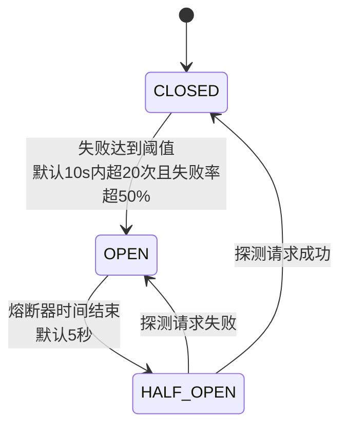

# Hystrix 简介：Spring Cloud 里的豪猪断路器

熔断的概念已经立起来了：给微服务装保险丝，下游持续失败就断开调用。下一个问题是自己写还是用现成的。自己实现熔断需要有非常丰富的多线程开发经验，状态机、线程隔离、统计窗口每一块都不好啃，难度非常大。好在行业里有成熟的框架替我们做完了这一切，这一节介绍的主角就是 Netflix 开源的 Hystrix：它是谁、名字从哪来、断路器三状态怎么转、降级回退提供哪几种方式。

## 先给结论

- Spring Cloud 中的断路器组件就是 Hystrix，它也是 Netflix 套件的一部分，与 Eureka、Ribbon、Feign、Zuul 同出一门，如今都收进了 Spring Cloud 的组件体系。
- Hystrix 的中文名是豪猪，周身长刺、以刺防御，与它做防御性容错的定位不谋而合。
- 工作原理核心是三状态断路器：关闭、打开、半开，默认 10 秒窗口内超过 20 次调用且失败率超过 50% 就切到打开，保持打开默认 5 秒后进入半开探测，可自我检测并恢复。
- 降级回退提供四种方式：返回空值、返回默认值、访问缓存、执行某些逻辑。
- 与另一款熔断降级框架 Sentinel 相比，Hystrix 以线程池隔离与熔断见长，已进入维护期；Sentinel 则是限流、熔断降级多维度并举，规则动态可调，生态仍在活跃演进。

## Netflix 系组件的又一位成员

Spring Cloud 只是规范和外壳，早期真正干活的组件大多来自 Netflix 开源套件。服务发现用的 Eureka、客户端负载均衡用的 Ribbon、声明式远程调用用的 Feign、API 网关用的 Zuul，全都出自 Netflix，如今都属于 Spring Cloud 的组件体系，Hystrix 也不例外。这也解释了它和 Feign 为什么是好基友：一家人，集成自然早就设计好了。

名字本身就在讲故事。Hystrix 对应的中文是「豪猪」，豪猪周身长满了刺，靠一身刺保护自己不受天敌伤害，代表了一种防御机制。这与 Hystrix 容错防御的功能定位不谋而合，因此 Netflix 团队用它命名，并配了对应的卡通形象做 logo。

## 三状态断路器：比保险丝多一个半开

现实中的保险丝只有断与不断两种形态，断了就得换新的。Hystrix 的断路器多出一种状态，靠它能自动探测下游恢复、实现自愈。三种状态的转换条件可以用一张状态机图说清：



这张图讲的是断路器的一生，关键路径有两条。

**第一条是熔断路径。** 关闭（CLOSED）是正常状态，请求照常放行。当对某个服务的调用在一定时间内（默认 10 秒）有超过一定次数（默认 20 次），并且失败率超过一定值（默认 50%），断路器切换到开路状态（OPEN）。此后所有请求直接失败，不会再发送到后端服务，同时触发服务降级。

**第二条是自愈路径。** 断路器保持开路一段时间后（默认 5 秒），自动切换到半开路状态（HALF-OPEN）。半开的意思是放一条探测请求过去试试：下一次请求如果成功，断路器切回闭路状态（CLOSED），恢复正常放行；如果还失败，重新切回开路状态，继续等下一个 5 秒。也就是说断路器有自我检测并恢复的能力，下游缓过来它就跟着恢复，不用人工介入。

这些默认值（10 秒窗口、20 次、50% 失败率、5 秒半开等待）都可以按需调整，面试里被问到「熔断什么时候触发」时，把默认参数和三状态一起说出来最有说服力。

## 降级回退：熔断后的四种出路

降级回退指的是某些服务熔断后，执行备用逻辑从故障服务中快速失败或快速返回，以保障主体业务不受影响。Hystrix 提供降级主要是为了容错，保证当前服务不受依赖服务故障的影响，从而提高服务的健壮性。fallback 的方式包括四种：返回空值、返回默认值、访问缓存、执行某些逻辑。

比如商品详情页依赖库存服务查询实时库存，库存服务熔断时可以返回一个默认库存值让页面正常渲染，或者返回缓存里的最近一次库存快照；秒杀入口则可以走「执行某些逻辑」这条路，直接返回「活动火爆，稍后再试」的友好提示。具体怎么把降级代码挂到 Feign 调用上，下一节的入门案例会完整演示。

## 真实工程里它长什么样

项目归档里可以直接看到 Hystrix 的接入痕迹。统一账户 API 模块的 pom 里引入的是 Spring Cloud 封装好的 starter：

```xml
<dependency>
    <groupId>org.springframework.cloud</groupId>
    <artifactId>spring-cloud-starter-netflix-hystrix</artifactId>
</dependency>
```

消费服务工程则直接引入了 Netflix 原生的注解驱动模块：

```xml
<dependency>
    <groupId>com.netflix.hystrix</groupId>
    <artifactId>hystrix-javanica</artifactId>
</dependency>
```

配置方面，万信金融项目的微服务统一通过 Apollo 管理配置，消费服务与网关工程的 `application.yml` 里都能看到 `micro_service.spring-hystrix` 名称空间，熔断相关参数集中在这个名称空间里维护，各服务关联引用即可生效：

```yaml
apollo:
  bootstrap:
    enabled: true
    namespaces: application,micro_service.spring-eureka,micro_service.spring-hystrix,micro_service.spring-ribbon
```

## 与 Sentinel 对照着看

课程在限流部分已经完整走过 Sentinel，把它和 Hystrix 放在一起看，选型思路会清晰很多。Hystrix 的主要手段是线程池隔离与熔断，缺少专门的限流模型，配置改动不够灵活，且已进入维护期、更新停滞；Sentinel 以流量为切入点，流量控制、熔断降级、系统负载保护多维度并举，限流是它的核心能力，规则支持动态调整并可对接配置中心，控制台开箱即用。两者不冲突的共识是：熔断降级都是保护服务的必要手段，区别在于能力半径与演进状态。理解了 Hystrix 的断路器模型，再去看其他框架的熔断实现，模型都是相通的。

## 常见误区

- **把「打开」状态当成正常。** 错例：看到 OPEN 就以为是放行的意思，像开闸放水。正解：断路器语境里 CLOSED 是闭合通电、正常放行，OPEN 是断路、拒绝请求，与直觉相反，第一次接触最容易搞反。
- **以为熔断打开后永远断着。** 错例：认为下游挂一次熔断就永久生效。正解：保持打开默认 5 秒后进入半开状态放探测请求，成功即回关闭，断路器具备自我检测并恢复的能力。
- **记错触发条件里的参数含义。** 错例：把「默认 20 次」理解成总失败次数达到 20 就熔断。正解：完整条件是默认 10 秒窗口内调用超过 20 次，且失败率超过 50%，两个条件同时满足才切换到开路。
- **把降级回退当成异常处理的替代品。** 错例：在 fallback 里吞掉所有异常不打日志。正解：降级是容错手段，create 时拿到的 Throwable 要记录原因，否则依赖服务故障被静默掩盖，排查无从下手。

## 面试可能被问到的问题

1. 面试官追问：「Hystrix 是什么，为什么叫这个名字？」
   答：Spring Cloud 中的断路器组件，Netflix 开源套件的一部分。Hystrix 中文意为豪猪，豪猪周身长刺、以刺防御，代表防御机制，与其服务容错的定位吻合，Netflix 团队因此命名并使用卡通豪猪作为 logo。
2. 面试官追问：「讲一下 Hystrix 断路器的三种状态和默认触发参数。」
   答：关闭、打开、半开三种状态。默认 10 秒窗口内调用超过 20 次且失败率超过 50%，断路器切到打开，所有请求直接失败不再发往后端；保持打开默认 5 秒后进入半开，放一次探测请求，成功切回关闭，失败重回打开，因此具备自我检测并恢复的能力。
3. 面试官追问：「Hystrix 的 fallback 有哪几种方式？」
   答：四种：返回空值、返回默认值、访问缓存、执行某些逻辑。目的都是熔断后快速失败或快速返回，保障主体业务不受影响，例如查询接口备默认值或缓存，秒杀业务提示稍后再试。
4. 面试官追问：「Hystrix 和 Sentinel 怎么选？」
   答：Hystrix 以线程池隔离和熔断为主，没有专门的限流模型，规则动态性弱，已进入维护期；Sentinel 多维度保护，限流能力强，规则可动态调整并能对接配置中心，控制台开箱即用，生态活跃。新项目一般优先 Sentinel，理解了 Hystrix 的断路器模型再上手 Sentinel 的熔断规则会非常快。
5. 面试官追问：「半开状态为什么要设计成只放一次探测请求？」
   答：下游刚恢复时承压能力未知，如果半开状态放全量请求进去，一旦恢复不彻底会立刻再次失败并重回打开，形成反复抖动。单次探测相当于小流量试水，成功才恢复全量放行，失败则继续等待，保证了恢复过程的平稳。

## 配套资料

- 讲义：`materials/docs/10/SpringCloud Hystrix服务熔断.md`，三状态工作原理的默认参数、降级回退的四种方式、豪猪命名的表述均出自「2 Hystrix」小节。
- 讲义：`materials/docs/10/Sentinel实现限流.md`，Hystrix 与 Sentinel 的对照维度参考此讲义的 Sentinel 部分结合阅读。
- 代码：`materials/code/10/wanxinp2p/`，P2P 工程归档（目录保留原始命名，路径列到该层级），统一账户 API 模块与消费服务模块的 pom、Apollo 名称空间配置为真实文件内容。
