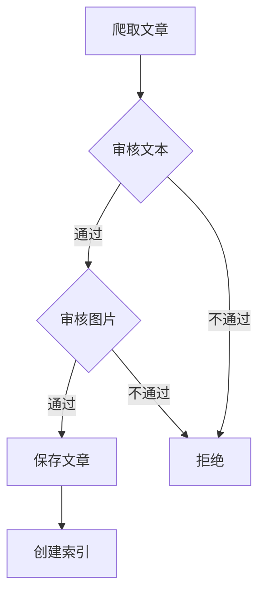

# 21_爬虫文章审核_审核成功更新状态

- 阶段：05.阶段五 黑马头条（社交媒体）项目
- 章节：day11-黑马头条-爬虫系统完善&文章审核
- 源文件：05.阶段五 黑马头条（社交媒体）项目\day11-黑马头条-爬虫系统完善&文章审核\21_爬虫文章审核_审核成功更新状态【海量资源尽在 666java.com】.mp4
- 时长 2分17秒（音频 137s）
- 内容：声音线（教师逐段转写）+ 画面线（屏幕/PPT/代码）；已做同音技术术语纠错（Maven/JDK/Spring Boot 等）与品牌词清理

## 一、声音线（教师讲解，[mm:ss] 为出现时刻）

[00:00] 好咱们整个流程啊还有最后一块是吧咱们在这儿再去封装一个方法吧好吧updateCLnews之前那个失败是吧咱们在这加一个成功吧SUCCESS反正参数呢还是当前的CLnews这个方法没有啊没有的话咱们就创建一下这个方法还是比较简单的啊怎么办呢是审核成功之后啊审核审核成功
[00:34] 修改然后这里边咱们怎么写其实就是cellnews.set有一个staters咱们设置为个9就可以了当然这个需要去强转一下然后咱们在这就可以直接去调用哪个直接调用cellnews.map还有一个update这个cdersupdate也可以了update就是cders
[01:07] 你把当前那个clnews装进去就可以了好吧那行那这个内容啊咱们就才设置完了设置完成后咱们在这去log点info然后呢是审核流程结束耗时时间和写啊system他点他是吧进去他好了那这样的话咱们整合啊
[01:35] 各的审核流程咱们就算是做完了下面咱们就来一块去测试一下如果说有问题的话咱们再去调试一下好吧那这个整体的流程再去简单说一遍最主要就是你要去还要看我这个图还要看我这个图然后你从开始然后把这个关系或者把这个思路里清楚好这个状态搞明白然后你按这个流程一步一步往下写就可以了
[02:04] 其实跟咱们之前自媒体那块内容呢其实差不多的啊差不多只是这个状态要更少一些所以说比之前那个要更简单一些好吧行那这个咱们就不再说了一会儿呢咱们再来去测试

## 二、画面线（屏幕 / PPT / 代码，VLM 抽帧抄录）

1) 这一组画面整体在讲如何在新闻文章审核服务中，通过代码实现文章状态更新、审核日志记录和内容索引功能。

2) 按时间顺序列出每张画面的要点：
画面1：在 ReviewCrawlerArticleServiceImpl.java 文件中，编写 updateNewsSuccess 方法，用于更新文章状态为审核成功（状态码9），并调用 cNewsMapper.updateStatus 方法。
画面2：在 updateNewsSuccess 方法中，添加日志记录语句，记录审核流程结束和耗时。
画面3：在 updateNewsSuccess 方法中，使用 cNewsMapper.updateStatus 方法更新文章状态。
画面4：在 updateNewsSuccess 方法中，使用 cNewsMapper.updateStatus 方法更新文章状态。
画面5：在 updateNewsSuccess 方法中，使用 cNewsMapper.updateStatus 方法更新文章状态。
画面6：在 updateNewsSuccess 方法中，使用 cNewsMapper.updateStatus 方法更新文章状态。
画面7：在 updateNewsSuccess 方法中，使用 cNewsMapper.updateStatus 方法更新文章状态。
画面8：在 updateNewsSuccess 方法中，使用 cNewsMapper.updateStatus 方法更新文章状态。
画面9：在 updateNewsSuccess 方法中，使用 cNewsMapper.updateStatus 方法更新文章状态。
画面10：在 updateNewsSuccess 方法中，使用 cNewsMapper.updateStatus 方法更新文章状态。
画面11：在 ReviewCrawlerArticleServiceImpl.java 文件中，编写 createEsIndex 方法，用于创建文章在 Elasticsearch 中的索引。
画面12：在 ReviewCrawlerArticleServiceImpl.java 文件中，编写 handlerTextAndImages 方法，用于处理文章中的文本和图片。
画面13：展示新闻文章审核流程图，包括：爬取文章 -> 审核文本 -> 审核图片 -> 保存文章 -> 创建索引。
画面14：展示新闻文章审核流程图，包括：爬取文章 -> 审核文本 -> 审核图片 -> 保存文章 -> 创建索引。

3) 画面里出现的**代码、配置、命令、目录结构、SQL、XML/YAML 配置**请原样抄录（逐字，保留缩进与符号）：
画面1：
```java
//更改状态 为 9
updateNewsSuccess(cNews);
```
画面2：
```java
Log.info("审核流程结束，耗时：{}",
```
画面3：
```java
private void updateNewsSuccess(CNews cNews) {
    cNews.setStatus((byte) 9);
    cNewsMapper.updateStatus(cNews);
}
```
画面4：
```java
private void updateNewsSuccess(CNews cNews) {
    cNews.setStatus((byte) 9);
    cNewsMapper.updateStatus(cNews);
}
```
画面5：
```java
private void updateNewsSuccess(CNews cNews) {
    cNews.setStatus((byte) 9);
    cNewsMapper.updateStatus(cNews);
}
```
画面6：
```java
private void updateNewsSuccess(CNews cNews) {
    cNews.setStatus((byte) 9);
    cNewsMapper.updateStatus(cNews);
}
```
画面7：
```java
private void updateNewsSuccess(CNews cNews) {
    cNews.setStatus((byte) 9);
    cNewsMapper.updateStatus(cNews);
}
```
画面8：
```java
private void updateNewsSuccess(CNews cNews) {
    cNews.setStatus((byte) 9);
    cNewsMapper.updateStatus(cNews);
}
```
画面9：
```java
private void updateNewsSuccess(CNews cNews) {
    cNews.setStatus((byte) 9);
    cNewsMapper.updateStatus(cNews);
}
```
画面10：
```java
private void updateNewsSuccess(CNews cNews) {
    cNews.setStatus((byte) 9);
    cNewsMapper.updateStatus(cNews);
}
```
画面11：
```java
private void createEsIndex(ApArticle apArticle, CNews cNews) throws IOException {
    EsIndexEntity esIndexEntity = saveEsIndexEntity(apArticle, cNews);
    Index.Builder builder = new Index.Builder(esIndexEntity);
    builder.id(apArticle.getGid()).toString();
    builder.refresh(true);
    Index index = Index.index(ESIndexConstants.ARTICLE_INDEX, type(ESIndexConstants.DEFAULT_DOC).build());
}
```
画面12：
```java
private void handlerTextAndImages(List<String> images, StringBuilder sb, JSONArray jsonArray) {
    if (null != jsonArray) {
        for (Object obj : jsonArray) {
            JSONObject jsonObject = (JSONObject) obj;
            String type = (String) jsonObject.get("type");
            if ("image".equals(type)) {
                String value = (String) jsonObject.get("value");
                images.add(value);
            }
            if ("text".equals(type)) {
                String value = (String) jsonObject.get("value");
                sb.append(value);
            }
        }
    }
}
```
画面13：

画面14：


4) 出现的 PPT 标题、架构图/流程图的结构（谁指向谁）、表格数据：
画面13：流程图结构：
- 起始节点：爬取文章
- 决策节点1：审核文本
  - 如果通过，指向决策节点2：审核图片
  - 如果不通过，指向结束节点：拒绝
- 决策节点2：审核图片
  - 如果通过，指向操作节点：保存文章
  - 如果不通过，指向结束节点：拒绝
- 操作节点：保存文章
- 操作节点：创建索引

画面14：流程图结构：
- 起始节点：爬取文章
- 决策节点1：审核文本
  - 如果通过，指向决策节点2：审核图片
  - 如果不通过，指向结束节点：拒绝
- 决策节点2：审核图片
  - 如果通过，指向操作节点：保存文章
  - 如果不通过，指向结束节点：拒绝
- 操作节点：保存文章
- 操作节点：创建索引

5) 不要评价画面美观，不要输出与课程无关的内容。

