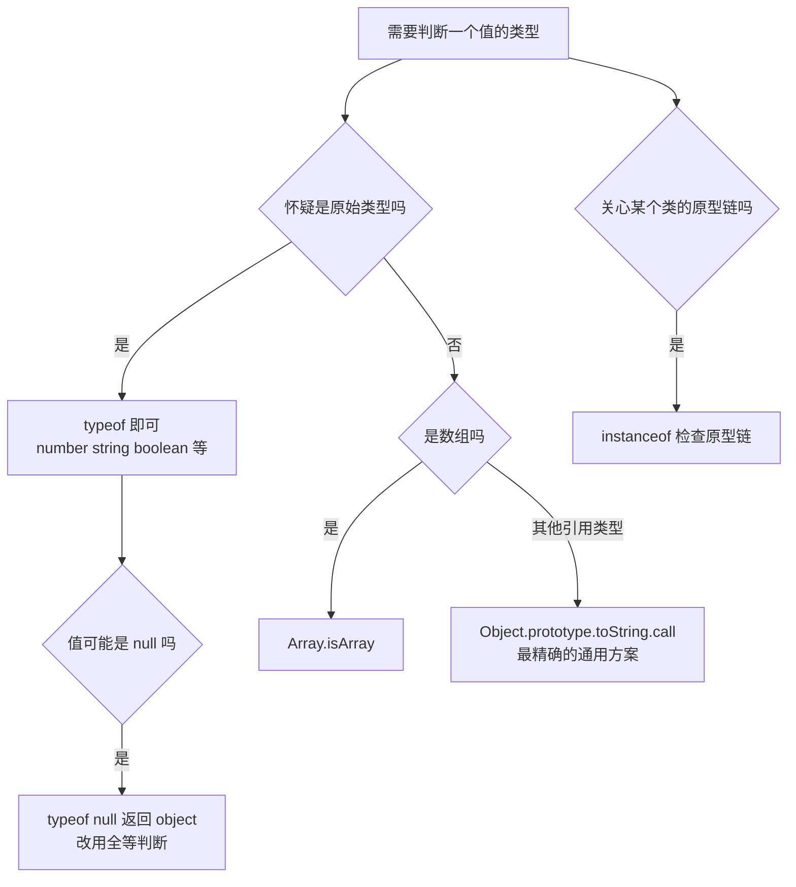

## BAS-018：哪些 CSS 属性只触发合成、动画性能最好？
**答**：
- transform 和 opacity 只参与合成阶段，不触发重排重绘，是动画属性首选。
- top/left/width/height 每帧触发重排，color/background 触发重绘，代价都更高。
- 代价排序：重排 > 重绘 > 合成；高频动画还要避免"读布局写样式"交替造成强制同步布局。

```css
.drawer {
  transform: translateX(-100%); /* 收起状态 */
  transition: transform 0.3s;   /* 只触发合成 */
}
.drawer.open { transform: translateX(0); }
/* 反例：把 transform 换成 left 动画，每帧重排，掉帧明显 */
```

## 三、JavaScript 基础

判断类型是基础题里最容易踩坑的考点，先记一张决策图。


