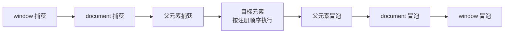

## BAS-033：事件冒泡和捕获是怎么回事？
**答**：
- 完整事件流分三阶段：捕获（window 往下到目标）、目标阶段、冒泡（目标往上到 window）。
- addEventListener 第三个参数传 true 表示在捕获阶段触发，默认 false 在冒泡阶段。
- `event.stopPropagation()` 阻止继续传播；`event.preventDefault()` 只取消默认行为，不影响传播。

```html
<div id="outer">
  <button id="inner">点我</button>
</div>
<script>
  // 捕获阶段先触发：document -> outer -> inner
  document.getElementById('outer').addEventListener('click', () => console.log('outer 捕获'), true);
  document.getElementById('inner').addEventListener('click', (e) => {
    console.log('inner 冒泡');
    e.stopPropagation(); // 阻止冒泡到 outer
  });
</script>
```


