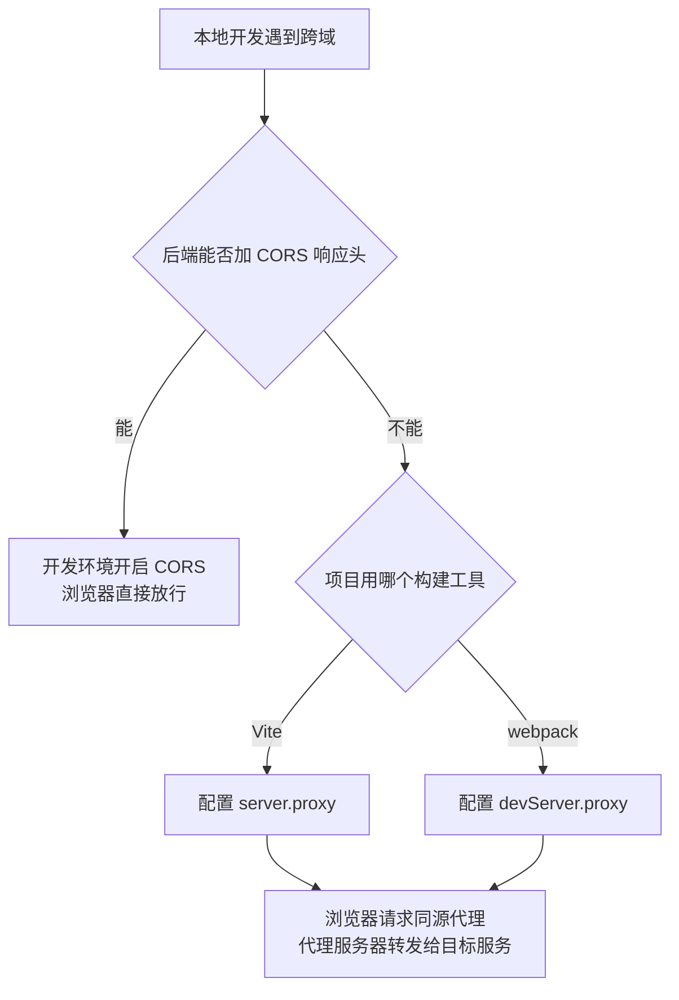

## BAS-046：本地开发遇到跨域有哪些办法？
**答**：
- 首选构建工具代理：Vite 的 server.proxy 或 webpack 的 devServer.proxy，浏览器请求同源代理，由代理转发目标服务，无需后端改动。
- 后端配合：开发环境直接开启 CORS 响应头。
- 应急方案：关闭浏览器安全策略启动（仅限本机自测）；JSONP 属于历史方案。

```javascript
// vite.config.js
export default {
  server: {
    proxy: {
      '/api': {
        target: 'https://dev-server.example.com',
        changeOrigin: true, // 修改请求 Host 为目标域名
        // rewrite: (path) => path.replace(/^\/api/, ''),
      },
    },
  },
};
```

本地跨域方案的决策路径：


