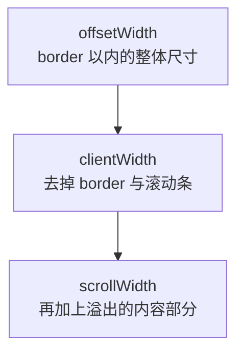

## BAS-095：offsetWidth/clientWidth/scrollWidth 三组尺寸有什么区别？
**答**：
- offsetWidth = content + padding + border（不含 margin）；clientWidth = content + padding，再减去滚动条宽度。
- scrollWidth = 溢出内容撑开的实际总宽，是"能滚多远"的依据；scrollTop/scrollLeft 可读写滚动位置。
- 判断元素是否出现纵向滚动：`scrollHeight > clientHeight`。

```javascript
/* .box { width:200px; padding:10px; border:5px solid; overflow:auto } */
const box = document.querySelector('.box');
console.log(box.offsetWidth);   // 230 = 200 内容 + 20 padding + 10 border
console.log(box.clientWidth);   // 220 再减去滚动条宽度
console.log(box.scrollHeight);  // 溢出内容的真实高度
console.log(box.scrollHeight > box.clientHeight); // true 表示纵向可滚动
```


