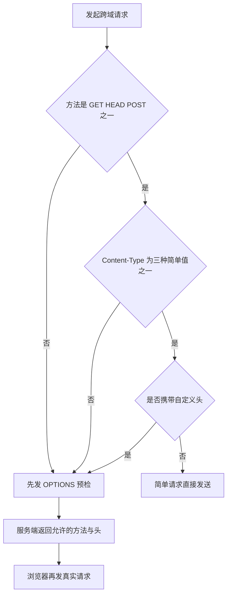

## BAS-105：什么情况下会触发 OPTIONS 预检请求？
**答**：
- 非简单请求先发 OPTIONS 探路：方法为 PUT/DELETE/PATCH 等，或 Content-Type 不是三种简单值，或携带自定义头（如 X-Token、Authorization）。
- 简单请求判定：GET/HEAD/POST 之一，Content-Type 限于 text/plain、multipart/form-data、application/x-www-form-urlencoded，且无自定义头。
- 预检由浏览器自动发出，服务端对 OPTIONS 返回 2xx 并带 Access-Control-Allow-Methods/Headers；Access-Control-Max-Age 可缓存预检结果减少次数。

```http
# 前端带自定义头的请求，浏览器先自动发预检
OPTIONS /api/user HTTP/1.1
Access-Control-Request-Method: POST
Access-Control-Request-Headers: x-token

# 服务端响应
HTTP/1.1 204 No Content
Access-Control-Allow-Methods: POST, DELETE
Access-Control-Allow-Headers: x-token
Access-Control-Max-Age: 86400
```


