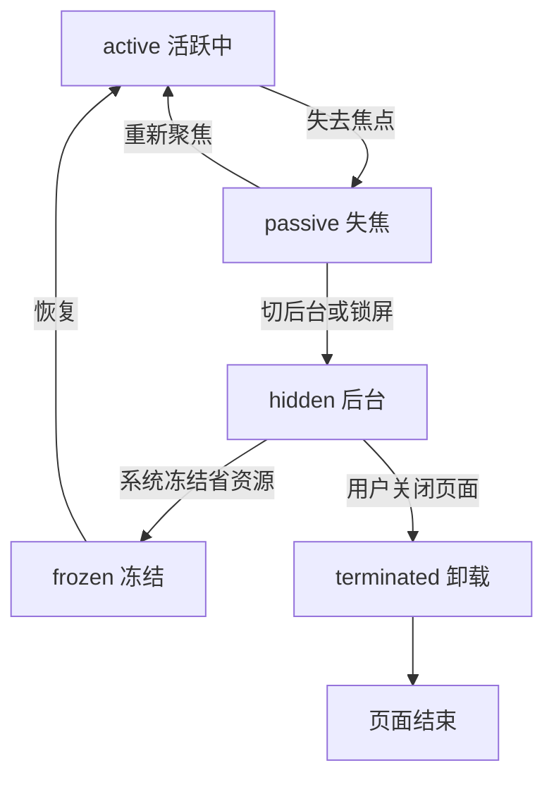

## BAS-111：页面生命周期有哪些关键 API？
**答**：
- 核心 API：visibilitychange（前台/后台）、pagehide/pageshow（含 bfcache 恢复的 persisted 标记）、freeze/resume（系统省资源冻结页面）。
- 状态流转大致是 active → passive（失焦未切走）→ hidden（切后台）→ frozen → terminated（卸载）。
- 数据上报在 hidden 时用 sendBeacon 而不是 unload；从 bfcache 返回的页面要重置动态状态。

```javascript
document.addEventListener('visibilitychange', () => {
  if (document.visibilityState === 'hidden') {
    navigator.sendBeacon('/report', JSON.stringify({ page: 'basics' }));
  }
});
window.addEventListener('pageshow', (e) => {
  if (e.persisted) console.log('从 bfcache 恢复，需重置动态状态');
});
```



## 十三、TypeScript 与工程基础补充
