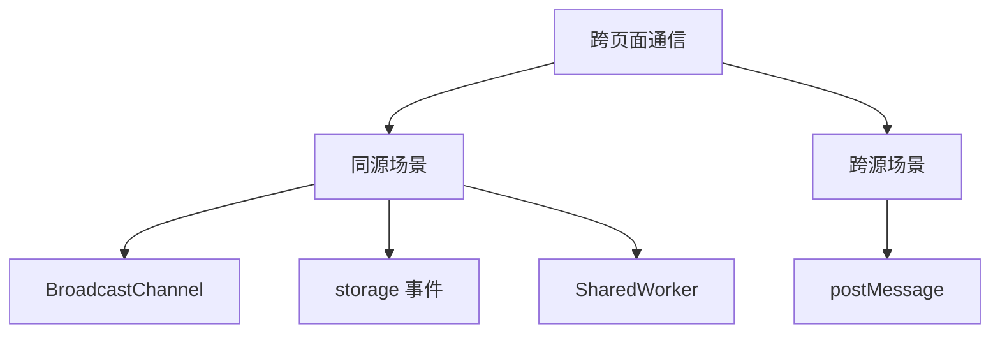

## BAS-122：同源页面之间有哪些跨页面通信方式？
**答**：
- BroadcastChannel：同源多标签广播，实时同步首选；localStorage 的 storage 事件也能跨标签通知（本页不触发）。
- SharedWorker：同源多页面共享一个 worker 实例与状态。
- 跨源场景用 postMessage（iframe、window.open 的窗口间）；Service Worker 也可做消息中转。

```javascript
const ch = new BroadcastChannel('cart');
ch.postMessage({ type: 'add', id: 42 });   // 广播到所有同源标签页
ch.onmessage = (e) => console.log('收到', e.data);

localStorage.setItem('sync', JSON.stringify({ t: Date.now() }));
window.addEventListener('storage', (e) => {  // 其他标签页触发，本页不触发
  console.log('storage 变化', e.key, e.newValue);
});
```


