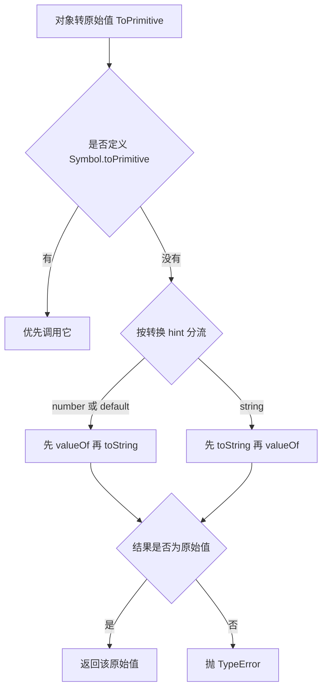

## BAS-137：ToPrimitive 把对象转原始值的流程是什么？
**答**：
- 优先调用 `Symbol.toPrimitive(hint)`；没有才按 hint 走 valueOf/toString。
- hint 为 number 或 default：先 valueOf 再 toString；hint 为 string：先 toString 再 valueOf。
- 两步之后仍是对象就抛 TypeError；Date 是例外，default 提示下先 toString。

```javascript
const obj = {
  valueOf() { return 10; },
  toString() { return 'obj'; },
};
console.log(obj * 2);      // 20 —— number 提示，走 valueOf
console.log(`${obj}`);     // 'obj' —— string 提示，走 toString
console.log(obj + '');     // 10 —— default 提示先 valueOf，得到 10 再转字符串
console.log(obj + 'x');    // '10x'
```


