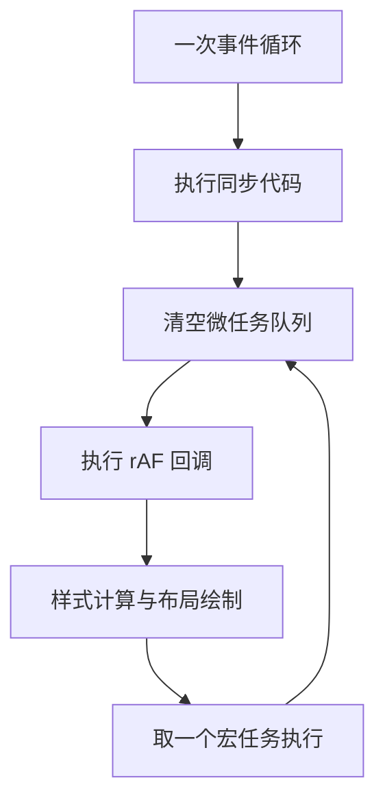

## BAS-150：事件循环和浏览器渲染的顺序是什么？requestAnimationFrame 排在哪？
**答**：
- 一帧内的顺序：清空同步代码与微任务 → 执行 rAF 回调 → 样式计算、布局、绘制 → 空闲后才取下一个宏任务。
- rAF 回调在绘制前执行，所以它拿到的 DOM 状态就是本帧要画的；微任务在每次宏任务结束后、渲染前清空。
- 这也是为什么连续同步修改样式再读 offsetWidth 会强制同步布局，而改样式放 rAF 能对齐渲染节奏。

```javascript
requestAnimationFrame(() => console.log('rAF'));
setTimeout(() => console.log('timeout'), 0);
Promise.resolve().then(() => console.log('micro'));
// 常见输出：micro → rAF → timeout
// 微任务先清空，rAF 在本次绘制前执行，setTimeout 通常落到下一帧
```



## 十七、CSS 进阶速答
