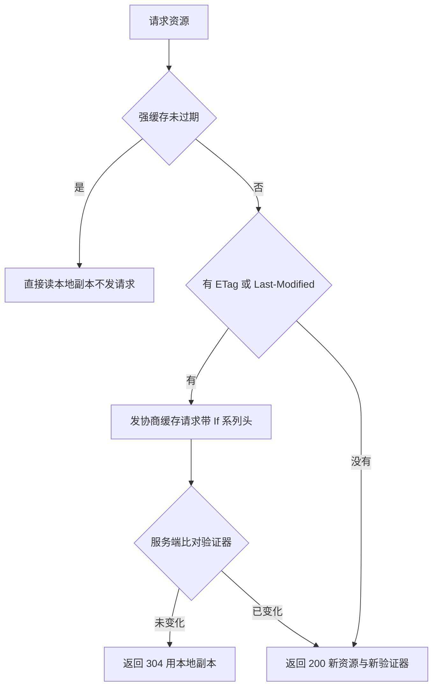

## BAS-171：ETag 和 Last-Modified 怎么协作？缓存决策链是什么？
**答**：
- Last-Modified 是时间戳验证器（秒级精度、内容不变改时间也会失效）；ETag 是内容指纹（强验证器，优先级更高）。
- 协商缓存请求同时带上 If-None-Match 与 If-Modified-Since，服务器优先比对 ETag，都没变才回 304。
- 完整链路：强缓存（Cache-Control 未过期）→ 命中即用；否则走协商缓存 → 304 用本地或 200 拉新。

```http
# 首次响应同时下发两个验证器
ETag: "abc123"
Last-Modified: Wed, 21 Oct 2025 07:28:00 GMT

# 过期后的协商缓存请求
If-None-Match: "abc123"            # 优先比对，内容指纹最准
If-Modified-Since: Wed, 21 Oct 2025 07:28:00 GMT
# 都未变化 → 304 Not Modified（无响应体）
```


