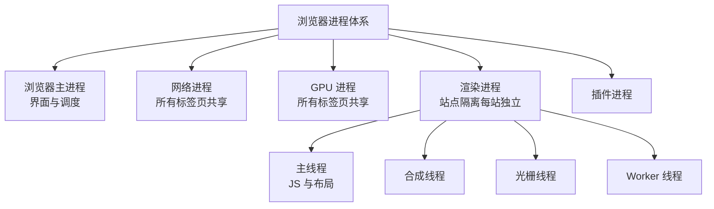

## BAS-180：浏览器的进程和线程怎么划分？哪些共享、哪些隔离？
**答**：
- 进程：浏览器主进程、网络进程（所有标签共享）、GPU 进程（所有标签共享）、每个站点独立的渲染进程、插件进程。
- 渲染进程内：主线程（JS + 布局绘制调度）、合成线程、光栅线程、多个 Worker 线程；Worker 不能碰 DOM，靠 postMessage 通信。
- 隔离体现在进程崩溃互不影响（站点隔离）；共享体现在网络与 GPU 进程全局复用。

```javascript
// 渲染进程内的线程分工
// 主线程：跑 JS、DOM、样式布局，卡它就是卡页面
// 合成线程 + 光栅线程：滚动与 transform 动画即使主线程忙也能动
// Worker 线程：与主线程隔离，postMessage 通信，无 DOM 访问权
new Worker('/heavy.js');           // 计算密集任务丢给 Worker
console.log('主线程继续可响应');
```



## 二十、Node 与 CLI 基础
