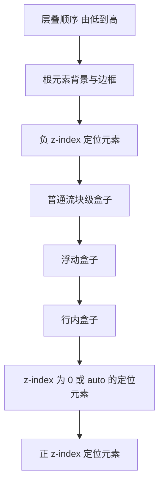

## CSS-017：层叠顺序是什么？同一层叠上下文中元素如何叠放？

**答**：
- 同一层叠上下文内按七级顺序叠放，z-index 数值只影响后两级。
- 决定因素：层叠等级 > 层叠顺序 > DOM 顺序，二者都相同时后来者居上。
- 创建层叠上下文的常见属性：根元素、z-index 非 auto 的定位元素、opacity < 1、transform、filter、isolation: isolate。
- `isolation: isolate` 是一个“无副作用”的创建方式，常用于隔离混合模式。



```css
.a { position: absolute; z-index: -1; }  /* 位于普通流之下 */
.b { position: relative; z-index: auto; }/* 与普通流之上、负 z 之上 */
.c { opacity: 0.99; position: relative; }/* opacity<1 创建新上下文 */
```
