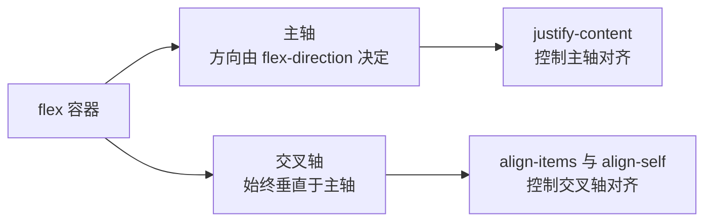

## CSS-019：flex 容器、项目、主轴与交叉轴的基本概念？

**答**：
- `display: flex` 的元素是 flex 容器，其直接子元素自动成为 flex 项目。
- 主轴由 `flex-direction` 决定（默认 row 水平向右），交叉轴垂直于主轴。
- `justify-content` 管主轴对齐，`align-items` 管交叉轴对齐。
- 项目默认不换行（nowrap）。默认 `min-width: auto` 会让项目收缩时不小于内容最小宽度（min-content），想让它继续压缩需显式设 `min-width: 0`。



```css
.container {
  display: flex;
  flex-direction: row;    /* 主轴水平，交叉轴垂直 */
  justify-content: space-between; /* 主轴：两端对齐 */
  align-items: center;    /* 交叉轴：垂直居中 */
}
.item { flex: 1; }        /* 均分剩余空间 */
```
