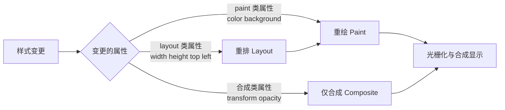

## CSS-049：为什么动画推荐用 transform 和 opacity 而不是 top/left？

**答**：
- top/left/margin 改变布局，每帧触发 Layout + Paint，代价高且掉帧。
- transform/opacity 在合成阶段处理，由 GPU 执行，通常跳过 Layout/Paint。
- 合成动画还能脱离主线程在合成器线程运行，页面卡顿时依然流畅。
- 需要位移的动画一律用 `transform: translate()` 替代 left/top。

```css
/* 差：每帧重排 */
.bad-move {
  position: absolute;
  transition: left 0.3s, top 0.3s;
}
.bad-move.active { left: 100px; top: 50px; }

/* 好：仅合成 */
.good-move {
  position: absolute;
  left: 0; top: 0;             /* 位置只设置一次 */
  transition: transform 0.3s;
  will-change: transform;      /* 提前提示，见下一题 */
}
.good-move.active { transform: translate(100px, 50px); }
```


