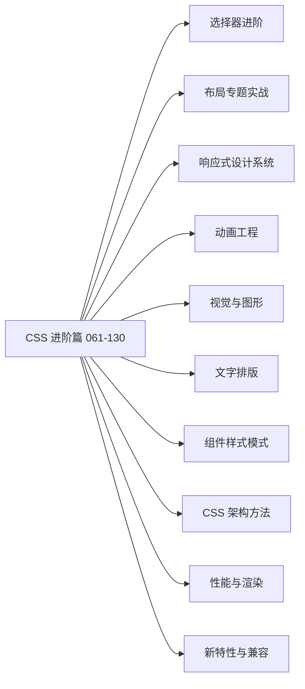

## CSS-060：CSS 层面有哪些性能优化手段？

**答**：
- 关键渲染路径：首屏样式内联或 preload，避免大量 @import 串行阻塞。
- 选择器效率：避免过深层级与通配后代选择器，现代浏览器影响已小但仍有解析成本。
- 减少重排重绘：动画用 transform/opacity、批量读写、contain: layout/paint 隔离子树。
- 资源层面：按需加载路由样式、purge 未使用样式、字体 font-display: swap、大图 lazy 加载。
- 用 Chrome DevTools Performance 与 Coverage 面板定位无用样式与长任务。

```css
/* 1. 现代等价清除浮动/布局隔离 */
.component {
  contain: layout paint;   /* 隔离内部布局与绘制影响 */
  content-visibility: auto; /* 视口外跳过渲染，长列表利器 */
  contain-intrinsic-size: auto 500px; /* 占位尺寸防跳动 */
}

/* 2. 动画只碰合成属性 */
.hover-lift { transition: transform 0.2s; }
.hover-lift:hover { transform: translateY(-4px); }

/* 3. 字体加载体验 */
@font-face {
  font-family: "Inter";
  src: url("/fonts/inter.woff2") format("woff2");
  font-display: swap;
}
```

---

## 十二、选择器进阶


