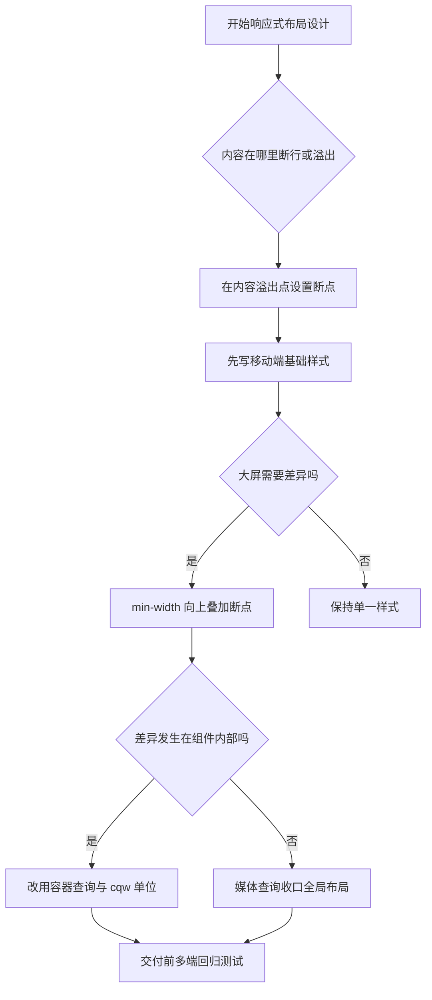

## CSS-074：shape-outside 如何实现文字环绕图形？

**答**：
- `shape-outside` 定义浮动元素外部的环绕形状，文字沿形状排布，而非沿盒子边框。
- 必须配合 `float`，且元素要有实际尺寸（或用渐变的 alpha 通道推导）。
- 支持 `circle()` / `ellipse()` / `inset()` / `polygon()` 与图片 alpha。
- `shape-margin` 控制文字与形状的最小间距。
- 适合杂志式图文混排、头像环绕等场景，纯装饰性内容注意加 `aria-hidden`。

```css
/* 圆形头像环绕：文字沿圆弧排布 */
.avatar {
  float: left;
  width: 120px; height: 120px;
  border-radius: 50%;
  shape-outside: circle(50%);
  shape-margin: 16px;
  margin-right: 8px;
}

/* 多边形：斜切图文分界 */
.diagonal-float {
  float: left;
  width: 200px; height: 200px;
  background: linear-gradient(135deg, var(--brand), transparent);
  shape-outside: polygon(0 0, 100% 0, 0 100%);
  clip-path: polygon(0 0, 100% 0, 0 100%);
}

.article p { text-align: justify; }
```

## 十四、响应式设计系统


