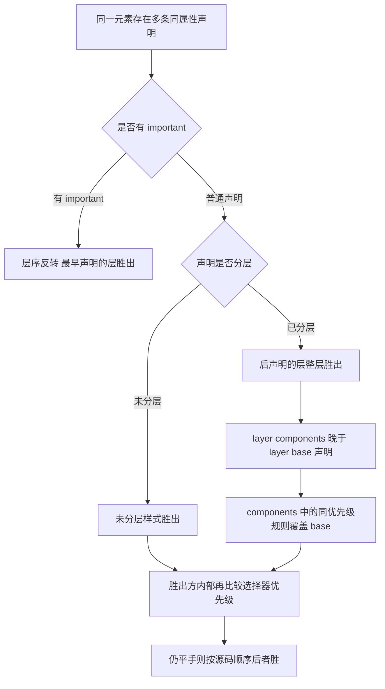

## CSS-113：@layer 级联层如何影响优先级？与 !important 怎么交互？

**答**：
- `@layer a, b;` 预声明层序，后声明的层在 normal 场景整体胜出——层序优先于选择器优先级。
- 层内仍按常规优先级比较；层与层之间只看声明顺序，一层之内再激烈竞争也赢不过后层。
- 未分层样式（layer 外）优先级高于所有分层的 normal 声明，适合放"必须生效"的补丁（但要收敛）。
- `!important` 反转层序：最早声明的层的 important 反而最强，且分层的 important 高于未分层 important。
- 工程价值：给第三方样式归入低层压权、reset 归 base 层、组件层互不打架。



```css
/* 1. 声明层序：base 最低，utilities 最高 */
@layer reset, base, vendor, components, utilities;

@layer reset { a { color: inherit; } }
@layer base { a { color: var(--color-link); text-decoration: none; } }
@layer vendor { /* 第三方库样式整体压到 base 之上、components 之下 */ }
@layer components { .nav-link { color: var(--brand); } }
@layer utilities { .text-red { color: var(--color-danger); } }
/* .nav-link.text-red：utilities 层胜，无需提高选择器优先级 */

/* 2. important 反转：reset 层的 important 最强 */
@layer reset { * { box-sizing: border-box !important; } }

/* 3. 引入第三方 CSS 时指定归层 */
@import url("antd.css") layer(vendor);
```
