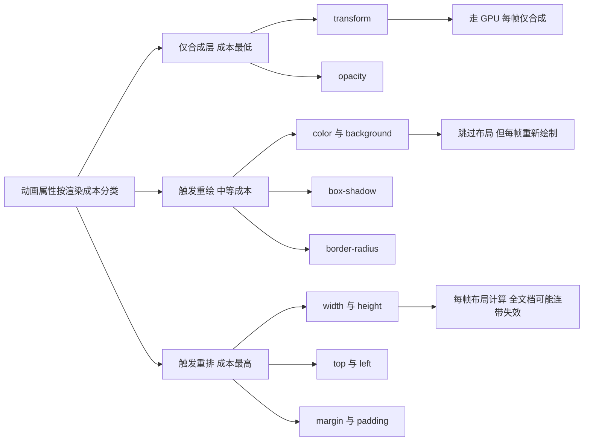

## CSS-115：设计系统与 CSS 的接口如何设计？token 怎么流转？

**答**：
- 单一来源：token 以 JSON/DSL 维护（颜色/字号/间距/圆角/阴影/动效六类），平台产物由它生成。
- 流转链路：token.json → style-dictionary/Style Tokens → CSS 变量 + TS 常量 + iOS/Android 主题。
- CSS 侧契约：组件只允许引用语义层变量，禁止写裸值，lint（stylelint token 规则）强制。
- 命名分层与版本化：语义 token 变更走 semver，破坏性重命名进 changelog。
- 跨端一致性的关键：同一 token 源 + 各平台生成器，而不是各端手抄色值。

```json
// tokens/semantic.json —— 单一来源
{
  "color": {
    "bg": { "surface": { "value": "{color.gray.0}" } },
    "fg": { "primary": { "value": "{color.gray.9}" } },
    "accent": { "value": "{color.blue.5}" }
  },
  "space": { "2": { "value": "8px" }, "4": { "value": "16px" } }
}
```

```css
/* style-dictionary 生成的 CSS（勿手改） */
:root {
  --color-bg-surface: #ffffff;
  --color-fg-primary: #17181a;
  --color-accent: #409eff;
  --space-2: 8px;
  --space-4: 16px;
}
```

```javascript
// 同源生成的 TS 常量，供 JS 动画/图表使用
export const token = { space: { 2: '8px', 4: '16px' } };
```

## 二十、性能与渲染


