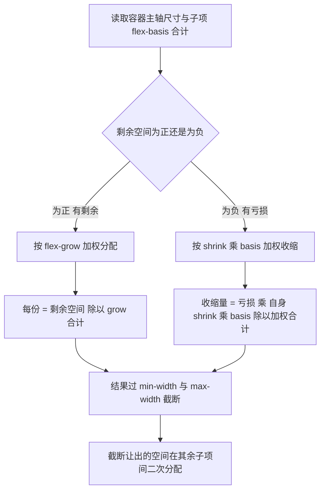

## CSS-140：flex-grow 的分配怎么计算？请给出完整例题与数学过程。

**答**：
- 核心公式：剩余空间 = 容器主轴尺寸 − Σ flex-basis；每份份额 = 剩余空间 ÷ Σ flex-grow；子项最终宽 = basis + 份额 × 自身 grow。
- 空间不足时走 shrink：每项收缩量 = 亏损 × (自身 shrink × 自身 basis) ÷ Σ(shrink × basis)，即“基准越大缩得越多”。
- 结果还要过 `min-width / max-width` 截断，被截断项让出的空间会在其余子项间二次分配。
- 面试压轴常考“带 max-width 的二次分配”，务必会推两轮。



```css
/* 例题：容器 900px，三个子项
   A：flex-basis 200px，flex-grow 1
   B：flex-basis 200px，flex-grow 1
   C：flex-basis 400px，flex-grow 2

   第一步：basis 合计 = 200 + 200 + 400 = 800px
   第二步：剩余空间 = 900 - 800 = 100px
   第三步：grow 合计 = 1 + 1 + 2 = 4，每份 = 100 / 4 = 25px
   第四步：A = 200 + 25×1 = 225px
           B = 200 + 25×1 = 225px
           C = 400 + 25×2 = 450px
   校验：225 + 225 + 450 = 900px，恰好铺满 */
.container { display: flex; width: 900px; }
.a { flex: 1 1 200px; }
.b { flex: 1 1 200px; }
.c { flex: 2 1 400px; }
```
