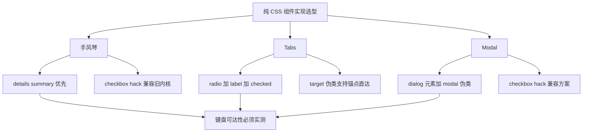

## CSS-191：不写 JS 能实现哪些交互组件？各自的最佳实现路径？

**答**：
- 手风琴：`details/summary` 原生元素，键盘可达性免费；旧内核用 checkbox hack。
- Tabs：radio + label + `:checked ~` 控制面板显隐；`:target` 方案支持锚点直达但有 URL 副作用。
- Modal：checkbox hack + label 做遮罩关闭；现代方案是 `<dialog>` + `:modal` 伪类（仍非 JS 可做焦点陷阱，严格无 JS 场景用 hack）。
- 共同边界：无 JS 方案拿不到焦点陷阱、动态内容与动画时序精细控制，键盘可达性必须实测。



```html
<!-- 手风琴：details 原生 -->
<details>
  <summary>问题标题</summary>
  <p>答案内容，展开收起全由浏览器接管</p>
</details>

<!-- Tabs：radio 驱动 -->
<section class="css-tabs">
  <input type="radio" name="t" id="t1" checked><label for="t1">Tab 1</label>
  <input type="radio" name="t" id="t2"><label for="t2">Tab 2</label>
  <div class="panel p1">面板一</div>
  <div class="panel p2">面板二</div>
</section>
<style>
  .css-tabs input { position: absolute; opacity: 0; }
  .panel { display: none; }
  #t1:checked ~ .p1,
  #t2:checked ~ .p2 { display: block; }
  #t1:checked ~ label[for="t1"],
  #t2:checked ~ label[for="t2"] { color: #096; border-bottom: 2px solid #096; }
</style>

<!-- Modal：checkbox hack -->
<input type="checkbox" id="m" class="modal-toggle">
<label for="m" class="modal-mask"></label>
<div class="modal">内容 <label for="m">关闭</label></div>
<style>
  .modal-toggle { position: absolute; opacity: 0; }
  .modal, .modal-mask { display: none; }
  .modal-toggle:checked ~ .modal,
  .modal-toggle:checked ~ .modal-mask { display: block; }
  .modal-mask { position: fixed; inset: 0; background: rgba(0,0,0,.4); }
  .modal { position: fixed; inset: 20% 25%; background: #fff; border-radius: 8px; }
</style>
```
