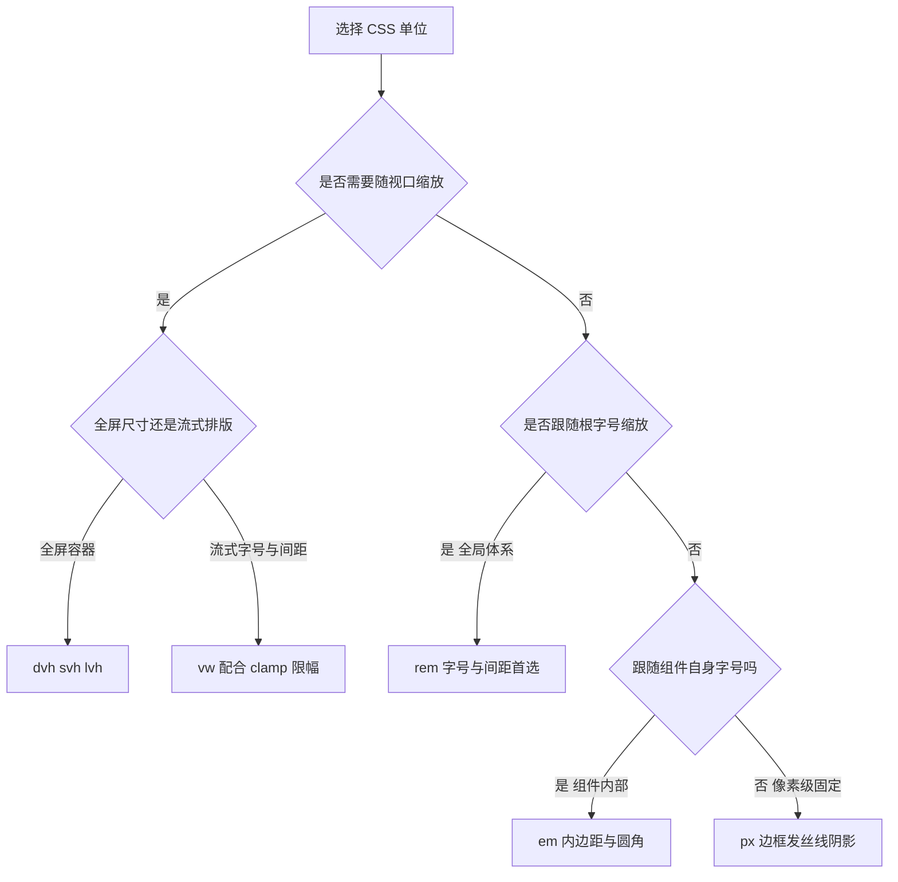

## CSS-194：px / em / rem / vw 如何选型？给出一棵决策树。

**答**：
- px：像素级精确、不参与缩放——边框、发丝线、阴影偏移、图标内部细节。
- rem：跟随根字号——全局字号、间距、组件尺寸，无障碍（用户放大根字号）的第一受益者。
- em：跟随自身字号——组件内部相对尺寸（按钮内边距随字号缩放）。
- vw/vh/dvh：视口驱动——流式排版 clamp()、全屏容器；断点内固定还是流式是分水岭。



```css
/* px：像素级细节 */
.icon-border { border: 1px solid var(--line); }
.hairline { box-shadow: inset 0 -1px 0 var(--line); }

/* rem：全局体系，用户调根字号时整体缩放 */
body { font-size: 1rem; }
.section { padding: 2rem 1.5rem; }
h1 { font-size: 1.75rem; }

/* em：组件内部相对自身字号 */
.btn {
  font-size: .875rem;
  padding: .5em 1.25em;   /* 字号变大 padding 同步变大 */
  border-radius: .25em;
}

/* vw + clamp：流式排版，320px 屏与 1280px 屏都落在舒适区间 */
.hero-title { font-size: clamp(1.5rem, 4vw, 3rem); }

/* dvh：全屏容器 */
.stage { height: 100dvh; }
```
